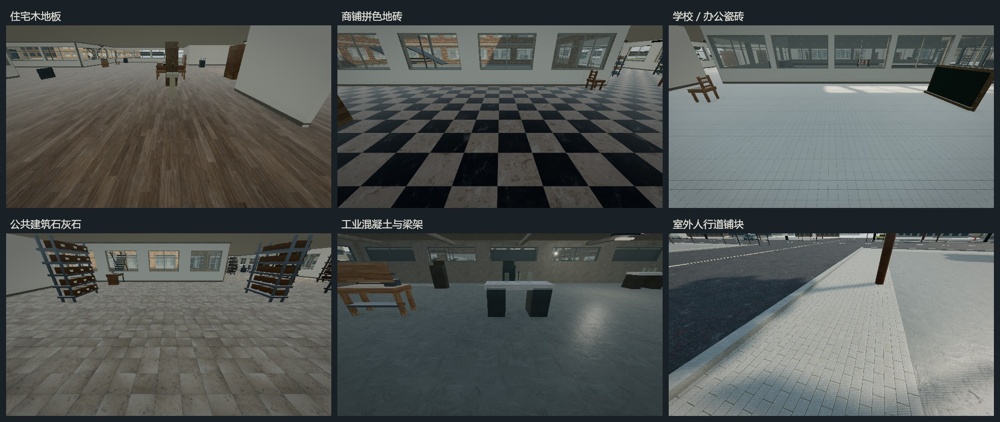
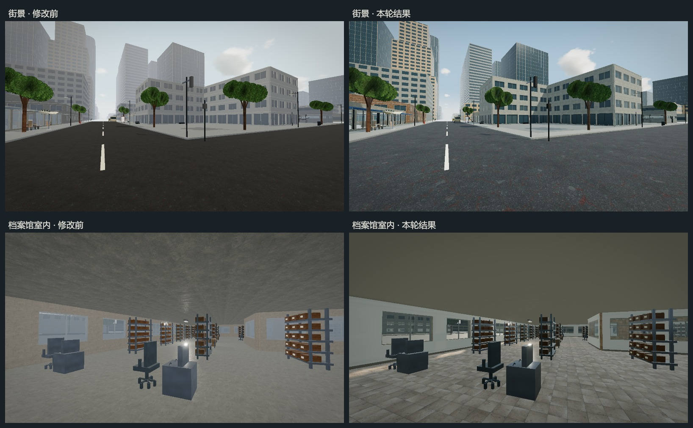

# Level 11 地面、建筑与光影细化

2026-10-13。本轮在已有城市重制上，对照 `reference/L11` 调整材质尺度、建筑内外细节和白昼照明。实际游戏截图位于 [reports/l11-refinement](reports/l11-refinement/)。

## 地面与材质

新增 ambientCG 的四套 CC0 1.0 Universal 资产，作者为 Lennart Demes：PavingStones035、Tiles139、Tiles107、TactilePaving002。城市表面纹理合计十二套，均使用配套颜色、OpenGL 法线和粗糙度通道。来源、许可、下载脚本和项目重复尺寸见 [资产记录](public/textures/L11-ASSET-SOURCES.md)。没有新增程序噪点表面纹理。

| 使用区域 | 材质与处理 |
|---|---|
| 车道 | 深灰沥青；主干道双黄线，其他道路白色虚线 |
| 人行道、滨水步道 | 浅色矩形铺块，与沥青、混凝土前场分开 |
| 档案馆前场、岸线压顶 | 石灰石板材与收边 |
| 住宅、体育馆、部分商住上层 | 木地板 |
| 排铺、庭院商业、旅馆 | 复古拼色地砖 |
| 学校、办公、其他商业室内 | 瓷砖 |
| 档案馆、博物馆、市政建筑 | 石灰石地板 |
| 工业、停车楼 | 混凝土地面 |
| 地铁 | 瓷砖步行区，入口上下端增加警示盲道砖 |

三种 PBR 通道共用以米为单位的 UV，修正斜向墙面纹理压缩和反向墙面尺度不一致。室外地形按建筑轮廓裁去，避免缓坡地表覆盖室内地板或发生深度闪烁；基础裙墙封闭楼板与缓坡之间的小缝。室内地板、内墙与家具使用独立材质实例，雨天保持干燥。



## 建筑与参考图

保留三十种结构原型，细节仍按距离分级合批。透明窗改用单片玻璃，减少多层透明盒面叠加造成的乳白遮挡。新增或强化窗洞退深、横梃、窗台、侧向阳台栏杆、竖肋、连续拱带、斜面雨棚与垂边、墙脚基座、檐口、女儿墙压顶、柱帽和少量外置空调。

内墙采用与外立面分开的暖白饰面，入口和窗洞沿用同一组空间轮廓。工业建筑保留混凝土墙顶，增加净高至少 2.6 米的梁和设备桥架，并避开楼梯洞口。首层门洞、可攀爬楼梯和原有碰撞描述继续共用建筑规划数据。

| 参考图 | 对应实景证据与检查重点 |
|---|---|
| `11iconic.jpg`、`11transition.jpg` | `realistic-mixed.jpg`、`realistic-family-fin-office.jpg`：深色窗带、暖色石材、立面退深和主干道层次 |
| `11evolution.jpg`、`11scenes.jpg` | `realistic-family-balcony.jpg`、`realistic-metro.jpg`：砖墙尺度、窗台、阳台侧栏和层间收边 |
| `11lowdensity.jpg` | `realistic-sign-bakery.jpg`、`realistic-sign-cafe.jpg`：低层店面、深色斜雨棚、门窗分格和原有 00 年代完整牌面 |
| `11canal.png` | `realistic-canal.jpg`：硬质驳岸、独立步道铺装、压顶和护栏 |
| `11unfinishedinterior.jpg` | `realistic-floor-concrete.jpg`：混凝土材质、外露梁架、窗边亮部和室内明暗 |

这些截图检查参考图的建筑语言、色调和材质分工；现有模块化体量、车辆和树冠仍保留实时游戏模型的简化特征。反射使用天空与地面环境探针，未采集周边建筑的实时镜面图像。

## 光影修正

修正 `CityBatch` 墙体法线与三角形朝向不一致的问题，坡面使用实际几何法线。取消城市表面的通用微自发光，使用更明确的暖色日光和偏冷天空补光；晴天雾距延长，雨、云、雾分别衰减直射光。

L11 太阳阴影覆盖相机周围 108 米范围，远裁面扩大到 350 米，光源提升到能够覆盖高楼的高度，并按阴影纹素吸附、隔帧更新。启用太阳阴影时，室内日照由楼板、窗洞和阴影决定；低画质或关闭太阳阴影时，直射光按室内外系数淡出，防止无阴影的阳光穿过屋顶。

曝光测光加入太阳贡献，避免只测环境补光后把白昼再次提亮。天空位图按上半球映射，地面方向使用城市地面反射；进入室内降低天空反射并转为中性补光。经典档没有环境反射，因此金属材质使用漫反射兼容参数，并按光照档分别缓存。



## 验证方法

使用真实 Engine、Renderer 和独立内存存档适配器，种子 `20261006`、1920×1080、设备像素比 1。脚本在独立端口启动 Vite 和真正的 `--headless=new` Chrome，核对浏览器启动参数及专属配置目录。三种画质顺序运行，避免它们互相争用 GPU。

每档覆盖 24 个固定机位和四种天气。先等待资源完成、运行曝光适应，再把截图时间固定到 10 秒；精确机位保存于运行报告的 `photoPoses`。`floor-comparison.jpg` 和 `before-after.jpg` 仅拼排原始游戏截图，可通过 `node reports/l11-refinement/build-contact-sheets.mjs` 重建。

执行命令及日志：

```text
npx tsc -p tsconfig.app.json --noEmit --pretty false --incremental false
npm run check:l11-surfaces
npm run check:l11-meshes
npm run build
npm run verify:l11 -- --refinement
npm run verify:l11 -- --refinement --classic
npm run verify:l11 -- --refinement --low
npm run verify:l11 -- --refinement --smoke
```

`check:l11-surfaces` 验证墙、盒体、正反斜墙、坡面三角形绕序与法线，以及显式 UV、连续墙面 UV。模型检查维持 30 个建筑、100 个装饰、32 块标牌，检查 1166 个几何对象及逐个释放，目录全部模型和 LOD 共 1,501,173 个三角形；该数值不是单帧绘制量。

生产构建通过，仍有项目既存的字体 URL、PostCSS `from` 和分包大小警告，见 [build.log](reports/l11-refinement/build.log)。运行结果、帧时间与清理记录见下方验收数据。

## 验收数据

真实光照、经典光照、低画质的完整运行均通过，控制台及运行时异常列表为空：

- [真实光照](reports/l11-refinement/realistic-runtime.json)
- [经典光照](reports/l11-refinement/classic-runtime.json)
- [低画质](reports/l11-refinement/low-runtime.json)

每档验证 24 个实际游戏机位、12 套材质的全部 36 张 PBR 通道图、32 块标牌及高低清晰度切换。Worker 与主线程一致性、跨宏区步行、旋转建筑楼梯、地铁出入口与站台、桥面及两侧人行道、水岸阻挡、搜刮后的存读档均通过。档案馆零盘／五盘磁带不能进入，六盘可进入；Level 9／10 出口可交互。旧 L11／Beta 存档迁移、备份失败保护、五条暂停任务和晋升门槛回归均通过。

雨天检查中，室内石灰石地板粗糙度维持 `0.68`、反射系数维持 `0.12`，室外沥青粗糙度从 `0.96` 降至 `0.48`。低画质的档案馆室内直射光强度为 `0`，室外约为 `3.1`，验证关闭阴影后不再穿透屋顶。经典档金属黑块和低画质室内过亮的中间截图分别保存在 `classic-interior-before-fallback.jpg`、`low-interior-before-shadow-fallback.jpg`，对应运行数据也一并保留。

测试硬件为 NVIDIA GeForce RTX 4060 Laptop GPU，Windows 上的 ANGLE / Direct3D 11，Chrome **154.0.8037.98**，真正无头模式，1920×1080、DPR 1。以下均为毫秒；移动样本为实际按住 W 步行 24 秒，跨过宏区边界。

| 档位 | 入口中位 / P95 | 混合街区静止中位 / P95 | 移动中位 / P95 / P99 | 移动最大帧间隔 | 移动超过 33.3 ms 的帧 |
|---|---:|---:|---:|---:|---:|
| 真实光照 | 8.3 / 8.4 | 8.3 / 12.5 | 8.4 / 16.9 / 25.0 | 429.0 | 6 / 2264 |
| 经典光照 | 4.2 / 8.1 | 4.2 / 8.5 | 8.2 / 16.5 / 20.8 | 379.2 | 6 / 3124 |
| 低画质 | 4.2 / 4.4 | 4.2 / 8.4 | 4.2 / 4.3 / 8.4 | 716.7 | 2 / 5441 |

静止场景满足本机 60 FPS 的帧预算，但跨区仍有明显长帧，**全程稳定 60 FPS 的优化目标尚未达到**。峰值未被筛去；低画质减少常规绘制耗时，但不能消除切区时的峰值。表中真实光照入口采样期间生产构建仍在收尾，混合街区及移动采样期间已无构建并行。

低画质兼容修正后，在没有构建并行的情况下再次执行[真实光照入口复核](reports/l11-refinement/realistic-smoke-runtime.json)，中位 `8.1 ms`、P95 `12.4 ms`、最大 `16.8 ms`，太阳强度 `3.1`、曝光 `1.202`，无运行错误。该复核报告与完整运行分开保存。

| 档位 | 混合街区绘制调用 / 三角形 | 三轮返回入口后的几何数 | 纹理数 | 着色程序数 |
|---|---:|---:|---:|---:|
| 真实光照 | 1276 / 525449 | 652 → 652 → 652 | 66 → 66 → 66 | 81 → 81 → 81 |
| 经典光照 | 263 / 154387 | 372 → 372 → 372 | 48 → 48 → 48 | 53 → 53 → 53 |
| 低画质 | 263 / 154387 | 378 → 378 → 378 | 52 → 52 → 52 | 61 → 61 → 61 |

绘制调用与三角形是采样末帧的计数，包含对应光照档的渲染开销；太阳阴影隔帧更新会使真实光照档的相邻帧计数不同。资源数来自 Three.js 的 `renderer.info`，不是独立测量的显存字节数。每轮返回入口后，建筑模型与空间引用均为 7 个，待加载、待释放队列清空；本轮三次循环没有资源累积。

测试结束后通过 [check-cleanup.ps1](reports/l11-refinement/check-cleanup.ps1) 只读核对专属浏览器配置目录、进程命令行和端口。已记录的七次运行均未遗留所属浏览器或服务器，配置目录已删除，记录端口没有监听者，见 [cleanup-check.json](reports/l11-refinement/cleanup-check.json)。没有连接或关闭日常浏览器及其他会话的服务。
