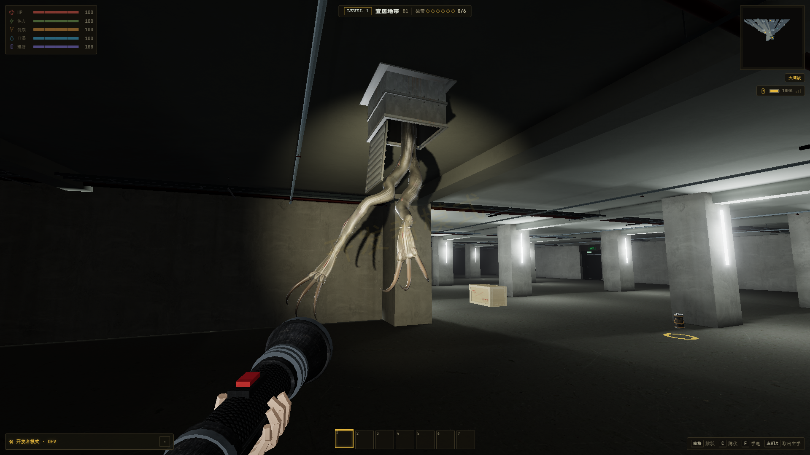
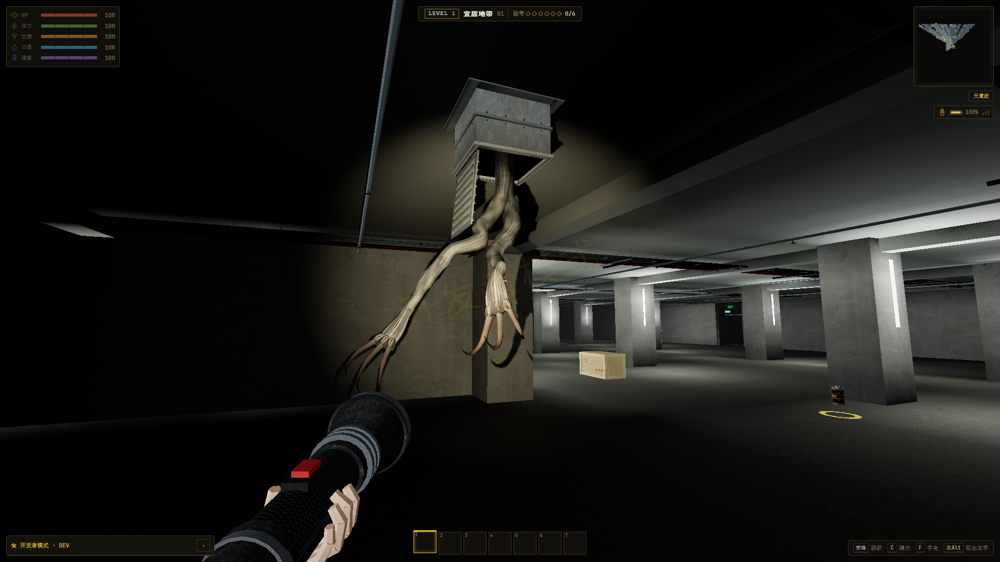
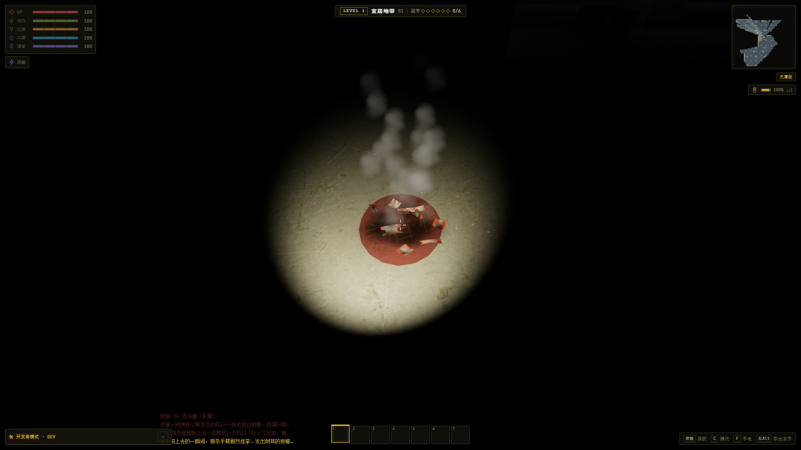
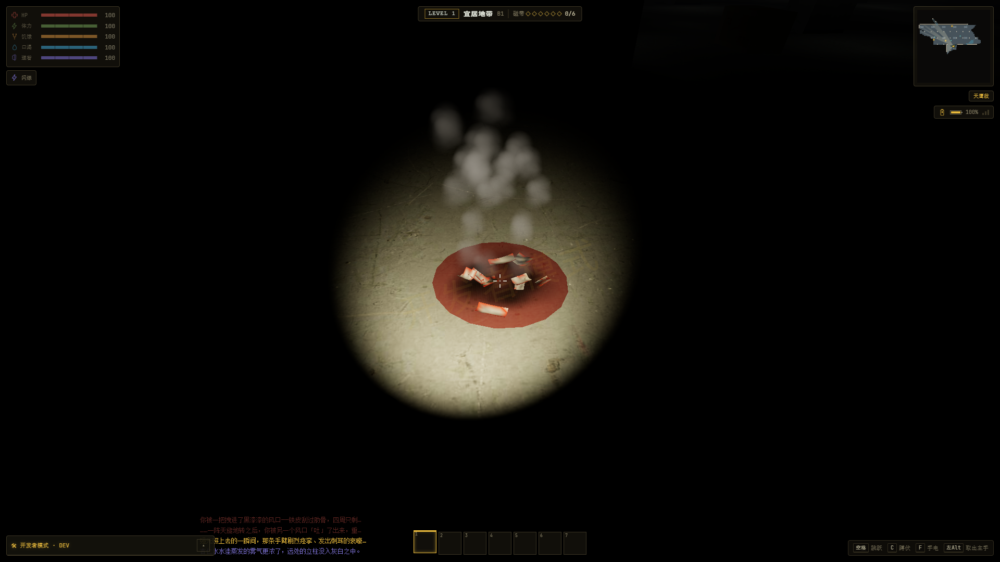

# “手臂”重制接入验收

2026-10-20；原项目 `E:\ZAN\backroom`。仅更新该项目的 `app` 和项目说明。用户原有改动及 L1 v3、Nguithr、分阶段加载和既有物品系统均保留。

已接入附件的 1–3 臂腐皮模型、钩爪、风管格栅、程序动画、声音及完整遭遇机制。实体 ID 仍为 `arms`。接入细节见 [实现说明](../../ARMS-REMAKE.md)，附件哈希、原始补丁和许可状态见 [来源记录](../../assets/sources/arms-remake/README.md)。

## 结果

- [生产构建](build.log)通过；[15 组相关回归](regressions.json)全部通过。
- [手臂机制](check-arms.log) 80/80；[动画](check-arms-anim.log)覆盖全部十种动作和循环，数据有限、IK 及伸长约束通过。
- [模型与实例资源检查](integration.json)通过 142,464 项断言：1–3 臂、经典／真实材质、UV／蒙皮／形变、实例独立释放、共享贴图、准备取消与重试。
- 最大三臂模型连风口为 6,880 三角面、4 个绘制批次、79 根骨骼。
- 两种光影均在实际 App 中完成原生 GPU 蒙皮、真实 AI 抓取、CDP 输入挣脱、吞入、移送、吐出、光照烧退和暂时驱逐。每种模式连续六轮完整身体、风口与焦皮回收后，空场资源数量保持一致。
- [原文件备份及变更审计](audit.json)通过；21 份被修改原文件的备份哈希完整，依赖字段保持一致。完整结构化结论见 [summary.json](summary.json)。

## 实际游戏验收

Chrome `--headless=new`，1920×1080，固定种子 `20261006`，原生分辨率，无动态分辨率；ANGLE D3D11 / NVIDIA GeForce RTX 4060 Laptop GPU。使用独立端口、浏览器配置和隔离存储，不写玩家存档。

| 项目 | 真实光影 | 经典光影 |
| --- | ---: | ---: |
| 最终记录 | [final-realistic](final-realistic/result.json) | [final-classic-complete](final-classic-complete/result.json) |
| L1 进入时间 | 8.979 秒 | 6.549 秒 |
| 首次目标实例准备至显示 | 1.685 秒 | 0.471 秒 |
| 实测臂数 | 2 | 2 |
| 吐出距离 | 20.44 米 | 29.77 米 |
| 吐出落地时生命 | 54 | 54 |
| 六轮回收后几何／贴图／程序 | 607 / 174 / 108 | 524 / 144 / 99 |
| 运行错误／游戏资源请求错误 | 0 / 0 | 0 / 0 |
| 模型／机制检查 | 17 项通过 | 17 项通过 |

进入时间是固定场景单次观测，不含打开应用标题页的时间，不代表全层级或五轮性能基准。实例准备为分步等待时间，不是一次主线程阻塞时长。本轮未进行 Android 真机验证。

测试器仅在 QA 场景排除其他环境实体，避免熄灯时笑魇干扰手臂吞入验证；手臂自身使用生产 AI、伤害、移动、光照及输入逻辑。落地生命使用移送结束且开启后续调试保护之前的 `hpAtLanding` 记录。

## 截图

以下截图均来自本次实际运行的 App；模型、动作和烧退烟雾已人工查看。

| 真实光影 | 经典光影 |
| --- | --- |
|  |  |
|  |  |

其他过程：[扑抓](final-realistic/arms-lunge.png)、[真实抓取](final-realistic/live-grab.png)、[挣脱](final-realistic/escaped.png)、[移送后吐出](final-realistic/spat-out.png)、[烧退](final-realistic/burn-retreat.png)。各最终目录保留进入、隐藏、探出、拖拽等完整截图及原始结果。

## 复现

在 `E:\ZAN\backroom\app` 执行，需本机 Chrome（可用 `CHROME_PATH` 指定）：

```powershell
npm run build
npm run check:arms
npm run check:arms-anim
npm run check:arms-integration
npm run verify:arms -- --seed=20261006 --label=review-realistic
npm run verify:arms -- --seed=20261006 --classic --label=review-classic
```

验证器自动选择独立服务／调试端口，使用真实无头 Chrome。结束或失败后关闭所属进程并移除自身浏览器配置。`--visual-only` 只运行姿态及回收检查；`--clips=emerge,search,lunge,drag` 可筛选姿态。

15 组回归另覆盖 Nguithr、L1 v3、L1 分步加载／离线生成／放置／交互、实体子变种、模型预热、程序完成、实例准备、旱虾手持缓存及杰瑞，各命令与结果见 [regressions.json](regressions.json)。

## 诊断记录和清理

早期 `realistic` 目录记录 QA 被额外环境实体干扰；`final-classic` 记录 QA 等待被远角裁剪的第 25 区块。分别改为隔离其他实体和使用生产可游玩窗口就绪条件后，最终两组验收通过。`realistic-isolated` 为中途通过记录；最终结果以上表两个目录为准。

附件早期 CPU 蒙皮／SwiftShader 图片及验证脚本仅保存于来源资料，不用作此次验收证据。测试进程清理复核见 [cleanup.json](cleanup.json)。

