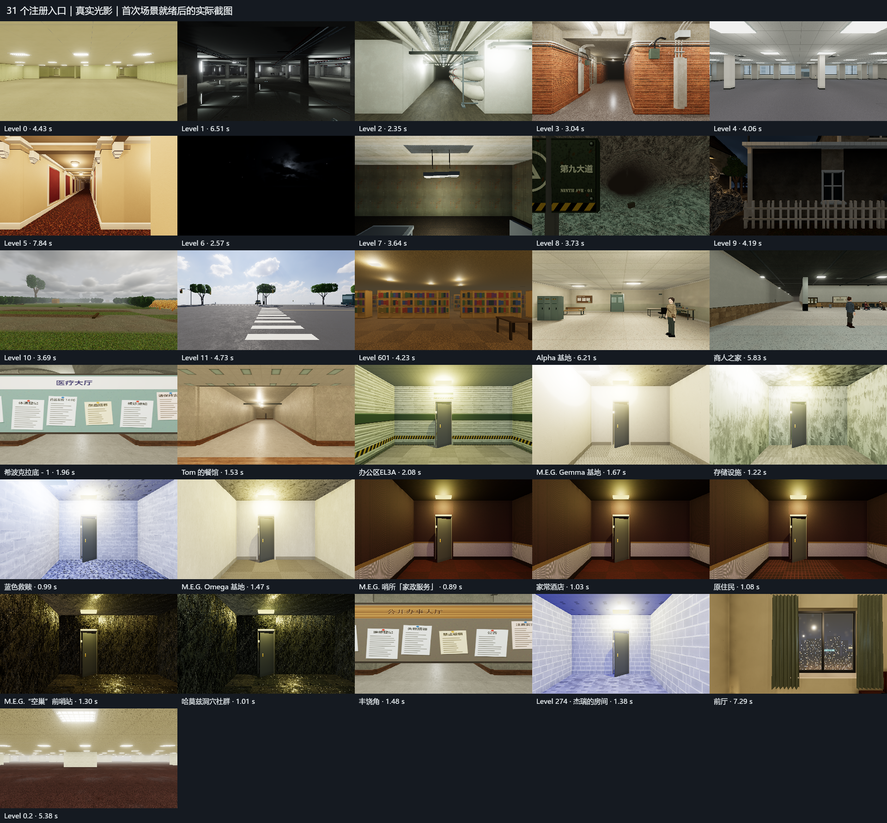
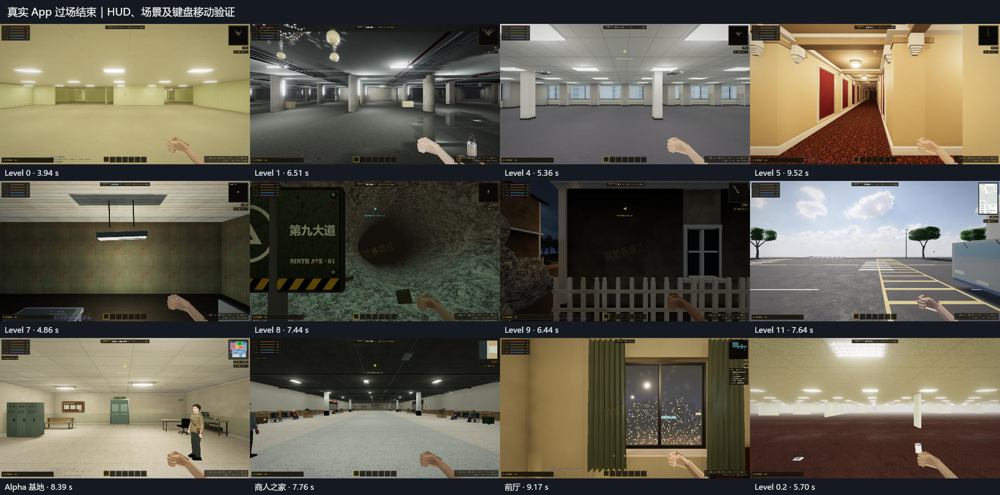
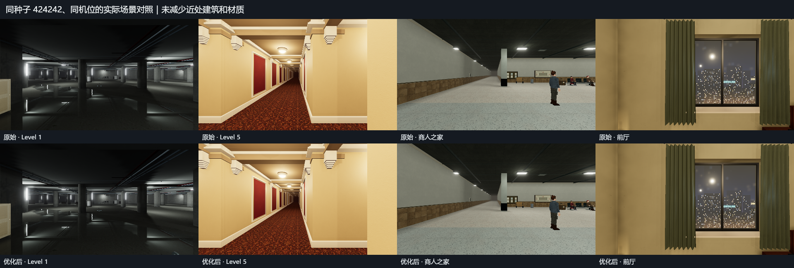

# 首次进入层级优化与前厅生存规则（2026-10-29～30）

本轮 31 个入口在真实光影、经典光影独立冷入口，以及真实 App 过场／键盘移动检查中均低于 10 秒。 最终测试基于 E:\ZAN\backroom\app 原项目。

## 结果

| 验证路径 | 覆盖 | 本轮最慢时间 |
|---|---:|---:|
| 真实 App：触发出口 → 过场消失 → 可操作 | 31/31，移动全部通过 | Level 5 9.523 秒 |
| 真实光影独立冷入口（四项合并复测取最慢） | 31/31 | Level 5 8.863 秒 |
| 经典模式独立冷入口 | 31/31 | 前厅 7.728 秒 |

新开局另走真实主界面按钮：前厅（正常坐在电脑椅上） 6.692 秒；跳过序章进入 L0 2.824 秒。
完整 App 表中的前厅另包含一次游戏通常不可达的“后室 → 前厅”强制切换压力检查；不能用它替代正常新开局结果。

[31 项逐层表、初测与复测汇总](comparison.md) · [机器可读汇总](comparison.json) · [真实 App 原始结果](final-priority-app-realistic/runtime.json) · [真实冷入口](validated-cold-realistic/runtime.json) · [经典冷入口](validated-cold-classic/runtime.json) · [每项三轮复测](validated-cold-retest/runtime.json)

重点冷入口：保留初测以及后续三次独立上下文的全部样本，表中取四次的最慢值；没有选择最好一轮。

| 入口 | 样本数 | 最快 | 中位数 | 最慢 |
|---|---:|---:|---:|---:|
| Level 1 | 4 | 4.349 秒 | 5.759 秒 | 6.887 秒 |
| Level 5 | 4 | 5.836 秒 | 6.845 秒 | 8.863 秒 |
| 商人之家 | 4 | 4.084 秒 | 4.997 秒 | 6.519 秒 |
| 前厅 | 4 | 3.695 秒 | 5.213 秒 | 7.295 秒 |

优化前真实 App 基线中，商人之家为 10.132 秒，前厅强制切换为 10.875 秒；60Hz 压力采样还记录过 L5 12.682 秒、商人之家 12.459 秒。保留全部基线和中间失败／超时结果，不把先前超过十秒的结果删掉。基线为 DEV 原生刷新，最终为 production 60Hz QA 调度，条件不同，不能据此计算严格提升百分比。

## 实现

- 贴图上传按 Renderer、Texture 版本和 Source 版本去重，释放或图片更新后失效；多实例仍共享图片，独立持有自己的几何和材质。
- 静态合批先做便宜的候选分组，再对真正可能实例化的几何计算完整哈希；同一几何引用只计算一次。几何、UV、材质和碰撞不降级。
- 加载阶段按 CPU 时间推进必需模型队列，首帧先稳定 HDR、环境和灯池，避免编译随后立即作废的变体；几何仍使用原来的 6ms 加载预算。
- 附近真实物品、NPC、实体、场景及手电准备继续阻止过早入场。没有出现的飞蛾、手臂、Nguithr 等备用模型改为游玩时轮转准备；CPU 有余量时每帧最多推进一类。实际实体仍由 presentationPending 保护，不会在模型尚未可见时攻击。可取得的活旱虾仍先准备手持资源。
- L5 和前厅明确标记的静态场景按同材质、同顶点属性的代表网格编译，所有真实网格仍完整上传；蒙皮、实例化、形变和自定义着色器维持原路径。
- 商人之家先构建近处建筑、可见建筑及近处家具，保留原来的附近就绪范围；静态受光使用最多两名 Worker，调用相同的 irradiance 算法，失败退回原 CPU 计算。取消加载会终止 Worker，并释放尚未发布的几何。
- 前厅提前编译实际室内和街区光照组合；加载卡片保持原过场时间和判断，仅缓存相同的静态画面，避免每帧重画整屏 Canvas。

## 前厅不消耗饥饿／口渴

前厅保持玩家当前饥饿与口渴值，不自动补满；自然结算、奔跑／低体力倍率以及开发者时间快进都不消耗这两项，也不触发饥渴警告或伤害。吃喝恢复逻辑不变。电池、理智、感染等原有系统继续运行，离开前厅后立即恢复其他层级及据点的原消耗规则。

[前厅专项：13 项检查](foyer-survival.log)；[真实 Engine／Renderer：24 项检查](final-priority-behavior/runtime.json)，包含连续 10 个模拟秒、时间快进、离开前厅恢复消耗，以及“可选模板不阻止进入、实际近处模型仍阻止进入”的检查。

## 测量边界与设置

- Windows / Chrome 真正 headless=new；独立 QA 端口、隔离临时 profile；原生 ANGLE NVIDIA RTX 4060 Laptop GPU / D3D11，32 个逻辑核心，1920×1080，DPR 1。没有软件渲染结果。
- 材质质量 1、显示比例 100%、细节 100%、最多 16 场景灯、两盏场景阴影、AO 1、泛光开；动态分辨率、动态曝光和颗粒关闭。加载几何预算 6ms，游玩 3ms。独立截图 yaw/pitch 为 0，默认基础 FOV 72°，种子 424242；实际 App 每层 mapSeed 和位置见 JSON。
- 最终测试使用 QA 侧 60Hz requestAnimationFrame 回调调度，防止显示器刷新率改变协作式加载步数；该调度没有进入游戏代码。页面确认 visible 且 focused。
- 独立冷入口为每层新建 incognito 上下文，清空 JS、HTTP 与 IndexedDB 缓存，统计 prepareChunkWindow 开始至实际就绪并绘制两帧；包含地图生成与 GPU 准备，不含浏览器启动／初次下载整个应用。浏览器进程、驱动及操作系统缓存仍可能共享。
- 完整 App 通过真实 Engine.takeExit、React 过场、最终场景和碰撞路径，记录恢复操作后实际键盘移动；省去任务钥匙等前置条件以覆盖全部注册入口。开发者面板在测量前收起。前厅另外走新开局按钮，验证坐姿。
- 覆盖 ALL_LEVEL_DEFS 的 29 项，加前厅 900 和 Level 0.2（902），合计 31；Beta 已合入 L11，不重复添加已废弃的 115。据点、子层级都在逐层表中。

## 回归、资源与截图

[相关回归命令](checks.json)：30/30 成功（15 组各自打包和运行）；包括合批 20,903 项、模型预热 111 项、图片生命周期 96 项、编译变体 47 项、活旱虾可用性 52 项、上传缓存 13 项及 Worker 16 项。
[最终构建与前厅检查](final-checks.json)：生产构建和 13 项前厅规则检查通过。构建原有字体路径、PostCSS from 和大包警告仍有记录，见 [最终构建日志](final-build.log)。

[取消与四轮往返资源检查](final-priority-resources/runtime.json)：15 项通过；离开后 Worker 为 0，没有旧地图覆盖新地图或取消中的前厅控制器残留。四轮返回餐馆后的 GPU 资源：

| 轮次 | Geometry | Texture | Program | 活跃 Worker |
|---:|---:|---:|---:|---:|
| 1 | 141 | 101 | 80 | 0 |
| 2 | 141 | 101 | 80 | 0 |
| 3 | 141 | 104 | 80 | 0 |
| 4 | 141 | 104 | 80 | 0 |

几何和程序数量稳定；纹理在缓存补齐时增加，最后两轮稳定。四轮检查不能替代长时间内存泄漏测试。最终运行的 JavaScript 异常／error 日志均为 0。







已人工检查整张入口索引、代表完整 App 截图和前后对照，另查看 L5／前厅原图；原始每层 PNG 保留在对应测试目录。截图用于确认画面没有通过删减近处建筑来缩短加载，计时以 JSON 为准。

## 复现

在 E:\ZAN\backroom\app 执行，Node.js / npm 在 PATH 中：

```powershell
npm run build
node scripts/build-entry-cold.mjs
node scripts/verify-entry-speed.mjs --bundle --fps=60 --label=repro-cold-realistic
node scripts/verify-entry-speed.mjs --bundle --fps=60 --classic --label=repro-cold-classic
node scripts/verify-entry-speed.mjs --bundle --fps=60 --levels=5,1,102,900,5,1,102,900,5,1,102,900 --label=repro-cold-retest
node scripts/verify-entry-app-speed.mjs --production --fps=60 --label=repro-app --app-levels=0,1,2,3,4,5,6,7,8,9,10,11,12,101,102,103,104,105,106,107,108,109,110,111,112,113,114,116,274,900,902 --newgame
node scripts/verify-entry-speed.mjs --behavior --label=repro-behavior
node scripts/verify-entry-speed.mjs --resources --label=repro-resources
npm run check:foyer-survival
node scripts/summarize-entry-speed.mjs --after=repro-app --cold=repro-cold-realistic --cold-retest=repro-cold-retest --classic=repro-cold-classic
```

每个驱动会验证专用 profile 与 headless 命令，并在 finally 中关闭自己的浏览器和服务。[最终进程核对](cleanup-audit.json)确认本轮专属浏览器及服务残留为 0；[最终验收汇总](acceptance.json)核对源码哈希和全部结果。不要同时运行多组 GPU 性能测试。

## 数据修订与限制

final-priority-cold-* 及更早的独立验证页错误地以 /verifier/ 解析少数相对资源路径（前厅道具贴图和 Alpha 烘焙 manifest）。这些原始运行保留用于追溯，已从最终冷入口验收排除。修正后的 validated-cold-* 使用根目录 baseURI，并自动拒绝错误的 /verifier/textures 或 /verifier/assets 路径。完整 App 始终使用正常应用根路径，其结果不受这一验证页问题影响。

原项目仍有少数可选外部图片查找失败并采用既有程序材质的情况；本轮未新增或替换资产。最终所有非成功网络请求及回退路径单独保留在 network-audit.json；不将“没有 JS 异常”等同于“全部资源请求成功”。

指标限于本机、这些种子和设置。GPU 完全冷驱动缓存、其他硬件／全部随机种子以及 Android 真机未测；此前迭代中的较慢结果仍保留。未来实体模板继续后台分帧预热，但本轮不声称已证明所有实体首次出现都没有卡顿。

初始源码备份在 app/.cache/entry-speed-20261029/before；当前文件与 SHA-256 见 task-files.json，可审阅本轮相对备份的 entry-changes.patch。

着色器异步编译完成检查遵循 [KHR_parallel_shader_compile 规范](https://registry.khronos.org/webgl/extensions/KHR_parallel_shader_compile/)，不通过跳过完成检查伪造就绪。
