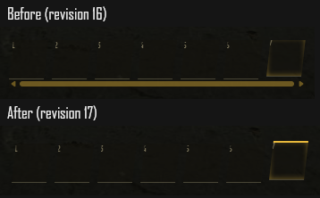
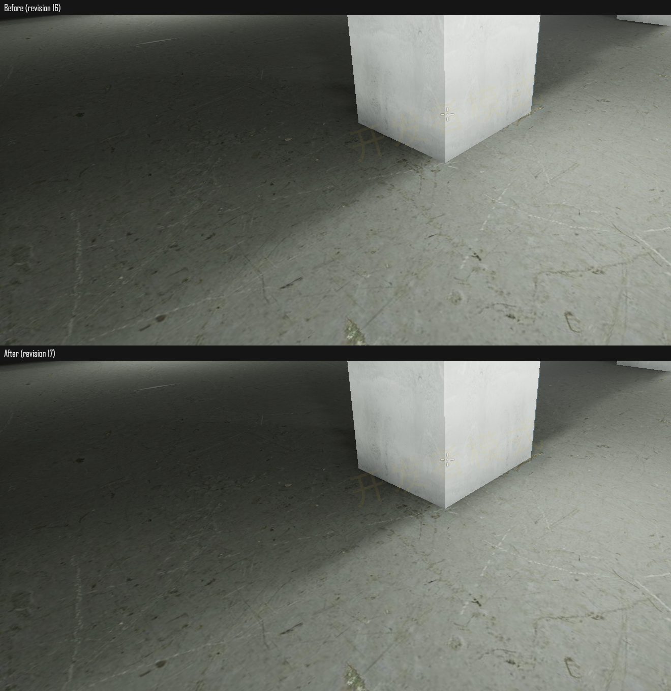

# 快捷栏、箱沿碰撞及 L1 阴影验收

2026-10-19。实现见 [更新说明](../../HOTBAR-COLLISION-SHADOW.md)，完整数据见 [summary.json](summary.json)。

## 本轮结果

- 修复沉浸式快捷栏选到第七格时出现的滚动条，以及选中格上移动画的顶部裁切。实际 App 检查两种界面、1920×1080、桌面 150% 缩放、320×760 触控模拟和 800×400 横屏；18 次选中检查均无滚动／裁切，真实触摸事件能切换栏位。
- 箱顶中心点支撑与箱侧身体半径阻挡不一致，导致慢速／斜向滑落时嵌入。统一支撑轮廓并增加有距离限制的重叠恢复。实际游戏连续慢速移动四秒：修复前移动约 **0.93m** 后卡住，240 帧中 175 帧嵌入；修复后移动约 **3.39m**、正常落地、零帧嵌入。静止放入真实箱体后也能局部恢复，不改高度、恢复后不漂移。
- L1 高档完整两米地面图块由 10×10 提高到 13×13；灯具面积及接收像素积分减少半影分档和矩形锯齿。保留墙柱脚接触暗部与哥特顶棚正确遮挡。烘焙修订 **17**，建筑生成版本仍为 6；108 个离线区块及生产包已更新。

## 画面对照

快捷栏，上方为修复前，下方为修复后：



同一世界坐标、朝向和视角的柱脚及阴影局部；只裁切实际游戏截图：



补充 [混合柱型区域对照](round-comparison.png)。实际 App 全图保存在 [真实模式](after-realistic/result.json) 和 [经典模式](after-classic/result.json) 所在目录，包含普通天鹰段、近距离柱脚、混合柱型区、暗区、哥特段、衔尾段，以及关闭 AO 的同角度对照。已检查截图，未发现新增柱脚亮圈或哥特拱顶自遮挡黑块。

## 功能及自动检查

| 检查 | 结果 |
| --- | --- |
| 箱沿、旋转、叠箱、30/60/144Hz、八个方向、通用恢复 | 240 组滑落，56,669 项通过 |
| L1 物品交互／箱顶、飞行、坐下 | 147 / 19 / 310 项通过 |
| 摆放、L1 v2、D 阶段接入 | 4,252 / 448 / 33,698 项通过 |
| 快速遮挡与完整射线命中一致性 | 20,024 条射线、3 个体积覆盖检查通过 |
| 有限灯管解析半影与分档 | 1,272 项通过，15 个过渡亮度等级 |
| 光照图集、数值、UV 外扩、几何与批次 | 2,024,785 项通过 |
| 高档跨区块光照 | 119 个共享位置，RGB 最大差 0.0009765625 |
| 低档负坐标接缝、确定性、资源引用释放 | 通过，接缝最大差 0 |
| 108 份离线资源及生产包逐文件哈希 | 通过，修订均为 17 |
| TypeScript / Vite 生产构建 | 通过 |
| 真实／经典模式实际 App | 均通过，运行时错误为零 |

七种代表场景检查到 **8,977** 个被实体覆盖的地面采样，均为零受光；图集仍为 512²，材质批次、几何、三角面及颜色 UV 与本轮前相同。数据见 [atlas.json](atlas.json)、[penumbra.json](penumbra.json)、[collision.json](collision.json)。

回归日志见 [机械回归](regression-luna.log)、[D 阶段最终复查](d-import-check.log)、[光照检查](bake-check.log)、[构建](build.log)。D 阶段第一次检查时尚未发布修订 17 的资源，因此暂时失败；完成发布后复查通过。构建仍报告既有字体路径与大包体积提示。

## 性能及范围

RTX 4060 Laptop，原生 ANGLE D3D11；种子 `20261006`，1920×1080，原生分辨率，纹理高档，关闭动态分辨率、动态曝光。原生无头 Chrome，每次独立 profile／CDP／服务器；未连接用户浏览器。

固定场景预热后采样五轮，每轮 90 帧；仅性能采样冻结游戏结算，功能检查仍运行真实移动与重力。表中为五轮中位数，P95 一栏为逐轮 P95 的中位数；数据是 rAF 帧间隔，不能视为 GPU 时间查询。

| 固定场景 | 帧时间中位数 | P95 | 绘制调用 | 三角面 |
| --- | ---: | ---: | ---: | ---: |
| 真实模式，修复前，相邻重测 | 9.6ms | 19.1ms | 304 | 161,036 |
| 真实模式，修复后，相邻重测 | 9.6ms | 9.7ms | 304 | 161,036 |
| 经典模式，修复后 | 9.6ms | 9.7ms | 293 | 128,825 |

相邻重测未观察到运行时回退，**不将 P95 差异归因为此次优化**。最早一次基线为 4.2ms，稍后旧版重测也变为 9.6ms，说明采样环境／帧调度存在波动。原始完整流程数据全部保留在 [早期基线](before-realistic/result.json)、[完整新版流程](after-realistic/result.json)；相邻对照见 [原版重测](before-realistic-benchmark/result.json)、[新版重测](after-realistic-benchmark/result.json)。完整新版流程有一轮 P95 为 20.1ms，略超此前 20ms 目标，不能据此承诺全地图稳定达标。

五轮固定场景资源数量稳定；新版完整流程末尾为 584 份几何、127 份纹理。L1 展示窗口进入时间约 3.2–5.0 秒，采用已发布资源，不能代表所有随机种子的冷进入。

**高档冷烘焙成本增加。** 三个并发离线 Worker 的单区块任务耗时中位数约 10.17 → 26.64 秒；108 份资源本次离线生成耗时约 16.3 分钟。该数据受并发 CPU 负载影响，不是进入耗时。序列化缓冲总字节数前后相同，运行时仍按原缓存上限保留；未覆盖的种子／地点仍需 Worker 生成。此次未证明这些地点都能在十秒内进入。

通用恢复最多平移两米，无合格落点时保留原位置，不强行穿越楼层或救出深坑。没有逐个遍历全项目每个家具模型；已验证箱、桌、门等通用碰撞及已有坐下／飞行回归。触控结果来自桌面模拟，不是 Android 真机性能结论。

## 复现命令与清理

在 `app` 中运行：

```powershell
npm run check:player-recovery
npm run check:l1-interactions
npm run check:dev-flight
npm run check:seating
npm run check:l1-placement-fixes
npm run check:l1-v2
npm run check:l1-d-import
npm run check:l1-shadow-edges
npm run check:l1-bake -- --high
npm run check:l1-offline
npm run verify:hotbar-collision-shadow
npm run verify:hotbar-collision-shadow -- --classic
npm run verify:hotbar-collision-shadow -- --before --benchmark-only
npm run verify:hotbar-collision-shadow -- --benchmark-only
node scripts/summarize-hotbar-collision-shadow.mjs
npm run build
```

修复前验证依赖本次 `.cache/hotbar-collision-shadow` 基线快照；无法从新版反推。各次 `result.json` 保存实际位置、朝向、FOV、浏览器参数、运行时错误及清理状态。本轮创建的浏览器、Vite 服务和临时 profile 均已清理。
