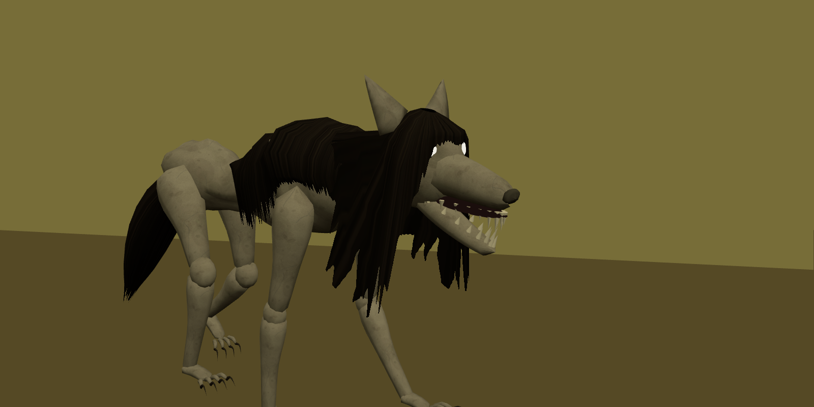
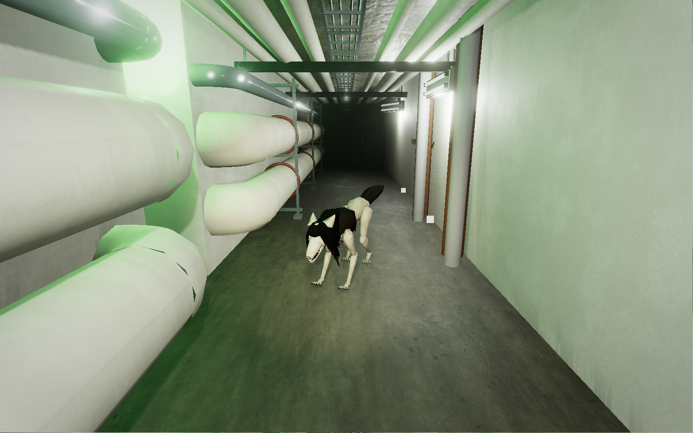
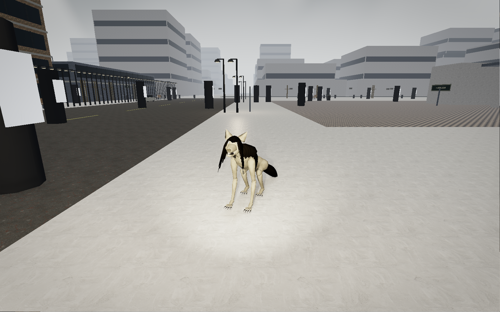
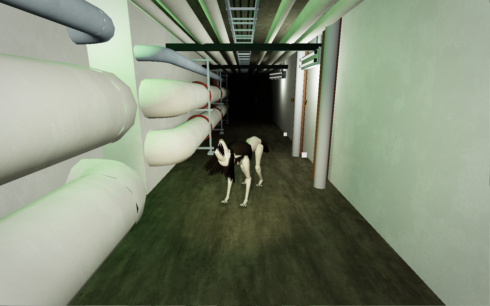

# 猎犬更新包导入验收 · 2026-10-08

已将用户提供的 `backroom-hound.zip` 合并至 `app`，替换原猎犬方块模型，接入四足动画、嚎叫音效、专属 AI、图鉴说明及 Level 11 中立表现。保留物种 ID `hound`、35 HP、基础速度 3.4、伤害 18 和自然生成表。来源、原包哈希、作者/许可和本地修正见 [导入记录](../../assets/hound-import/IMPORT.md)。

## 接入修正

- 感知缓存按 Engine 与当前地图隔离；记忆目标采用世界坐标，流式窗口移动不再误判玩家奔跑。
- 扑击开始与命中均检查视线、楼层和隐身；直视退缩会取消待命扑击。
- Level 3 伏击与退缩由同一个状态机处理，持续直视不超时，移开视线后继续行动。
- 中立个体首次受击立即激怒；致命首击也能惊动同楼层 10 米内同类，未初始化 AI 的同类同样生效。非致命首击保留嚎叫。
- 中立个体受惊逃跑及被盯视后转身走开持续执行；开发者召唤立即初始化状态并落在当前楼层。
- 修正程序化贴图边缘复制使用不同随机角度/曲线的问题。
- 原包伏低插地、坐姿后足悬空改为有限次平面双骨求解，覆盖支撑脚与摆动脚；不增加网格、模型面数或地形射线。

只接入单机；没有更新联机协议或同步逻辑，没有修改 app-lite。已有 UI、物品、笑魇与 Level 1 工作保留。构建时顺便移除了 `mapgen.ts` 中已经没有引用的 `l1StyleAt` 导入，未改变 Level 1 行为。

## 自动与生产渲染检查

| 检查 | 结果 |
| --- | --- |
| `npm run check:hounds` | 原包 13 项行为检查通过 |
| `npm run check:hound-integration` | 专项 AI、UV/有限数值、独立几何/材质与共享贴图、落脚姿态、实际 Engine 战斗/碰撞/开发者召唤通过 |
| `check:smilers`、`check:smiler-integration`、`check:smiler-forms` | 通过 |
| Level 2 经典 / 真实、Level 11 真实渲染 | 各 245 项检查通过；着色器、皮肤切换、五种姿态、三轮缓存回收；无浏览器运行错误 |
| `npm run build` | 通过；仍有既有字体路径、Browserslist、PostCSS 和大包提示 |

原有 `check:smiler-spacing` 本次随机运行在 `canid/2.7: eyes remain outside body (4/16)` 断言失败。该测试直接使用未被此次导入修改的笑魇工厂/动画，实体工厂随机选择 `animT`；将 `Math.random` 固定为 `0.5` 的诊断复测完成 19,604 项断言。未改写原测试以掩盖失败，也未据固定相位复测宣称所有随机姿态通过；这是后续笑魇面部可见性检查的已知不稳定项。

专项检查包含：隔墙/异层/隐身的待发扑击、Level 3 伏击与无限直视停顿、击杀中立个体与同类激怒、世界坐标重定位、地图缓存隔离；实际引擎中完成扑击伤害与减速、墙体阻挡，Level 11 中立不攻击，以及冻结 AI 的上层召唤。

## 模型与资源

- 单只 24 个网格、10,052 三角面；皮肤和毛发各一张 256² 贴图，所有实例共享。
- 不透明毛发壳采用 alphaTest；没有逐根毛发、多层半透明发片或附加灯光。
- 每实例独立拥有几何和材质，回收单只不销毁共享贴图。
- RTX 4060 Laptop GPU / Windows Chrome / 1600×1000 视口。使用独立 QA 浏览器与内存存储，不操作玩家存档。

三轮创建两只、移除两只后，场景总资源均稳定在下表值：

| 场景 | 几何 | 纹理 | 着色器程序 |
| --- | ---: | ---: | ---: |
| Level 2 经典 | 923 | 137 | 32 |
| Level 2 真实 | 954 | 161 | 47 |
| Level 11 真实 | 499 | 154 | 66 |

原始检查数据：[经典](game-classic.json)、[真实](game-realistic.json)、[城市中立](game-realistic-level11.json)。JSON 中帧时间包含检查切换与构建过程，仅作诊断，**不是正式性能对照或移动端性能结论**。

## 截图

共 18 张：3 张原型和 3 组各 5 张生产渲染姿态。

## 复现

在 `app` 执行检查命令和 `npm run build`。运行 Vite 后打开 `/proto-hound.html?mode=poses`（也可使用 `close`、`side`）。生产游戏中从开发者召唤选择猎犬；Level 11 显示中立猎犬，恢复 AI 后可检查观察、坐下、受惊和受击反应。

自动截图：以 `L0_VERIFY=1` 启动端口 3007 的 Vite；打开使用独立配置、调试端口 9238 的 Chrome，访问该服务器。依次执行 `node scripts/verify-hound-import.mjs proto`、`node scripts/verify-hound-import.mjs game classic`、`node scripts/verify-hound-import.mjs game realistic`；设置 `HOUND_QA_LEVEL=11` 后再次运行真实模式。驱动可用 `HOUND_QA_URL`、`HOUND_QA_CDP` 覆盖地址和端口。

## 范围限制

动画落脚针对当前地面高度的平面，不是逐足台阶 IK。长毛和尾巴没有独立碰撞，极窄拐角仍可能局部穿墙。未完成长期人工追逐调参、嚎叫听感或 Android 真机验收。项目原本没有持久保存普通动态实体，本次未扩展该存档系统，因此不承诺重载后保留每一只中立猎犬的状态。
