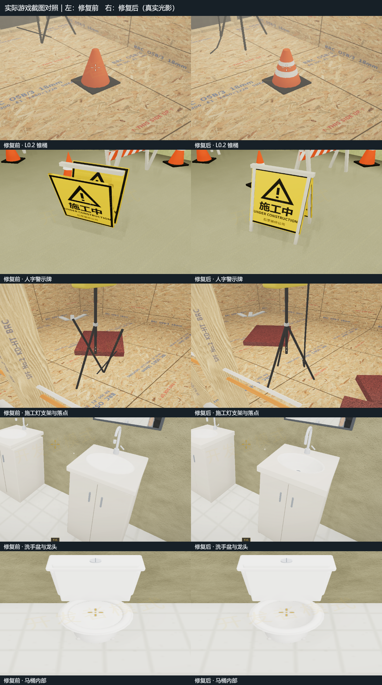

# L0.2 与入口施工物件修正（2026-10-30）

在原项目 E:\ZAN\backroom\app 检查并修复施工装饰物。保留原有材质风格、交互、碰撞、生成规则和存档；洗手间镜面继续使用现有真实反射。

## 修复内容

| 物件 | 原因 | 修正 |
|---|---|---|
| L0.2 锥桶 | 两道白色条带的半径小于锥体表面，埋在橙色外壳里 | 按同一锥面轮廓拆分橙白区段，边界半径和 UV 连续，取消叠壳 |
| 入口锥桶 | 白色套筒比锥面突出，轮廓鼓起 | 共用同一分段锥面生成器，保留底座和三组材质 |
| 人字警示牌 | 两块牌面向外翻，顶部与铰链不衔接，底部缺少支撑 | 校正倾斜方向，补齐连接铰链和地面的四条支腿，英文限制在边框内 |
| 护栏 | 支脚顶端分散，没有连接到横板 | 从地面到实际连接点计算杆件姿态，并合并同材质支架 |
| 施工灯 | 部分支腿方向错误，电缆悬空；落点可能跨斜坡或木龙骨 | 三脚架使用真实端点，电缆接回灯后并落地；灯位避开坡道、隔墙和外围墙体 |
| 洗手台 | 台面与盆口为实心面，柜顶遮住盆内，出水管与弯管之间有断口 | 椭圆台面开孔、中空盆体和柜壳，校正开孔位置与柜门接缝，连接出水管 |
| 马桶 | 碗口被上盖面封死，内壁藏在里面 | 外壳和内壁沿正确法线接合，保留座圈、水箱和附件 |

同时检查了洗手间隔断、路由器、板夹、桶／工具和吊顶设备层。对应实景与原有 L0.2 回归保持正常。所有修正使用项目既有程序几何、材质及贴图。

## 实际游戏验证

使用真实 App、Engine 与 Renderer，原生 RTX 4060 Laptop GPU / D3D11，Chrome headless=new，1920×1080、DPR 1、纹理质量 2；关闭动态分辨率、动态曝光、颗粒和抖动。L0.2 种子 20261025，入口施工点 L0 种子 424242。

通过生产崩塌控制器触发房屋，用生产 planHole 的 flip=.1 结果固定坡道，保证前后测试的实际几何一致；没有使用截图专用模型或材质。镜头落点检查真实身体净空，地下机位向 floorHeight 传入实际脚底高度；近景、反面、入口支架和设备层均有原始截图。灯位改变后，灯具近景背景会随落点变化。

- 真实光影：[原始结果](final-realistic/result.json)，36 项本轮物件检查通过，另有 23 项原有 L0.2 检查和 9 项施工入口／GL 检查。
- 经典光影：[原始结果](final-classic/result.json)，31 项本轮物件检查通过，另有 11 项原有 L0.2 检查和 9 项施工入口／GL 检查。
- 两种模式均无 JavaScript／GPU 错误；非成功资源请求只有 favicon.ico。

关键几何证据（实际场景射线，不只检查对象 visible）：

| 指标 | 修复前 | 修复后 |
|---|---|---|
| 锥桶 .17/.20/.29/.32m 高度的首个表面 | coneOrange / coneOrange / coneOrange / coneOrange | coneWhite / coneWhite / coneWhite / coneWhite |
| 洗手台中心向下首个表面高度 | 0.872m，封口面 | 0.772m，盆底／排水口 |
| 第一盏灯中心距坡道／隔墙最近边缘 | 0.010m | 0.500m |

施工灯脚的平面半径约 0.31m；新的落点查询至少保留 0.36m 的中心距离，并让两盏灯相隔至少 0.8m。灯位同静态受光计算共用，灯光与模型不会分离。

## 回归与资源

[检查和生产构建日志](checks.json)：

- 1,103 项几何回归通过：两个锥桶规格、四向射线和材质边界、有限顶点／法线／UV、中空设施、支架端点、全部真实坡道方向及正负世界坐标。
- 30,940 项既有 L0.2 检查通过，覆盖 400 个种子、门／设备生成、崩塌、充电中断及共享材质回收。
- 141 项猎犬／L0 任务／L0.2 接入回归通过。
- 生产构建通过，见 [构建日志](build.log)；保留原有字体、PostCSS 和包体大小提示。

模型继续按材质合批。单组洗手台 8 个网格（含现有镜面）、马桶 5 个、地下施工灯 4 个；锥桶曲面只分为橙色和白色两组。入口护栏与三脚架的同材质杆件合为一组。光照沿用静态受光。

三轮实际“建房屋 → 离开 L0.2”后的资源：

| 轮次 | Geometry | Texture |
|---:|---:|---:|
| 1 | 297 | 96 |
| 2 | 283 | 96 |
| 3 | 283 | 96 |

最后两轮稳定，离开场景会释放私有几何；现有共享材质不会因单个实例回收而失效。这里是资源生命周期检查，不作为整机 FPS 或 Android 性能结论。

## 前后对照



[修复前完整截图](final-before/) · [真实光影完整截图](final-realistic/) · [经典光影完整截图](final-classic/)。已人工查看最终锥桶、灯架、洗手台、马桶和两种光影下的警示牌；原始截图保留完整 HUD、环境和相机参数。

## 复现

在 E:\ZAN\backroom\app 执行：

```powershell
npm run check:l02-props
npm run check:l02-round5
npm run check:hound-l02-integration
npm run build
npm run verify:l02-props -- --label=repro-realistic
npm run verify:l02-props -- --classic --label=repro-classic
node scripts/l02-props-gallery.mjs
```

每次浏览器检查都使用独立端口和临时 profile，结束后关闭自己的浏览器／服务。修复前复现另加 --baseline，读取 app/.cache/l02-props-20261030/before 的只读源码备份。早期调试结果保留，最终验收以 final-before、final-realistic、final-classic 为准。

文件清单和 SHA-256 见 [source-files.json](source-files.json)，相对本轮初始源码的补丁见 [changes.patch](changes.patch)。
