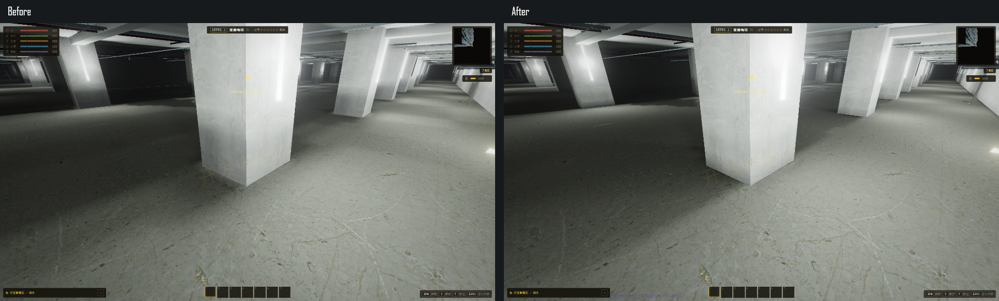
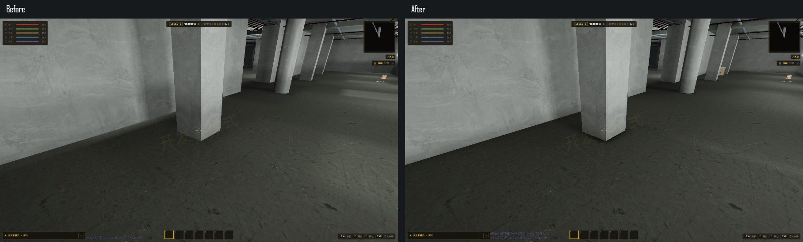
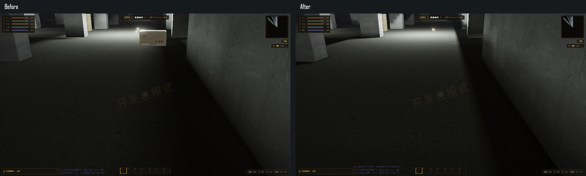
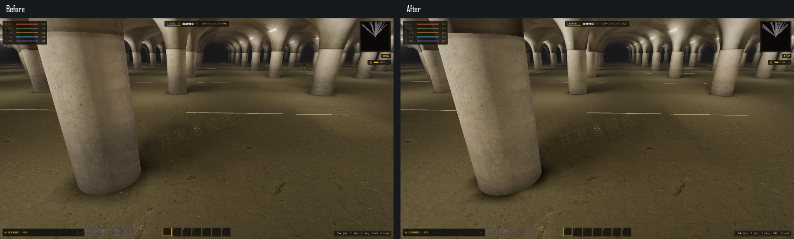

# L1 烘焙光影验收 · 2026-10-19

已将网格状间接光改为有表面与遮挡约束的连续插值，修正墙柱内部采样漏光，保留贴地的真实接触阴影。图集重新打包，地面获得更细采样；哥特拱顶同步修正代理背面的错误自遮挡。实现见 [说明](../../L1-BAKE-SMOOTHING.md)。

## 画面对照

左侧为修改前，右侧为最终版本，均来自实际游戏的相同世界坐标、朝向和 FOV。下列图只是原截图等比并排，未对场景图像调色或重绘。









原始截图：

- [修改前真实模式](before-realistic/result.json)：方柱、近墙柱、暗区、哥特段、衔尾段。
- [最终真实模式](after-realistic/result.json)：六个场景及关闭 AO 的对照，PNG 位于同目录。
- [最终经典模式](after-classic/result.json)：相同取景及 PNG。
- [哥特拱顶复查](after-realistic-gothic/gothic.png)：确认没有新增黑色自遮挡斑块。

上述 JSON 记录每次取景的世界坐标、视角、FOV、渲染统计与 GPU。种子 `20261006`，1920×1080、原生分辨率、纹理高档、关闭动态分辨率与动态曝光。所有画面由 `--headless=new` Chrome 的 RTX 4060 Laptop / ANGLE D3D11 渲染，并已人工检查截图。

## 自动与实际游戏检查

| 检查 | 最终结果 |
| --- | --- |
| 墙柱覆盖的地面 texel | 七类场景共 5235 个，错误受光为 0；旧图集覆盖检查的 1308 个均存在受光 |
| 图集打包、外扩与过滤 | 高／低档图块均有完整外扩，图块与外扩无重叠，采样数值有限 |
| 渲染几何 | 对照已有离线基线，顶点、法线、原材质 UV、索引及材质批次数完全相同 |
| 烘焙确定性与负坐标接缝 | 相同输入结果一致；17 个共享边界采样最大差值为 0 |
| 共享实例释放 | 探针保留至最后一个模型实例释放 |
| 离线包 | 修订 16，108 区块、11 个锚点，建筑指纹与文件一致 |
| 生成与定位 | 448 项生成检查、4252 项定位断言通过；哥特拱顶裁切与柱体接缝通过 |
| 既有内容 | 33698 项 D 阶段检查、147 项交互检查，以及服务管线、材质细节检查通过 |
| 实际游戏 | 真实／经典模式均通过，无运行时异常；无资源请求失败（浏览器自动请求的 favicon 404 除外） |
| 生产构建 | `npm run build` 通过，最终 Vite 构建 21.29 秒；保留项目既有依赖和体积提示 |

逐 texel 数值及原始采样位置保存在 [static.json](static.json)，最终汇总与源码 SHA-256 在 [summary.json](summary.json)。

## 性能

实际 App 的固定方柱视角，预热后每轮 90 帧、共五轮。采样时固定模拟状态，保留生产渲染路径；记录的是无头浏览器 rAF 间隔与渲染 CPU 时间，未使用 GPU 时间查询。

| 指标 | 修改前 | 最终版本 |
| --- | ---: | ---: |
| 五轮帧间隔中位数的中位数 | 4.2 ms | 4.2 ms |
| 五轮 P95 的中位数 | 16.1 ms | 4.3 ms |
| 最差一轮 P95 | 21.0 ms | 8.3 ms |
| 渲染 CPU 中位数 | 4.7 ms | 3.0 ms |
| 每帧绘制调用中位数 | 304 | 304 |
| 每帧三角面中位数 | 161036 | 161036 |
| 标题继续存档至出生点可操作 | 4.90 s | 2.51 s |

这组测量未发现实时渲染成本增加。新版五轮的几何／贴图计数保持 581／125；基线短流程为 472／110。两组流式浏览历史不同，缓存资源总量不作直接增减比较；实际可见场景的绘制调用与三角面一致，逐批次几何及光照图集尺寸另有静态比对。经典模式五轮中位帧间隔均为约 4.2 ms，P95 为 8.3～8.4 ms。

无头浏览器的帧节奏存在系统调度波动，不能将此表直接换算为普通窗口中的实际游戏 FPS。点击继续的时间也不含程序启动和标题资源预热。Android 真机未在本轮测试。

更细的采样会增加没有缓存的区块的 CPU 烘焙时间：本机七个高档场景的纯烘焙约为 4.65～10.09 秒，旧版约为 2.16～3.80 秒；这部分仍是本轮的成本取舍。最终单区块成本见 [after-diagnostic.json](after-diagnostic.json)，旧基线见 [before-diagnostic.json](before-diagnostic.json)。展示种子的 108 个区块随项目预烘焙保存，压缩包总量约 117.1 MiB；运行时继续使用原有 Worker 池和有上限的缓存。

## 复现

在 `app` 中执行：

```powershell
npm run prebake:l1-smooth
npm run check:l1-bake-smoothing
npm run check:l1-bake -- --high
npm run check:l1-offline
npm run check:l1-v2
npm run check:l1-placement-fixes
npm run check:l1-vault-mesh
npm run check:l1-services
npm run check:l1-detail
npm run check:l1-d-import
npm run check:l1-interactions
npm run verify:l1-bake-smoothing
npm run verify:l1-bake-smoothing -- --classic
npm run build
```

历史源码及离线贴图快照位于本地 `.cache/l1-bake-smoothing/before`，复测基线使用 `npm run verify:l1-bake-smoothing -- --before --benchmark-only`。`node scripts/summarize-l1-bake-smoothing.mjs` 汇总已有结果并生成并排图片。重新测性能前应结束离线烘焙与构建任务。

验证使用独立存储、独立端口与独立浏览器 profile，未读取玩家存档；创建的 QA 浏览器、服务器及临时 profile 均已清理。
