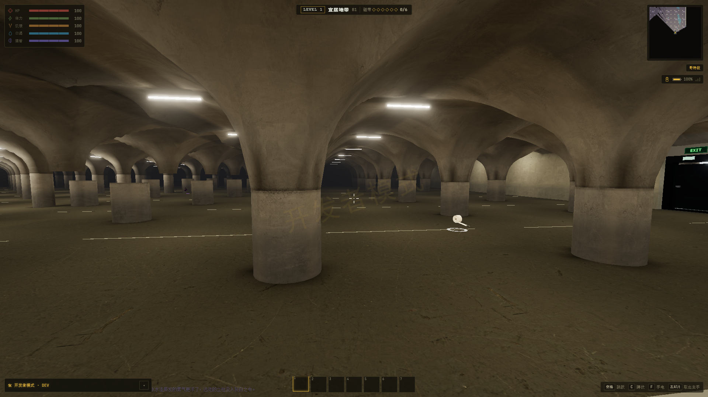
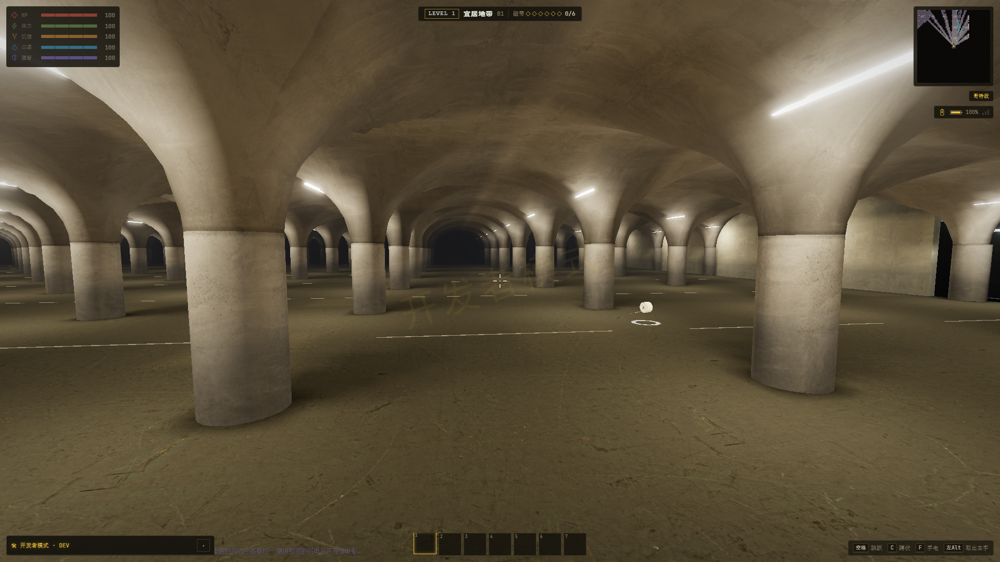
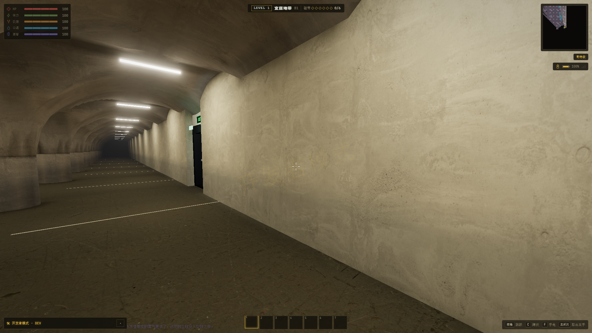
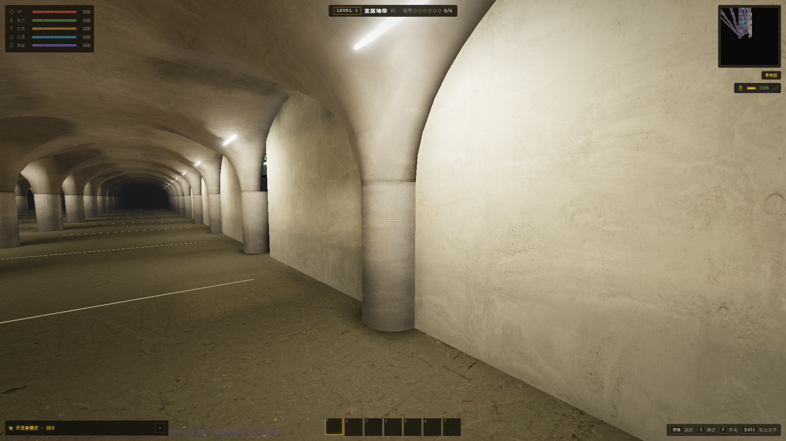

# Level 1 摆放修正验收

实际 App，种子 `20261006`，1920×1080、原生渲染分辨率、高档纹理、关闭动态曝光／动态分辨率和颗粒，冻结 AI 与随机停电。Chrome 使用 `--headless=new`，硬件为 NVIDIA RTX 4060 Laptop，ANGLE / D3D11；没有软件光栅器或上下文丢失。实现说明见 [L1-PLACEMENT-FIXES.md](../../L1-PLACEMENT-FIXES.md)。

## 画面

哥特大厅边界，修复前：左侧多根柱身与拱腹分离。



相同世界坐标、朝向和 FOV，修复后：大厅的柱网与起拱高度一致。



靠墙柱，修复前：墙面前缺少与拱腹相接的柱身。



相同取景，修复后：实际露出的靠墙柱保留到起拱位置。



门与装饰的细节取景：

- [楼梯井](after-realistic/stairs.png)、[未上锁的门](after-realistic/unlockeddoor.png)：实际墙面凹口，准星能选中相应出口。
- [小径外墙卷帘入口](after-realistic-details/outpost.png)：全组织使用同一墙面定位规则，保留原据点交互。
- [插座斜向近景](after-realistic-details/wall-dressing.png)：检查挂点、方向及墙面间距。
- [经典模式靠墙柱](after-classic/wall-column.png)、[经典模式出口](after-classic/unlockeddoor.png)。完整七项取景分别保存在真实／经典目录。

逐项位置、朝向、FOV、资源数及绘制统计见 [真实模式结果](after-realistic/result.json)、[经典模式结果](after-classic/result.json)、[最终细节结果](after-realistic-details/result.json)。前后装饰取景可能因重新定位而选到不同物件，未将其作为同一物件的像素对照。

## 检查

- [专项数据](static.json)：4,252 项断言，三个种子、675 个基础窗口区块，覆盖 1,447 根哥特柱、39 根靠墙柱、730 件贴墙装饰；额外检查 147 个保底出口宿主和 156 个据点名额，包括五种组织、负坐标与反向加载次序。
- 实际 App：真实、经典模式各完成七项取景和 1,202 项断言（多数为当前已加载柱体的逐根衔接检查）；最终卷帘门与插座细节另完成 13 项检查。两个出口均通过真正的准星选取，Alpha 入口通过真正的地标选取。没有以单独模型查看器代替实际游戏。
- 生成回归 `check:l1-v2`：448 项通过；D 阶段回归 `check:l1-d-import`：33,698 项通过；上一轮物品／地图交互 `check:l1-interactions`：147 项通过。
- `check:l1`、`check:l1-props`、`check:l1-services`、`check:l1-bake`、`check:l1-vault-mesh`、`check:l1-room-dressing`、`check:l1-offline` 通过。日志保存在本目录；旧架构检查同步改为允许实际露出的靠墙柱，并按入口新归属检查 Alpha。
- 99 个发布区块均为烘焙修订 15，指纹与当前建筑一致，压缩文件总计 83,786,368 字节。
- [生产构建日志](build.log)保留构建工具的已有字体路径、Browserslist、PostCSS 和大包提示；本轮没有借此修改其他系统。

真实与经典模式这两次从继续游戏到实际进入 L1 分别约 3.15 秒、2.10 秒。该数值是本机固定种子和离线资源窗口下的单次进入记录，不代表所有随机位置、其他设备或 Android 性能，也不是新一轮全层级帧时间验收。

## 命令

```powershell
npm run check:l1-placement-fixes
npm run check:l1-v2
npm run check:l1
npm run check:l1-props
npm run check:l1-services
npm run check:l1-bake
npm run check:l1-vault-mesh
npm run check:l1-room-dressing
npm run check:l1-d-import
npm run check:l1-interactions
npm run check:l1-offline
npm run verify:l1-placement-fixes -- --before
npm run verify:l1-placement-fixes
npm run verify:l1-placement-fixes -- --classic
npm run verify:l1-placement-fixes -- --details
npm run build
```

本次旧基线按文件内容快照恢复，包括旧烘焙资源；快照位于 `.cache/l1-placement-fixes`。截图已人工检查。所有 QA 运行使用各自的用户配置与端口，最终清理状态见各运行的 `cleanup` 字段。
