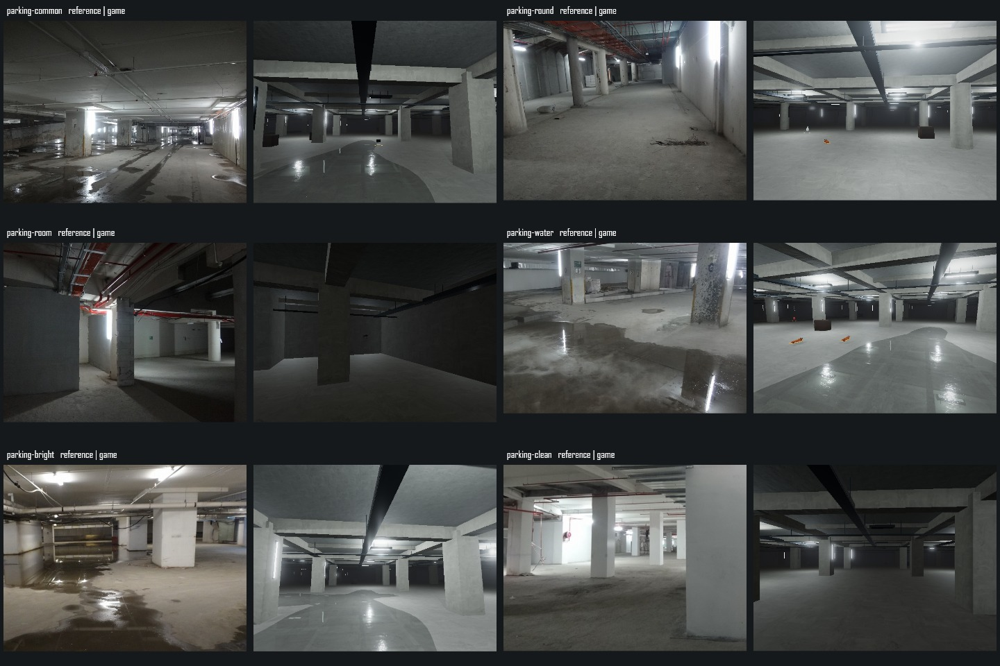
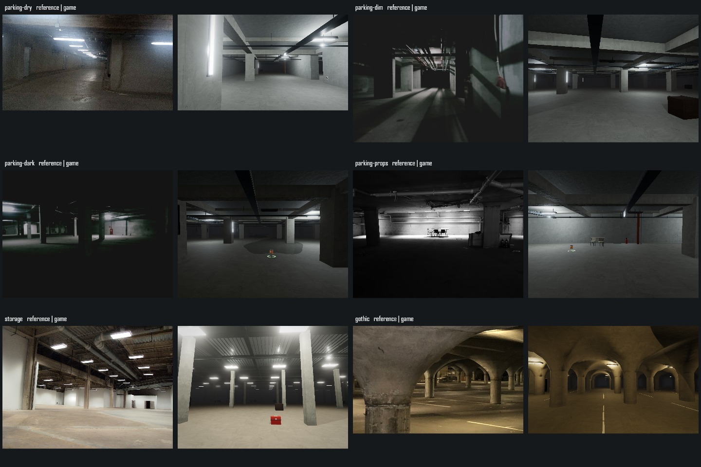
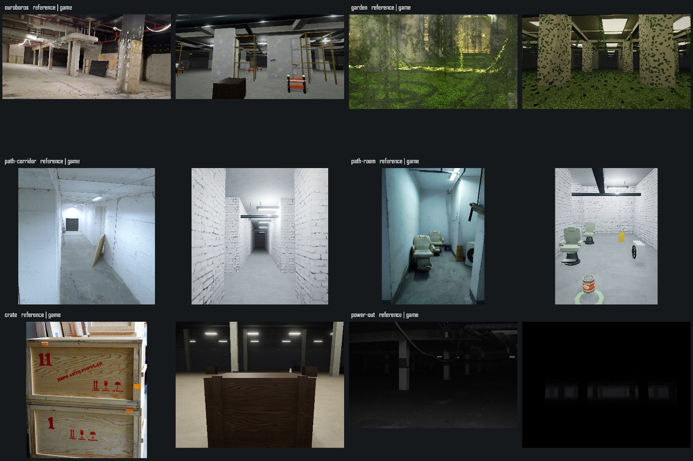

# Level 1 重制验收记录

日期：2026-10-07。范围：`app` 与根说明；保留工作区中其它物品/UI 改动。联机维持冻结，未纳入更新或测试。

本轮已接入五区、小径、据点入口、新材质和单机环境机制。**十八参考图的精确构图复刻尚未通过**：已保存实际取景、并排与叠加对照，但部分柱距、开口、材料磨损及光斑形状仍有明显差异；不能把这些截图标作 3% 轮廓误差验收通过。冷构建仍有长帧，稳态指标与冷加载分别记录。

## 实现与检查

完整实现、用户已确认的规则、启动步骤见 [L1-REMAKE.md](../../L1-REMAKE.md)。生成版本 2；主存档 v:1。普通种子与展示种子共用建筑、灯光、地面湿度和碰撞。

| 项目 | 结果与证据 |
| --- | --- |
| 五区、小径 | 连续世界坐标布局，普通大厅不再按区块围盒；小径为带门分支。大区分布、负坐标查询、距离异常范围与固定取景类型检查通过。 |
| 天鹰干湿 | 确定性水洼足迹同时驱动湿地脚步和真实几何，近邻单目标反射；世界坐标邻域查询通过。 |
| 哥特/高低顶 | 连续拱顶、圆形起拱；低顶背面及高低顶边界从两个方向射线检查通过。 |
| 装饰与模型 | 八类陈设双模式 UV、有限值、三角面/批次和独立释放检查通过；六类建筑服务几何和灯具实例化回归通过。 |
| 停电 | 35 项实际引擎检查包含五区和小径原生灯清除、携带光源保留、预警、45–90 秒时长及 300–600 秒间隔。 |
| 持久化 | 读档保留停电、花园阶段和空箱内容；视线外箱子低频变化，玩家存物箱受保护，不刷新已搜刮物资。 |
| 小径/据点 | 实际准星交互开关门及身体碰撞通过；Alpha 入口保留原据点目的地。没有逐一重新验收全部据点内部，因为内部不在本轮范围。 |
| 取景安全 | 18 个记录点身体净空通过。 |
| 构建/共用渲染 | 生产构建通过；静态合批、纹理图像、模型预热及新增 L1 检查通过。 |

[实际功能结果](current/functional.json)。静态测试为 `check:l1`、`check:l1-props`、`check:l1-services`、`check:static-batch-job`、`check:texture-images`、`check:model-warmup`。未运行包含联机要求的旧 L1 runtime 脚本。

生产构建仍有已存在的缺省字体路径、Browserslist 数据过期、PostCSS `from` 和大包警告；没有将这些警告当作构建失败，也没有在本轮更新无关依赖。

## 视觉证据

展示种子 `20261006`。记录 [18 个相机参数](current/cameras.json)，包括坐标、眼高偏移、朝向、FOV 和原参考画幅。实际图存于 `current/reference/`；`comparison/*-overlay.jpg` 为原图与游戏各 50% 的叠加，只辅助比较，不是误差得分。

| 取景 | 本轮校正 | 尚存差异 |
| --- | --- | --- |
| 常见/水洼/较亮天鹰 | 低顶梁柱、原生吊灯、连续漏水与灯影反射；参考点漏水写入真实地图 | 前景柱的位置、墙面老化、地面流痕仍不同，水边较规则 |
| 圆柱天鹰 | 圆柱与柱侧荧光灯 | 参考侧墙更接近相机，梁管的密度与斜向构图仍不同 |
| 天鹰小房间 | 真实折墙、侧开口及干地 | 房间比例、红管和灯位尚未精确匹配 |
| 干净/干燥天鹰 | 去除水洼、长视廊及局部净墙 | 柱距、墙面脏污、局部亮度不完全一致 |
| 阴暗/黑暗天鹰 | 稀疏灯位保留亮斑，背光区域深暗 | 参考中的长条斜射阴影尚未重现，局部补光仍偏均匀 |
| 杂物墙 | 折桌、杂椅、金属板、灭火器及固定取景位置 | 物件比例和整面墙的亮暗关系仍不同 |
| 跃金 | 细柱、钢梁、波纹顶板、不到顶的白隔墙、悬灯 | 参考顶梁更复杂，隔墙位置和前景构图待进一步校准 |
| 哥特 | 连续交叉拱顶及圆形起拱，移除重复柱帽叠面 | 柱脚污损、停车线方向及近景柱比例仍不同 |
| 衔尾 | 灰白剥落、裸顶、红管、垂线、板材 | 保留的施工设施较参考密集，细管与墙面磨损尚未逐项匹配 |
| 花园 | CC0 小叶片、攀附/垂藤、地被、顶窗阴影 | 植被团簇较均匀，参考的苔藓与细密日光斑尚有明显差异 |
| 小径走廊/侧房 | 白刷砖墙接入、座椅圆角及朝向、空调和小杂物 | 参考走廊末端门、砖尺寸、侧房宽度及色调尚未精确匹配 |
| 板条箱 | 真实可搜刮箱、木纹/PBR、近景取景 | 参考的浅木、完整包边和运输印字未完全复刻 |
| 停电 | 原生照明灭掉，仅保留允许的光源 | 固定取景比原图更黑，不能据此判定光照完全一致 |

场景没有使用背景照片、取景专用假墙或绕过正常碰撞。物资与 NPC 是真实游戏对象，固定取景冻结状态，正常游玩仍能交互。

补充经典模式回归截图：[哥特](current/classic/gothic.png)、[花园](current/classic/garden.png)、[小径侧房](current/classic/path-room.png)。最终哥特柱顶增加 32 个方向的实际网格射线接合检查，确认无空隙；[实际浏览器截图](current/gothic-final.jpg)记录修复后的画面。柱顶细分和材质变化仍可辨认，未宣称照片级无缝。

## 性能与资源

设备由 WebGL 报告为 **NVIDIA GeForce RTX 4060 Laptop GPU / ANGLE D3D11**。Codex 内置浏览器隐藏页面，1920×1080，像素倍率 1、固定真实光影、半分辨率 AO、泛光、16 场景灯和最多两盏场景灯阴影。不是独立 Chromium headless，也不是 Android 真机测试。

预热等待构建、贴图、程序和待释放资源收敛，至少 3 秒，再稳定 1 秒。各场景采五轮，每轮至少 120 帧及 1.2 秒；RAF 与 CPU render、GPU 时间分列。浏览器实际刷新节奏约 240 Hz，4.2ms 附近的 RAF 分档不能直接等同纯 GPU 耗时。

- [最终六区域性能统计](PERFORMANCE.md)：新版实际五区与小径，检查取景区域标识；稳态目标中位数 ≤16.7ms、P95 ≤20ms。
- [六区域逐轮原始数据](current/regions-performance.json)。初次衔尾验收曾超标，保留 [优化前数据](current/regions-performance-before-culling.json) 与 [单独复测](current/ouroboros-culling-performance.json)，不只报告最好一轮。
- [原坐标当前数据](current/performance.json) 与 [同内置浏览器基线](baseline/performance-iab.json)。生成变化会改变旧位置的区段，**这是相同坐标对照，不是建筑不变的严格消融实验**。早期外部浏览器文件 `baseline/performance.json` 只保留历史坐标；最终验收遵循用户要求使用隐藏的内置浏览器。
- [四轮切区/画质回收](current/resources.json)：检查返回相同场景后的几何、纹理和程序数量。有限的按需纹理差异不能当作逐轮增长；完整数值见统计。
- 改造前游戏截图保留在 `baseline/`。固定参考图对照与旧版本截图不是同一类比较。

冷构建峰值仍明显超过单帧预算，包括首次纹理上传、着色程序准备和流式几何构建。直接写入顶板/管线缓冲减少临时对象；施工人员按实际可见范围更新后，衔尾稳态开销下降。仍不宣称冷加载或持续快速跨区全程 60 FPS。

## 可复现步骤

1. 按 [启动说明](../../L1-REMAKE.md) 启动验证页；保持画质与 1920×1080，关闭其它会占用 GPU 的测试页面。
2. 点击“功能回归”，保存页面结果；点击“六区域性能验收”，等待六个区域及各五轮全部完成。
3. 点击“检查切区与画质回收”，四轮结束后保存资源结果。最后再作经典/真实截图检查。
4. 点击“生成全部参考画幅”，导出 18 个实际 PNG 与相机参数。执行 `node scripts/verify-l1-remake.mjs` 更新并排图和叠加图。
5. 用“开始自由游玩”核对门口、背面、区段交界及手电。固定取景图只证明该视角的输出，不能替代自由游玩、长时生存或移动端验收。

设定、图片、模型和纹理的来源与许可见 [L1-REMAKE-SOURCES.md](../../L1-REMAKE-SOURCES.md)。
