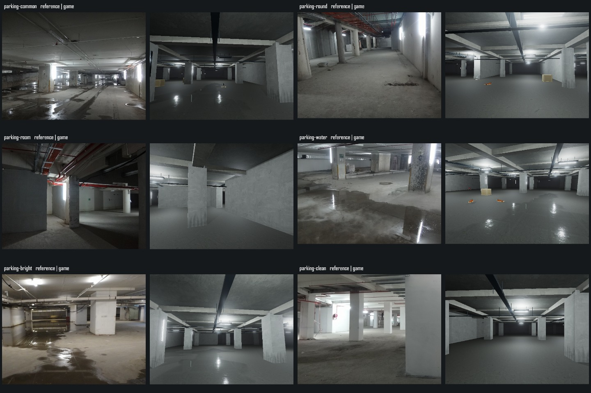
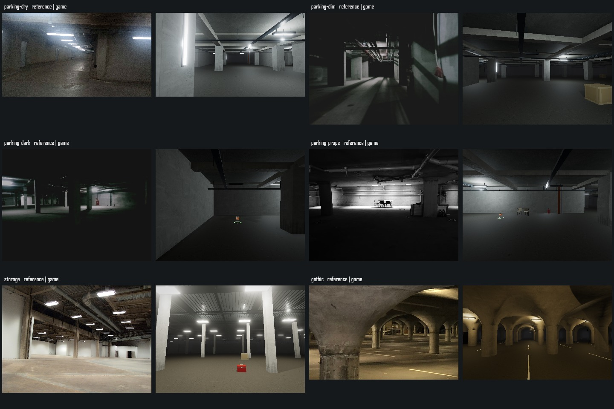
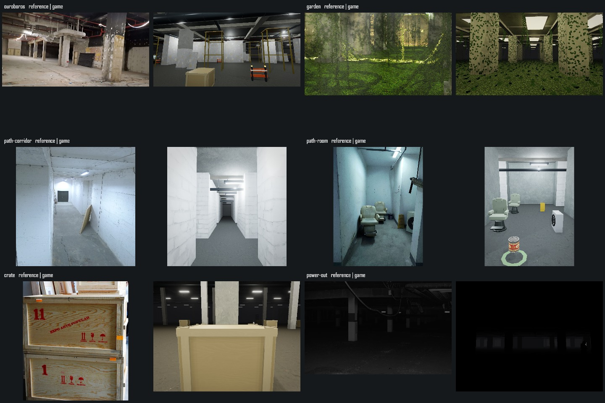
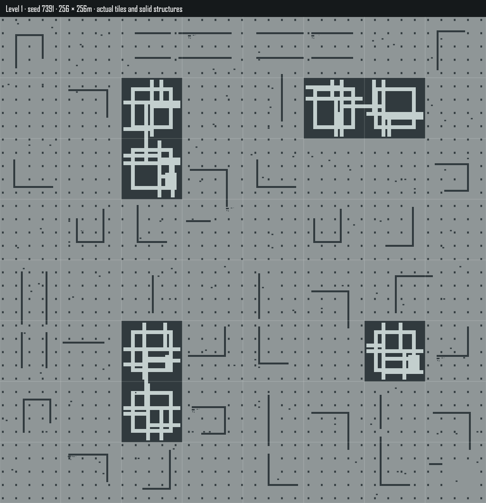
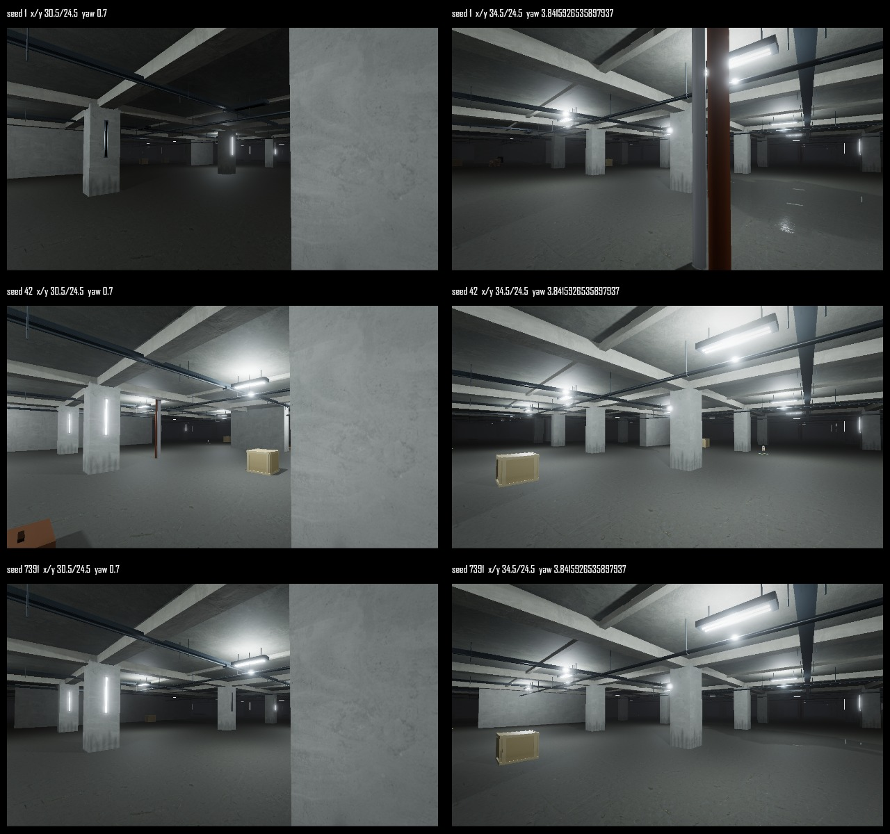

# Level 1 第二轮：纹理与大厅布局

日期：2026-10-08。范围为 `app` 与根项目说明，单机验收；保留其它任务的物品、UI 和笑魇改动。前轮报告和素材未覆盖。

## 本轮改动

- 普通种子采用 64 米开放隔墙组合，具有旋转、错位开口、侧凹及 L 形墙；继续按 32 米区块加载，避免所有空间都按区块围合。保护出生、既有物资、门口和出口。生成版本升为 3；旧物资分配继续使用冻结的 v2 掩码，已有物品身份不重新抽取。被新墙覆盖的旧掉落与投出光源寻找原区块内安全点。
- 地板使用已有 CC0 磨损混凝土，与墙顶区分；颜色、OpenGL 法线、粗糙度共用世界 UV。修复吊顶每米重复重置和墙面斜向取样；降低白刷砖接缝及凹凸对比。小径侧房内面使用粉刷，外侧仍为白砖。
- 天鹰梁和管线变薄，柱脚加轻度污损。积水采用不规则边缘、淡出和视角反射，保持单张 512px 反射目标及 15Hz 更新上限。
- 板条箱补齐顶底和四面边框，木纹随构件方向布置；保持两批材质。展示区箱子净空修正，干净天鹰段稳定照明。

纹理全部复用项目内许可明确的扫描资产，本轮没有生成或下载新纹理。作者、路径、许可及运行时改动见 [纹理来源](../../../public/textures/l1/SOURCES.md)。普通种子和固定取景都使用实际建筑、碰撞及同一渲染路径。

## 检查

- `check:l1`、`check:l1-props`、`check:l1-services`、`check:l1-refinements` 通过。新增检查覆盖 80 组连通布局、33 种实际组合、加载顺序、原物资净空、旧掉落迁移、粉刷内侧面、正负坐标 UV 接缝、邻块积水连续及箱体顶底射线。
- `check:static-batch-job`（11621 项）、`check:texture-images`（96 项）、`check:model-warmup`（66 项）通过。
- 35 项真实引擎单机机制检查通过，包含小径门的准星交互和碰撞、箱子内容与异常变化、玩家存物保护、停电/花园保存恢复、各区原生光源、据点目标及十八参考点净空。见 [原始结果](current/functional.json)。
- `npm run build` 通过。仍有原有字体解析、Browserslist、PostCSS `from`、动态导入和大包提示；沙箱 Vite `realpath` EPERM 后在授权本机环境完成构建。
- 经典模式回归 [天鹰](current/classic/parking-common.png)、[侧房](current/classic/path-room.png) 和 [木箱](current/classic/crate.png)；当前浏览器捕获的 [错误日志](current/browser-errors.json) 为空。该结论只覆盖本次固定场景，不等于所有设备/全部流程无错误。

## 视觉证据与限制

十八参考点的画幅、相机和截图见 [cameras.json](current/cameras.json)、[实际截图](current/reference)。三张总览每组左侧是参考、右侧是游戏；另保存 50% 叠加图。不把对照图当作误差通过证明。







粉刷侧房的墙面、白砖接缝、地面细节与积水轮廓已有调整，但参考构图仍有明显差异：天鹰柱距与灯位较规则；衔尾脚手架和管线密度不同；花园藤蔓仍偏稀、叶片分布规则；小径侧房偏宽、粉刷磨损偏重；箱子没有参考中的堆叠与文字。**未达到逐图 3% 轮廓误差标准**。本轮未改变这些未完成项的验收状态。

普通种子 7391 的 256×256 米实际生成布局：



该图白线只是诊断区块网格，不存在于场景。大厅隔墙不以该网格围盒；小径仍有规则的宏观间距，不能宣称所有重复感已消除。

种子 1、42、7391 的区块两侧实机画面及 [世界坐标](current/normal-cameras.json)：



## 性能与复现

后台使用隐藏的 Codex 内置浏览器，没有外部浏览器窗口；这不是独立 Chromium headless。RTX 4060 Laptop，1920×1080、DPR 1、真实光影、纹理档 2、半分辨率 AO、泛光开启、两盏场景阴影灯、场景灯上限 16、无动态分辨率。每区完成构建与资源稳定后采样五轮，每轮至少 120 帧且不少于 1.2 秒；记录 RAF、CPU render、GPU 查询及轮末资源。

测量及回收表见 [PERFORMANCE.md](PERFORMANCE.md)。前轮相机和性能副本保存在 `baseline`；工作区其它角色/物品功能也在变化，因此跨轮差值不是仅归因于本轮纹理的严格实验。冷构建与稳态分别报告，没有 Android 真机性能结论。

本次整批六区中 **5/6 达标**：衔尾有一轮 P95 为 29.2ms，超过 20ms 目标。随后同代码、同设置独立五轮复测 P95 为 8.4–16.7ms；不覆盖初测，也不能据此确认超标原因。冷构建最大帧间隔约 562.6ms，仍是未达标项。四轮切区/画质回收的几何始终 390、程序始终 120，纹理从首轮 61 增至 62 后后三轮保持不变。

在 `app` 按 [实现说明](../../../L1-REMAKE.md) 启动验收页。用“生成全部参考画幅”“普通种子与接缝取景”“功能回归”“六区域性能验收”“检查切区与画质回收”复现。页面使用独立内存存储，不写玩家存档。选“经典光影”后重新生成画幅可回归低成本路径。

```powershell
npm run check:l1-refinements
node scripts/verify-l1-remake.mjs iteration-2
node scripts/summarize-l1-remake.mjs iteration-2
```

## 勘误（2026-10-08）

`current/ouroboros-followup.json` 记录的独立复测 viewport 实际为 **1280×720**；原文将其称为 1080p 设置复测不准确。该复测不能作为 1080p 达标或同设置对照。原始 JSON 与初测超标记录保留，不覆写历史数据。第三轮将新增每区域 viewport 与 renderSize 记录后重新对照。
