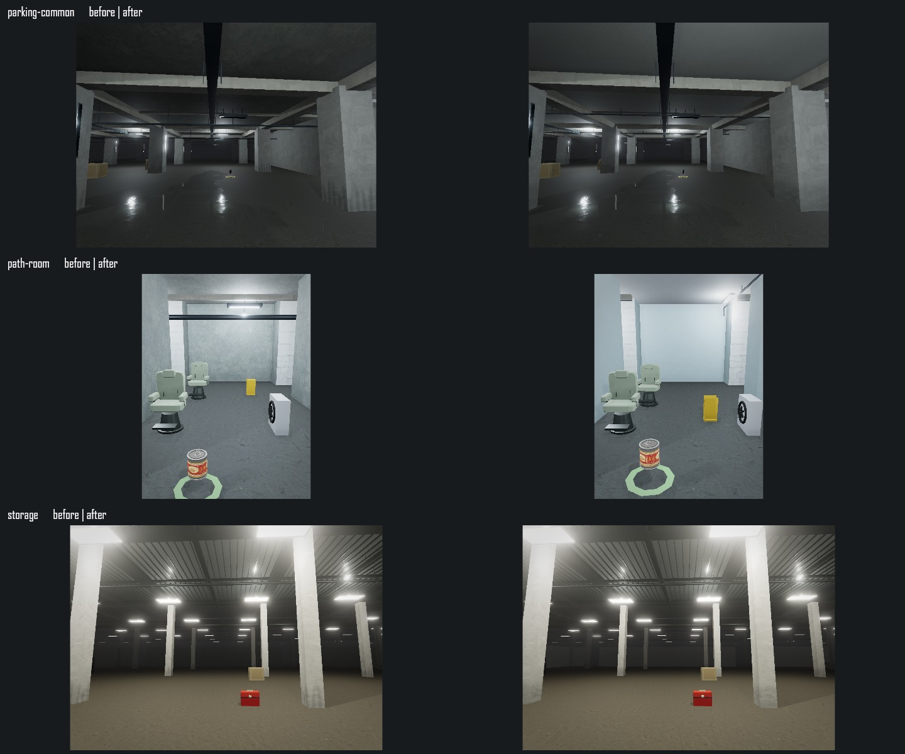
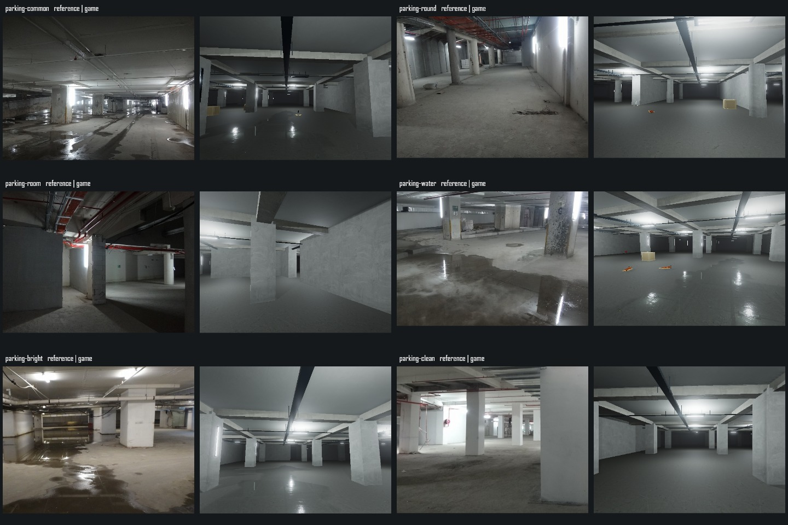
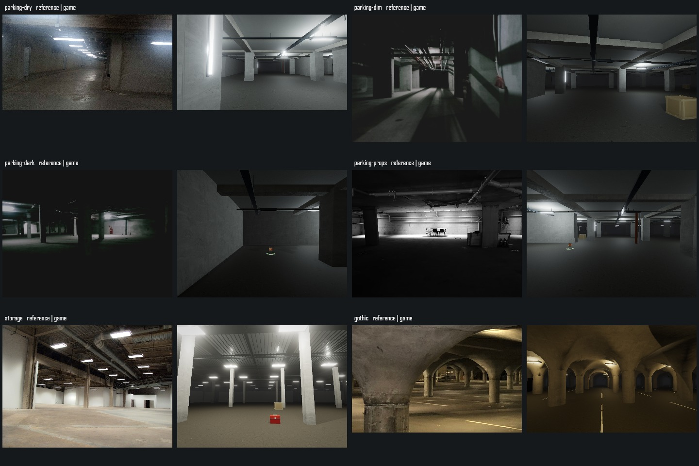
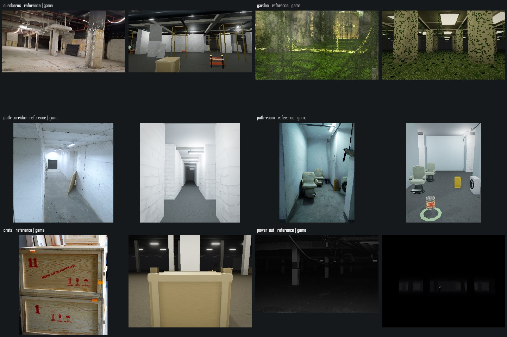

# Level 1 第三轮：顶面、管线与构建开销

2026-10-08。范围为 `app` 和根项目说明；单机验收，保留其它工作区改动。本轮继续第二轮的连续大厅生成规则，不重新抽取物资、箱子身份，也不改变存档版本。

## 实际改动

- 粉刷墙与天鹰、小径顶面继续使用现有 CC0 Plaster004 扫描，压低大片污渍对比，法线强度降为 0.045。小径侧房采用偏冷的灰青粉刷。柱脚污损由扫描纹理控制，去掉重复的竖向条纹。[来源及处理参数](../../../public/textures/l1/SOURCES.md)。
- 天鹰细管从顶下 0.82m 移至 0.37m，半径 0.045m 降至 0.035m；小径细管贴近顶面，半径 0.025m。侧房使用平顶、右墙附近的纵向灯管和沿墙细管，撤去横穿房间的规则横梁。侧房灯位来自同一生成数据，真实照明位置同步改变，仍参与停电；普通种子的同类侧房也使用该规则。
- 两把参考座椅靠近，空调外机和提示牌移至近端右侧，生成与碰撞范围同步；保留实际物资、危险和交互，不为截图隐藏掉落物。
- 逐米的梁、顶板肋条、桥架、线缆和直管先合并连续段，再生成顶点缓冲；保留墙体断口、接头、吊杆、弯折与原世界 UV。减少内部端盖和重叠面，仍按原材质合批，不增加灯、渲染目标或纹理。

## 检查与证据

`check:l1`、`check:l1-props`、`check:l1-services`、`check:l1-refinements` 通过。新增区间合并检查覆盖正负坐标、相接/重叠、不同截面键、真实间隙、输入不变及无效数值。实际梁/管射线检查确认断口没有被合并跨越；取消构建后仍能独立重建。侧房两个座椅、外机、提示牌均实际生成，灯位与停电标记正确。既有 80 组大厅连通、加载顺序、物资净空、掉落迁移、UV/积水接缝回归通过。

贴图生命周期 96 项、模型预热 66 项、静态合批 11621 项通过。真实引擎的 [35 项单机机制回归](current/functional.json) 通过。`npm run build` 通过（2102 modules）；仍有现有字体路径、Browserslist、PostCSS、动态导入与大包提示。本机 Vite 构建沿用授权的非沙箱执行方式。

十八个参考取景、普通种子 1/42/7391 的区块两侧取景、经典模式回归分别保存在 [reference](current/reference)、[normal](current/normal)、[classic](current/classic)。[相机参数](current/cameras.json)和[普通种子坐标](current/normal-cameras.json)随图保存。[浏览器错误记录](current/browser-errors.json)仅覆盖本轮访问的场景。

下图左侧为本轮修改前，右侧为修改后：



完整参考对照（每组左侧参考、右侧游戏），另有逐图 50% 叠加图：





## 性能结果与边界

本轮先保留完整源代码基线，再在同一 RTX 4060 Laptop、隐藏 Codex 内置浏览器中依次测量前后版本。六场景每次均显式记录 `viewport` 和实际 `renderSize` 为 **1920×1080**，DPR 1、真实模式、纹理档 2、半分辨率 AO、泛光、最多两盏场景阴影灯、16 盏灯池，无动态分辨率。各场景预热并等待资源稳定，采样五轮，每轮至少 120 帧且不少于 1.2 秒。不是独立 Chromium headless，也没有 Android 真机结论。

六区稳态全部通过：最差轮中位数均约 4.2ms，最差轮 P95 为 4.3–8.4ms。与本轮基线相比，稳态 RAF 没有显著改善，主要收益是三角面和构建工作量减少。[六区详细数据与回收](PERFORMANCE.md)、[同轮前后表](COMPARISON.md)。绘制调用与三角面为轮末采样，阴影/反射更新相位不同，不能把不同相位的值直接当成完整逐帧分布。

纯服务几何的 32×32m 空场景对照如下；不包含地面、角色、道具和后处理，也不代表整场帧率。预热两次、再测五次的 Node 构建诊断及逐步耗时见 [原始数据](service-geometry.json)。

| 服务类型 | 原三角面 | 当前三角面 | 减少 |
| --- | ---: | ---: | ---: |
| 天鹰 | 33120 | 6336 | 80.9% |
| 跃金 | 75104 | 10624 | 85.9% |
| 衔尾 | 38240 | 9472 | 75.2% |
| 小径 | 13280 | 3236 | 75.6% |

四轮切区及经典/真实切换后，几何始终 390、程序始终 123，纹理由首轮 61 增至 62 后保持稳定。

**未完成项仍保留：**初次构建最长 RAF 间隔约 487.4ms（本轮基线 504.2ms），其它区域也有 95.7–216.6ms 构建长帧，远未达到单帧预算。`generationMs` 单独记录同步窗口生成时间，初次目标窗口约 134.8ms；这些计时不能确定剩余长帧全部来自哪一阶段。测试未清除驱动缓存，不是多次独立进程冷启动统计。前轮衔尾偶发超标原因仍未定位。

视觉上，天鹰柱距、顶面及灯位仍偏规则；小径侧房偏宽、座椅轮廓较硬、墙面阴影和设备细节仍不同；衔尾施工物数量、花园叶片分布、箱体堆叠和字样仍未精确复刻。未达到逐图约 3% 建筑轮廓误差目标。

前轮报告另作勘误：其衔尾独立复测 JSON 的实际视口为 **1280×720**，不能作为 1080p 的同设置复测依据。原始记录、初测超标均保留；本轮新增视口和实际画布尺寸记录后重新测量。

## 复现

按 [L1 实现说明](../../../L1-REMAKE.md)启动验证服务，用 `verifier/l0-remake.html?level=1` 的“生成全部参考画幅”“普通种子与接缝取景”“功能回归”“六区域性能验收”“检查切区与画质回收”。固定取景使用独立内存存储；选择经典光影再生成画幅可检查低成本路径。性能验证前明确设置 1920×1080，检查导出的两组尺寸。

本轮本机基线为 `app/.cache/l1-iteration3-before/src/game`，通过 `?level=1&baseline=l1-iteration3` 访问；该忽略目录不作为生产依赖，也不随源码分发。重要文件的前后 [SHA-256](source-hashes.json)、本轮 [基线数据](baseline/regions-performance.json)与基线截图已保存。纯服务测量脚本需要此本机源快照。

```powershell
npx esbuild scripts/check-l1-service-runs.ts --bundle --platform=node --format=esm --outfile=.cache/check-l1-service-runs.mjs
node .cache/check-l1-service-runs.mjs
npm run check:l1-services
npm run check:l1-refinements
node scripts/verify-l1-remake.mjs iteration-3
node scripts/summarize-l1-remake.mjs iteration-3
node scripts/compare-l1-iteration3.mjs
```

三个离线报告脚本只处理已保存的证据，不会启动或控制浏览器。所有新增实现属于单机路径，联机仍封闭，`app-lite` 不变。
