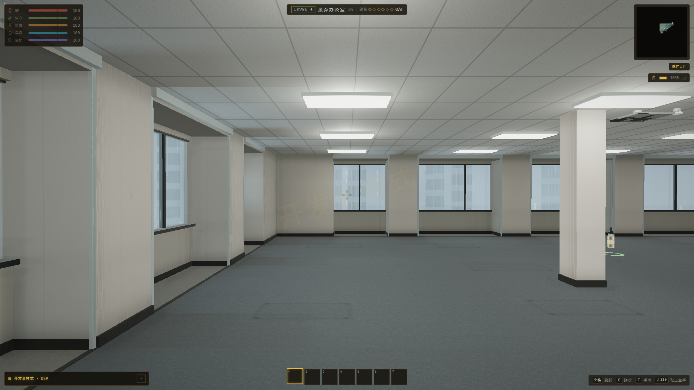
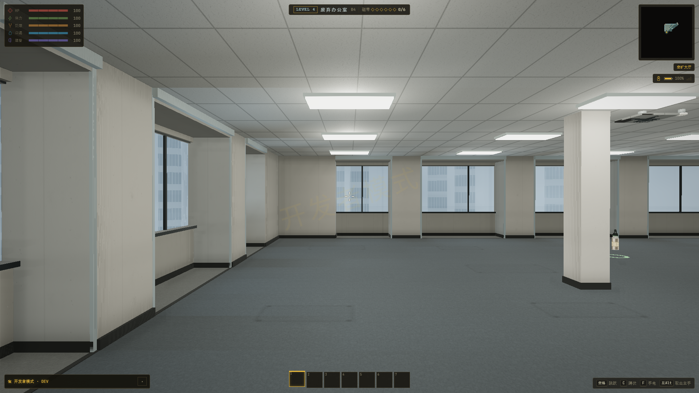

# L4 性能、L2/L3 地图、爆酸者和残缺者腿碰撞验收

完成：2026-10-22。目录名保留本轮启动日期 20261021。实际开发目标 E:/ZAN/backroom/app，原工作区内容保留；未更新 GitHub 副本、app-lite 和已冻结联机。

## 结果

15 组相关回归通过，生产构建通过。经典/真实光影实际游戏完整检查通过，最后的 AI 公共保护/图鉴修正另在双模式完成专项实际游戏复验。所有验收运行均使用独立内存存档、专属端口/profile、Chrome --headless=new；运行记录包含启动命令、GPU、异常、请求失败和进程清理状态。

- [全部回归结果](checks.json)
- [生产构建日志](build.log)
- [真实光影全流程](game-realistic-final/result.json)；[经典全流程](game-classic-final/result.json)
- [最终爆酸者真实模式复验](burster-final-realistic/result.json)；[经典复验](burster-final-classic/result.json)
- [实现、来源、作者与许可](../../L4-BURSTER-MAPS.md)；[附件逐文件哈希](../../assets/sources/burster-20261022/SOURCE.json)

## L4 同条件性能

GPU：ANGLE (NVIDIA, NVIDIA GeForce RTX 4060 Laptop GPU (0x000028E0) Direct3D11 vs_5_0 ps_5_0, D3D11)。1920×1080，种子 424242，textureQuality=2，native/100%，关闭动态分辨率和动态曝光，真实光影。使用原版 App 继续存档进入 L4，流式窗口全部 25 块完成后预热；固定场景冻结 AI，每轮 80 次 requestAnimationFrame，采样五轮。以下帧时间是五轮统计的中位数，P95 栏为五轮各自 P95 的中位数；包含实际世界、阴影和后处理，不是 GPU timer，也不代表 Android。

固定取景：世界坐标 (-26.5,84.5,0)，yaw=0、pitch≈-0.00538456、FOV=58。构图、建筑和摆放前后检查一致；外窗以单层合成减少透明叠加。

| 指标 | 修改前 | 修改后 |
|---|---:|---:|
| 帧时间中位数 | 20.1 ms | 6.3 ms |
| P95 | 26.0 ms | 10.4 ms |
| 绘制调用中位数 | 1391 | 733 |
| 渲染三角面（含阴影等通道） | 1949793 | 277671 |
| GPU geometry 记录 | 1645 | 1032 |
| 场景 Mesh 节点（含隐藏交互代理） | 27210 | 4259 |
| 菜单继续至可玩 | 8.2 s | 2.9 s |

[原始基线](before-realistic/result.json)；[修改后原始数据](after-realistic/result.json)。entryMs 不包含 App 首次启动/导入模块；样本中的 settleMs 包含等待完整窗口与五轮采样，不能单独当作地图构建时间。




## L4 多区域

额外独立运行，每个取景同样采样五轮。小房间取景在实际房门前，保留闭门的真实遮挡。

| 场景 | 中位帧时间 | P95 | 绘制调用 |
|---|---:|---:|---:|
| 空旷大厅复验 | 6.6 ms | 10.4 ms | 733 |
| 办公间区 | 6.7 ms | 11.0 ms | 768 |
| 开阔区 | 5.9 ms | 10.3 ms | 595 |
| 小房间区/门口 | 8.6 ms | 14.0 ms | 761 |
| 窗边 | 7.1 ms | 10.6 ms | 760 |

全部稳定场景的各轮 P95 最高约 15.2 ms。[完整多区域数据](after-all-regions/result.json)。办公间、开阔区、小房间/门口、窗边截图分别位于 after-all-regions/ 下。

## 地图与机制

| 项目 | 实际游戏证据 |
|---|---|
| L2 六类区域、L3 七类区域，原版地图与图形图例 | [L2 大地图](game-realistic-final/l2-map.png)、[小地图](game-realistic-final/l2-minimap.png)、[L3 大地图](game-realistic-final/l3-map.png)、[小地图](game-realistic-final/l3-minimap.png) |
| 合批后的精确交互代理仍可被射线命中 | 全流程 JSON 中 proxies 八个实例；独立回归对比合并前后的变换、包围盒和命中距离 |
| 爆酸者休眠、自然苏醒和喷酸 | [休眠](burster-final-realistic/burster-sleep.png)、[喷酸](burster-final-realistic/burster-burst.png) |
| 酸液失明、实际使用水清洗，HUD 保持清晰 | [失明](burster-final-realistic/burster-blind.png)、[洗眼/结茧](burster-final-realistic/burster-shell.png) |
| 茧壳裂纹、破茧、酸性胼胝掉落/三份装弹 | [裂纹](burster-final-realistic/burster-crack.png)、[掉落](burster-final-realistic/burster-broken.png)；57 项 CPU 行为检查包含真实 strike/squirt 结算、护具、休克、孵化、公共圣所和图鉴发现 |
| 残缺者实际动画骨骼生成 24 段碰撞，玩家被足端挤出 | [实际实体](game-realistic-final/mangled-legs.png)、[足端手电近景](game-realistic-final/mangled-foot.png)；核心回归另覆盖腿间通行、实际腿骨抬高、旋转/成长、原点平移和死亡清理 |
| 经典模式兼容 | 同名截图位于 game-classic-final/ 和 burster-final-classic/ |

L2/L3 绘图检查使用真实 Canvas，覆盖区域分类、图例唯一性、探索裁剪和地图数组不被修改。普通地图维持迷雾；开发者全开使用原系统，不新增面板地图。没有新增联机测试。

## 回收

在完整 25 块窗口、同一画质和取景下，三轮 L3 → L4 后：

| 模式 | GPU geometry 三轮 | texture 三轮 |
|---|---|---|
| 经典 | 799 → 769 → 756 | 104 → 104 → 104 |
| 真实 | 864 → 830 → 817 | 133 → 133 → 133 |

纹理计数稳定，几何计数下降、没有累增。GPU 延迟释放和可见资源驻留使三轮数量不完全相等，因此这里检验同场景资源不累增，不宣称每轮字节数一致。爆酸者独立资源检查验证几何/材质/关节/实例矩阵不共享，两张生成纹理共享；释放一个实例后另一个仍能完成动画。离层不遗留酸液实例网格、失明遮罩或旧坐标飞滴。

所有本轮验收报告中的 cleanup 均确认专用 profile 删除；Browser.close 与后备停止仅作用于脚本自己创建的进程。

## 复现

在 E:/ZAN/backroom/app 运行（Node/npm 可用）：

```powershell
npm run build
npm run check:burster
npm run check:l23-map
npm run check:mangled-legs
npm run check:l4-burster-integration
npm run check:l4
npm run check:l4-collisions
npm run check:l4-details
npm run check:l4-batch-job
npm run verify:l4-burster-maps -- --label=repeat-realistic
npm run verify:l4-burster-maps -- --classic --label=repeat-classic
npm run verify:l4-performance -- --label=repeat-performance --all-scenes
node scripts/verify-burster-final.mjs --label=repeat-burster
```

其余相关回归命令见 checks.json。程序自动申请空闲端口、原生 GPU；不提供软件渲染成绩充当实际 GPU 性能。源实现及视角定义保存于 scripts/verify-l4-performance-current.mjs、verifier/l4-melee-wrangler-check.ts、verifier/l4-burster-maps-check.ts。

## 范围与已知限制

- 性能采样为稳定固定场景；持续快速跨区的单帧构建峰值、长时间战斗、大量实体与 Android 真机未做同等五轮基准，不据此宣称所有场景都能稳定 60 FPS。
- 本轮没有修改 L4 布局生成规则。旧装饰回归仍要求已不存在的 wallkit，已对齐现有 wallDecor，并通过；合批同步算法基线作为持久 fixture 保存，避免回归命令依赖 .check 临时目录。
- 构建保留项目原有字体路径、PostCSS 与较大 chunk 提示，无新增编译错误；实际游戏检查无 runtime/console error 或资源请求失败。
- 开发中的早期失败日志可保留作调试过程记录；验收依据为本报告链接的 *-final、after-*、checks.json 和 build.log。
