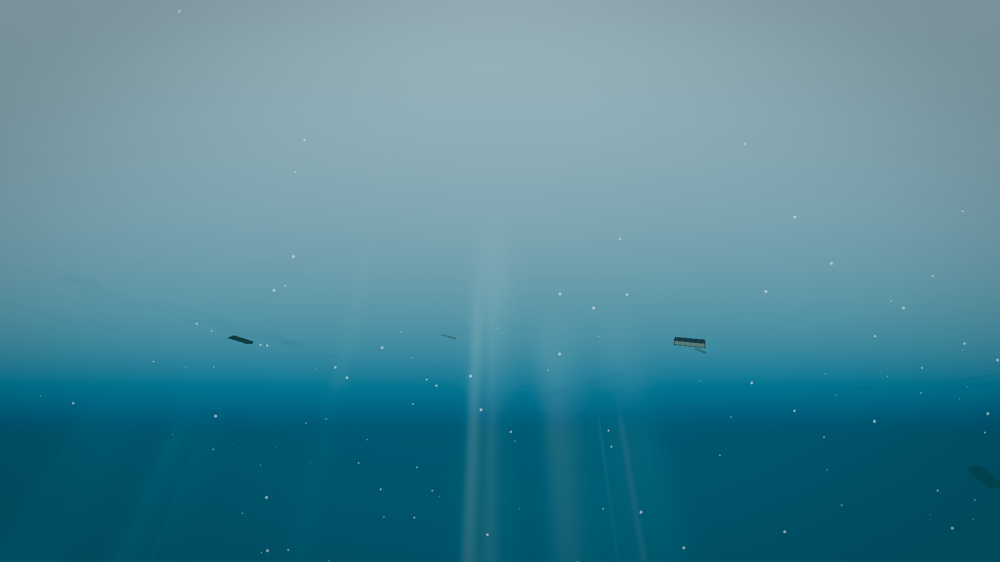
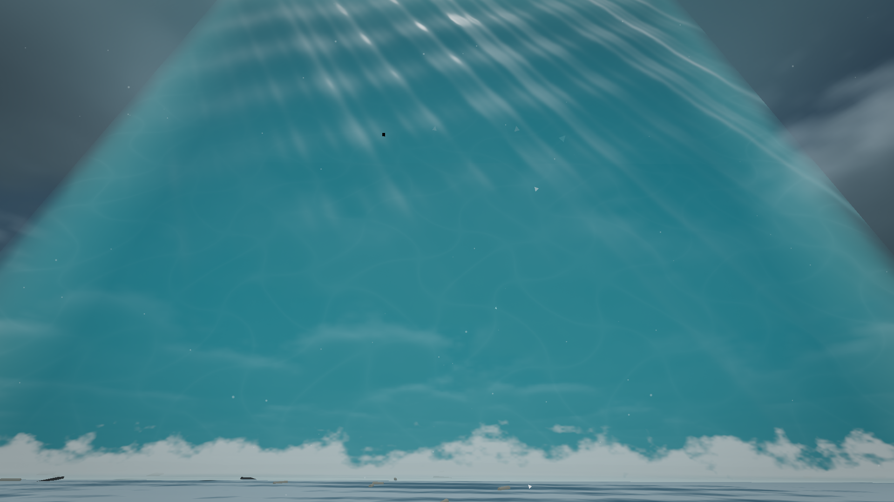
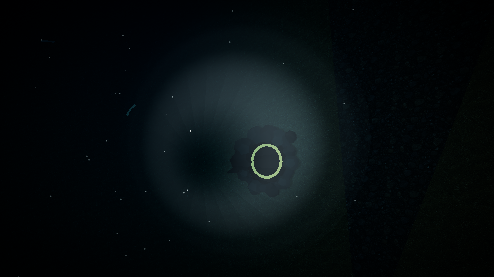

# Level 7 双包导入验证（2026-10-09）

已合并用户提供的 `backroom-l7.zip` 和 `backroom-l7-polish.zip`，保留当前天空系统、Level 10 水体、材质工厂与已有工作区修改。范围为 `app` 和根说明，联机继续冻结。

## 内容与适配

包含入口海山/陡崖、固定通往 L8 的海底岩洞、远海沟脊、水墙与倒悬水面、六类海底/岛屿模型、涌浪/远海幻觉/深海音景，以及水下光束、焦散、消光、颗粒和斯涅尔窗。

本地修复：保留材质钩子与双模式缓存；骨架实例独立几何；效果组延迟回收、释放实例缓冲；水墙按实际帧时间刷新并响应传送；缓存固定洞口查询；新增堡垒容器使用独立身份槽；深海音效离层停止；修复涌浪采样、光锥方向、反向 smoothstep，以及透明天光叠加暗角时错误泛白。原始包与校验值见 [来源记录](../../assets/l7-import/SOURCES.md)。作者与许可未在包内注明。

## 自动和运行验证

命令均在 `app` 目录执行，原始日志在本目录：

- `npm run check:l7`：2,433 项通过，5 个种子。
- `npm run check:l10-model-import`：5,839 项通过。
- `npm run check:texture-images`：96 项通过。
- `npm run check:model-warmup`：66 项通过。
- `npm run check:program-completion`：58 项通过。
- `npm run check:static-batch-job`：11,621 项通过。
- `npm run build`：TypeScript 和 Vite 生产构建通过；保留既有字体路径、Browserslist、CSS 和大包提示，详见 `build.log`。
- `npm run verify:l7-import`：真实 Engine/Renderer 中 123 项通过；最终控制台/运行错误为 0，见 `runtime.json`、`after-errors.json`。

运行覆盖普通游泳、主动升降、中性悬停、水墙内游动与离墙坠落、涌浪与流式窗口连续、远海幻觉积累/衰退、准星选择岩洞并触发 L8 过场、绳索部署/攀回门廊、音频节点创建/停止、L7→L10→L7、模式切换及独立几何回收。测试存储隔离，不覆盖玩家存档。L8 完整游玩、Android 真机与人工听音未在本轮验证。

四次经典/真实模式切换，第二次真实模式与第四次真实模式的几何、纹理、程序数量一致；完整数值见 `runtime.json`。最低纹理档关闭额外光束和碎裂，见 `after-shallow-low.png`。

## 画面和性能

真正无头 Chrome，`--headless=new`；独立 profile `app/.cache/l7-qa`，CDP 9240，Vite 3009。`browser.json` 保存实际启动参数与版本。GPU 为 RTX 4060 Laptop，经 ANGLE D3D11；1920×1080、DPR 1、FOV 75、种子 20261006、真实模式/纹理高档。每个场景预热后采样五轮，每轮至少 180 帧及 1.2 秒。表内为五轮统计值的中位数，非 Android 或完整游程的帧率结论。

| 场景 | RAF 中位/P95 ms | GPU 中位/P95 ms | 绘制调用 | 三角形 |
|---|---:|---:|---:|---:|
| 原海面 | 4.2 / 4.3 | 4.05 / 5.11 | 328 | 120,079 |
| 新海面 | 4.2 / 4.3 | 3.90 / 5.53 | 178 | 80,073 |
| 浅水光束 | 4.2 / 8.4 | 5.32 / 8.58 | 578 | 207,051 |
| 深海洞口+手电 | 4.2 / 4.3 | 3.90 / 5.82 | 156 | 56,365 |
| 水墙外侧 | 4.2 / 4.3 | 3.77 / 5.04 | 113 | 103,793 |

海面同机位对照没有观察到稳态帧时间回退；新地形与雾距改变了可见内容，因此调用数降低不能单独归因于合批。此处不把预热结果当作首次构建或长途流式移动无卡顿的证明。原始五轮、GPU 计时和资源数见 `*-performance.json`、`performance-*.json`、`performance-summary.json`。

截图已经查看：入口、海面、浅水光束、仰视斯涅尔窗、陡崖、骨架、深海洞口、水墙外侧/内侧、倒悬海面、经典与低档。每张对应 `camera-*.json`，包括实际坐标、朝向与资源数据。以下为关键截图：

## 复现与清理

先确认 3009/9240 未被其他任务占用。在独立终端设置 `$env:L0_VERIFY='1'`，执行 `npm run dev -- --host 127.0.0.1 --port 3009 --strictPort`。另行以 Chrome 的 `--headless=new --enable-automation --no-first-run --no-default-browser-check --remote-debugging-port=9240 --user-data-dir="<项目绝对路径>/app/.cache/l7-qa"` 打开 `http://127.0.0.1:3009/verifier/l0-remake.html?level=7&mode=realistic`，再运行上述验证命令。脚本会核对 profile/端口/无头参数，不能使用日常浏览器。

改造前本地快照保存在 `app/.cache/l7-import/baseline/game`，`node scripts/verify-l7-import.mjs before` 可在该快照仍存在时重新采样；已归档前后截图和数据无需快照即可阅读。结束后只关闭此 profile 的 Chrome，并核对 `processes.json` 中的命令行后停止本次 Vite。实际清理结果见 `cleanup.json`。
