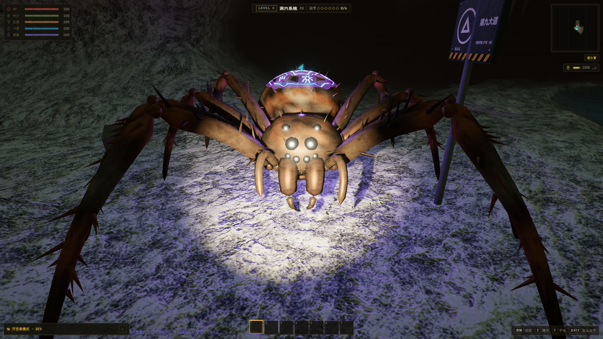
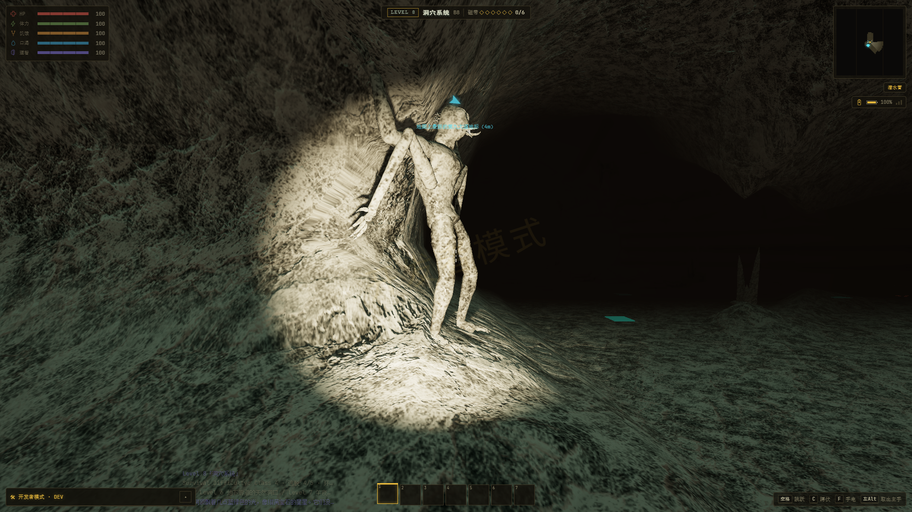
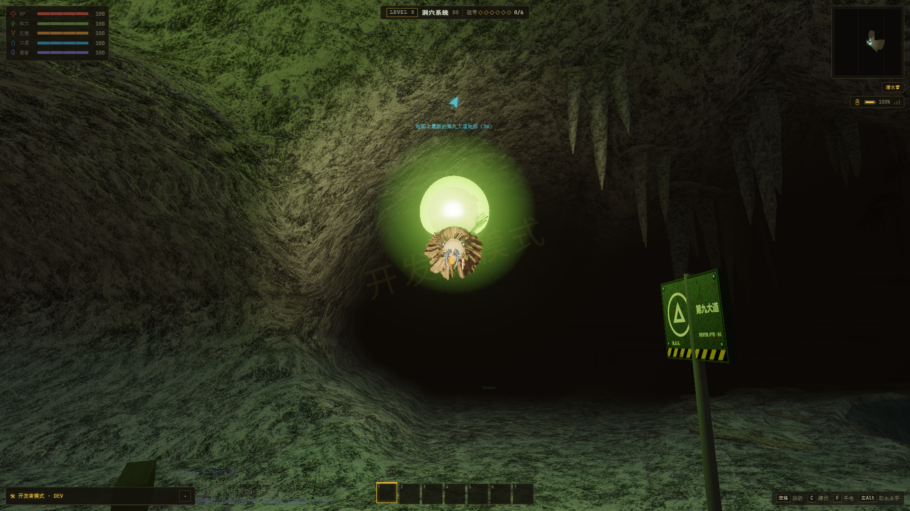
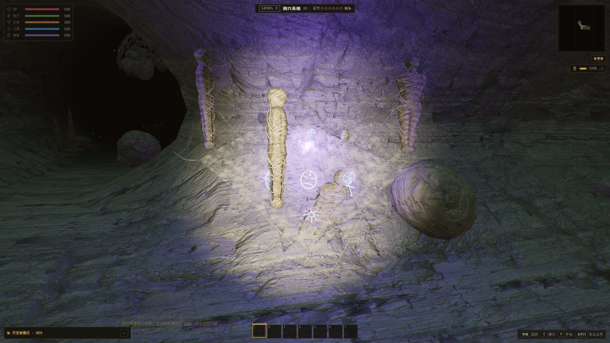
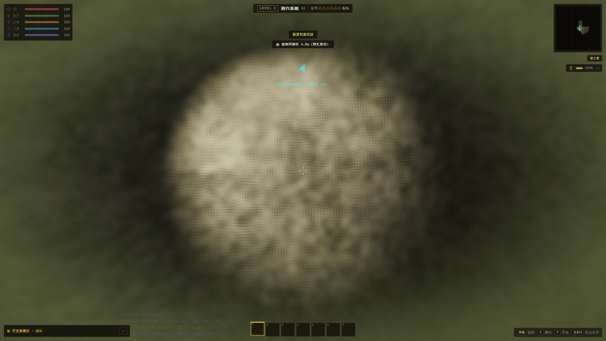

# L8 stage 3 接入与残缺者追踪验收

日期：2026-10-22。目标：原项目 E:/ZAN/backroom/app。附件来源和逐文件 SHA-256 见 [SOURCE.json](../../assets/sources/l8-stage3-20261022/SOURCE.json)，实现见 [L8-STAGE3-IMPORT.md](../../L8-STAGE3-IMPORT.md)。

## 实现

- 接入蛛形纲 17 种形态、迷彩爬行者、受眷鸟及微光向导的模型、动画、AI、生态生成和图鉴模型。
- 蛛形纲使用独立 arachnid 状态字段，保留手臂原有 ar 状态；旧形态按附件映射读取。
- 新增身体分部构建任务，按时间预算推进；实例几何和材质独立，纹理共享。高成本熔岩纹理分行准备，取消任务回收已附着部件。CPU/GPU 准备完成前维持现有实体保护期。
- 修正受眷鸟图鉴/预热只拿到空组、光晕精灵共用缓冲、视图残留和流式粒子偏移；符文纹理按有限外观缓存。
- 酸雾、蛛网视效走已有 WebGL finishing pass，HUD 保持清晰，经典模式同样有效。
- 残缺者的手动生成和浓雾活动期均使用街道绕路追踪。离场仍依照浓雾机制。攻击结束必定释放、回到追踪并冷却；免死时不错误增长，之后可再次攻击。

## 自动检查

| 命令 | 结果 |
|---|---|
| check:camo | 通过 |
| check:arachnid | 通过 |
| check:curabitur | 通过 |
| check:l8-resources | 通过 |
| check:mangled-pursuit | 通过 |
| check:watch | 通过 |
| check:l9-fog | 通过 |
| check:mangled-legs | 通过 |
| check:entity-forms | 通过 |
| check:entity-preparation | 通过 |
| check:moth-watch-resources | 通过 |
| check:burster | 通过 |
| check:lightguide | 通过 |
| check-l8-surfaces.ts | 28,792 项精确对照通过 |
| npm run build | 通过；保留现有大包体提示 |

四组附件机制检查分别为 66/66、53/53、53/53、67/67；变种注册 252 项、49 个子形态、10 个父实体。资源检查 4,526 项，23 组外观（包含带母蛛的群体），覆盖有限几何/法线/有纹理表面的 UV、动画姿态、精灵和实例缓冲独立性、共享纹理、释放隔离与构建取消。普通无纹理鬃毛采用顶点色和世界坐标伪装，无须伪造无用途的 UV。

逐项输出见 checks.json、check-*.log、resources.json。新增脚本命令：

~~~powershell
npm run check:arachnid
npm run check:camo
npm run check:curabitur
npm run check:lightguide
npm run check:l8-resources
npm run check:mangled-pursuit
npm run check:watch
npm run check:l9-fog
npm run check:mangled-legs
npm run check:entity-forms
npm run check:entity-preparation
npm run check:moth-watch-resources
npm run check:burster
npm run build
~~~

## 实际游戏

原生 RTX 4060 Laptop GPU，ANGLE Direct3D11；1920×1080、像素比 1、原生分辨率、关闭动态分辨率。Chrome 使用 --headless=new，独立临时用户目录、CDP 端口和 Vite 端口；仅连接本轮创建的进程。测试使用内存存档，不覆盖玩家存档。

- [真实光影最终记录](final-realistic/result.json)：全部 17 种蛛形纲、两性受眷鸟、爬行者及向导逐个显示；爬行者循声显形、鸟活动、发光物品使用、酸雾/蛛网视效、真实程序化蛛巢、离开场景清理，以及残缺者两轮攻击均通过。
- [经典模式最终记录](final-classic/result.json)：相同完整流程，87 项断言通过。三轮固定区块窗口回收使用相同 14 个地形区块，几何和纹理数量分别保持 356 / 63。
- 真实模式固定窗口三轮均为 384 个几何体、66 张纹理、相同 14 个地形区块，见 [独立记录](resource-realistic/result.json)。早一轮真实模式的跨层回收还在后台构建不同数量区块，其原始数字保留在 final-realistic/result.json；不能把它当作严格固定场景资源对照。
- 两种模式中，手动生成的残缺者均自然追近、预警、抓取和同化；玩家在开发者无敌下幸存后释放，冷却后再次攻击。正常死亡与挣脱路径由 check:watch 等回归覆盖，未改为非致命同化。
- 控制台/运行时异常和失败请求均为 0；所用浏览器、服务器和临时 profile 均已清理，证据在每次 result.json 的 command / pids / cleanup 字段。

L4 → L8 的本机近场可玩等待约真实 5.30 秒、经典 2.94 秒，表示本轮固定种子及画质下的实跑，未作为所有设备/所有生态的上限。真实模式单件可见前准备约 32–651ms，经典约 33–624ms（readyMs），500ms 截图稳定等待单独计入 settledMs；准备过程分帧完成，实体在此期间不能发动攻击。

复现：

~~~powershell
npm run verify:l8-stage3-mangled -- --label=review-realistic
npm run verify:l8-stage3-mangled -- --classic --label=review-classic
npm run verify:l8-stage3-mangled -- --resources-only --label=review-resources
~~~

种子 424242；入口由 verifier/l4-melee-wrangler-app.tsx 启动实际 App，再通过本轮 helper 进入 L8/L9。截图与位置、模型包围盒、资源数保存在各 result.json 中。

## 旧生态脚本的已知差异

原有 scripts/smoke-l8-ecology.mts 未通过，不计入通过项。通过 esbuild 只读插件把 infiniteL8.ts 替换为本轮之前的精确备份，确认原来已有 6 项失败：旧 hive 区域断言、旧新莫维勒鸟/飞蛾/蜘蛛配额、旧总实体限额和原地形开阔率上限。后者当前采样为 0.955，而旧上限是 0.94；28,792 项表面精确回归确认本轮地形函数没有变化。

本轮附件另外允许多维之路野外蛛形纲，并把新莫维勒从仅普通蜘蛛扩展到新变种，因此增加 2 项与旧规则的差异。保留附件规则及旧脚本原文，详见 legacy-ecology-comparison.json 和 check-l8-ecology-before.log / check-l8-ecology.log，不以修改断言掩盖差异。

未开展 Android 真机、完整星群压力场景或全层级五轮帧时间验收；这里的原生 GPU 实跑与资源对照不作这些性能结论。
