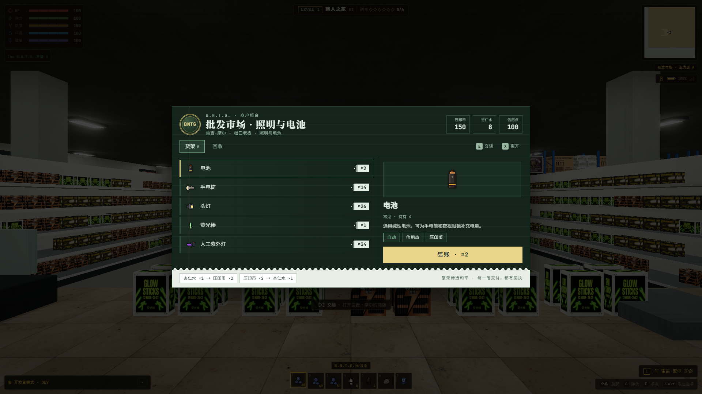

# NPC 对话与商店 UI 接入（2026-10-25）

已将用户提供的 `backroom-shop-ui.zip` 合入原工程 `E:\ZAN\backroom`，保留当前商人之家通路、门框、枪械、人物及存档改动。采用补丁逐处合并；`package.json` 只增加检查命令，其余配置与导入前逐项一致。来源完整文件、原始说明和补丁存于 `incoming/`，导入前源文件存于 `before/`；文件 SHA256 见 [接入清单](import-manifest.json)。包内旧验收截图与报告作为来源材料保存，没有覆盖本项目已有报告。

## 已接入

- NPC 底部对话框、真实人物模型预览、逐字台词、数字 1–9 选项及独立交易按钮。
- 默认 **E 交谈、X 交易**；商店内 E 返回交谈，X/Esc 离开，Tab 切货架/回收，上下键选择、Enter 成交。显示与输入均支持玩家改绑；移动端复用情境“交易”按钮。
- 七套阵营样式：B.N.T.G. 账本收银台、M.E.G. 军需领用单、首都百货、阿丽亚娜处方单、Tom 黑板菜单、家常酒店客房服务、原住民纸板摊。首都样式保留为预备皮肤，没有新增首都商人。
- 逐格、按数量出售。商品/其他物品及声望决定回收比例，医疗箱/近战武器按剩余使用情况折价；货币、钥匙、任务物品不收。B.N.T.G. 可收压印币或入账信用点，ATM 明细显示“商户回收”。
- 各团体原有货币、兑换、换物、折扣与银行账户继续使用；交易通过暂存背包提交，失败时不扣物品或余额。当前 v1 存档支持新增 `sale` 记录。
- 按包内更新下架石卡祖笛的市场售价、商人库存和售卖台词；玩家已持有的笛子保留，使用机制不变。

## 接入时修正

1. 原 Ferren tick 无条件清空特殊键点按，吞掉世界中的交易输入。改为只有实际处理 Ferren 交互时才消费，原有摸摸/盖被子/打扰回归通过。
2. 双击货品按该行执行，不再读旧选中行；键盘选中索引限制在有效范围，自动滚动到当前行。
3. 台词点击补全时取消未完成动画，防止下一帧退回半句；支持键盘补全。
4. 短屏商品详情独立滚动，结账按钮留在滚动区外，避免被页脚挡住；补齐焦点恢复、输入框热键保护及自定义键位提示。

没有修改联机、`app-lite` 或另一个 GitHub 副本。本轮没有新增运行时图片/模型；主题纹理由包内 CSS 生成，字体沿原 HTML 的 Google Fonts 路径加入并保留系统回退。React 检查覆盖 hook 顺序、监听清理、焦点、按键闭包、原子交易与避免在渲染期间结算。

## 截图



[实际 NPC 对话](accepted-realistic/01-real-dialog-bntg.png) · [数量回收入账](accepted-realistic/03-real-buyback-credit-receipt.png) · [ATM 回收明细](accepted-realistic/08-atm-buyback-statement.png) · [Alpha 寄存页](accepted-realistic/11-actual-alpha-warehouse.png)

[390×844 竖屏商店](accepted-realistic/06-shop-phone.png) · [844×390 横屏商店](accepted-realistic/07-shop-landscape.png) · [真实触屏入口](accepted-realistic/09-real-touch-trade.png)

主题补充预览：[B.N.T.G.](accepted-realistic/10-skin-bntg.png)、[M.E.G.](accepted-realistic/10-skin-meg.png)、[阿丽亚娜](accepted-realistic/10-skin-ariane.png)、[Tom](accepted-realistic/10-skin-tom.png)、[家常酒店](accepted-realistic/10-skin-homely.png)、[原住民](accepted-realistic/10-skin-originals.png)、[首都预备样式](accepted-realistic/10-skin-capital.png)。这些主题图使用包内独立预览页与真实组件，不作为各层级的自然 NPC 生成验证。

## 验证结果

| 检查 | 结果 |
|---|---|
| `npm run check:merchant-trade` | 44/44；含 2,556 组跨商人买卖不套利、满背包/余额上限失败回滚、共享特殊键和 v1 回收记录 |
| `npm run check:bntg-bank` | 银行、支付及原有模型检查通过 |
| `npm run check:traders-market` | 749 项通过 |
| `npm run check:traders-shops` | 1,507 项通过 |
| `npm run check:ferren` | 76 项通过 |
| `npm run build` | 通过，见 [最终构建日志](build-final.log) |
| 实际 App + 补充主题检查 | 真实/经典各 46 项通过，各 18 张截图；运行错误、请求失败均为 0 |

从正式主菜单继续存档进入商人之家，用实际准心/E/X 和 CDP 触屏进入 UI；检查购买、双击、数量回收、任务物品拒收、改绑 Z、无目标点按不锁存、大小屏按钮遮挡、ATM 和真正存档重载。Alpha 原生 NPC 的寄存和监督者页面也已打开；该额外检查通过真实引擎对话事件进入（没有声称从其当前位置成功瞄准）。未调用真实 LLM 服务，未复测所有特殊 NPC 剧情分支或 Android 真机性能。

真实/经典完整记录分别见 [真实模式](accepted-realistic/runtime.json)、[经典模式](accepted-classic/runtime.json)，包含检查项、世界设置、实际 Chrome 启动参数、端口、进程和清理结果。两轮均使用 `--headless=new`、各自的浏览器配置与独立 Vite/CDP 端口；自己创建的浏览器、服务器和临时配置均已清理。

初轮记录保留：`initial-realistic` 发现 X 被 Ferren 吞掉；`integration-realistic` 发现短横屏结账遮挡；`ui-final-realistic` 的主题检查误选了不售货的 Kat，随后改为真正的军需官「算盘」，没有为通过检查给 Kat 添加商品。最终采用 `accepted-*` 记录。

## 复现

在 `E:\ZAN\backroom\app` 运行：

```powershell
npm run check:merchant-trade
node reports/npc-shop-ui-20261025/verify.mjs --label=review-realistic
node reports/npc-shop-ui-20261025/verify.mjs --classic --label=review-classic
```

使用独立存储的种子 `424242` 存档，原生 1920×1080，纹理/阴影质量 1、场景灯上限 16，关闭动态分辨率/曝光和颗粒震动；锁定 NPC 移动和生存属性用于重复检查。窄屏为 390×844 / 844×390，另用真实 CDP touchStart/touchEnd 激活交易。源脚本为 [实际流程](app-check.mjs) 与 [独立运行器](verify.mjs)，不读写玩家已有存档或日常浏览器。

开发者也可访问 `proto-shop-ui.html?npc=suanpan&mode=shop` 等包内原型页查看主题。构建保留已有字体、PostCSS 与大 chunk 警告，本轮不作帧率/加载时间的性能结论。
