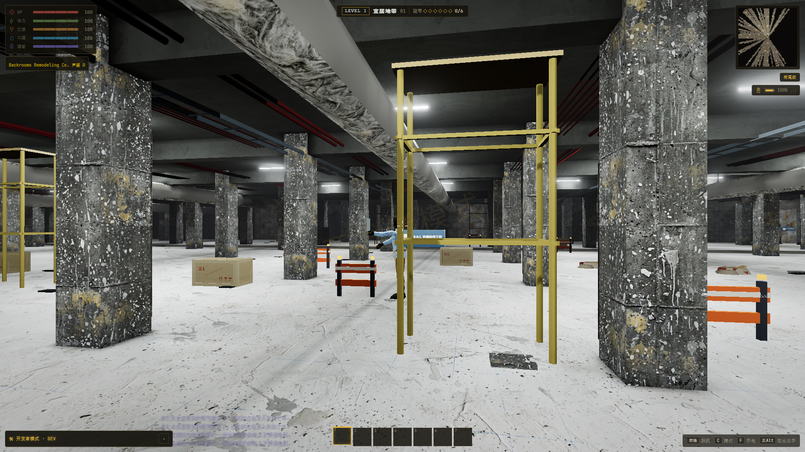
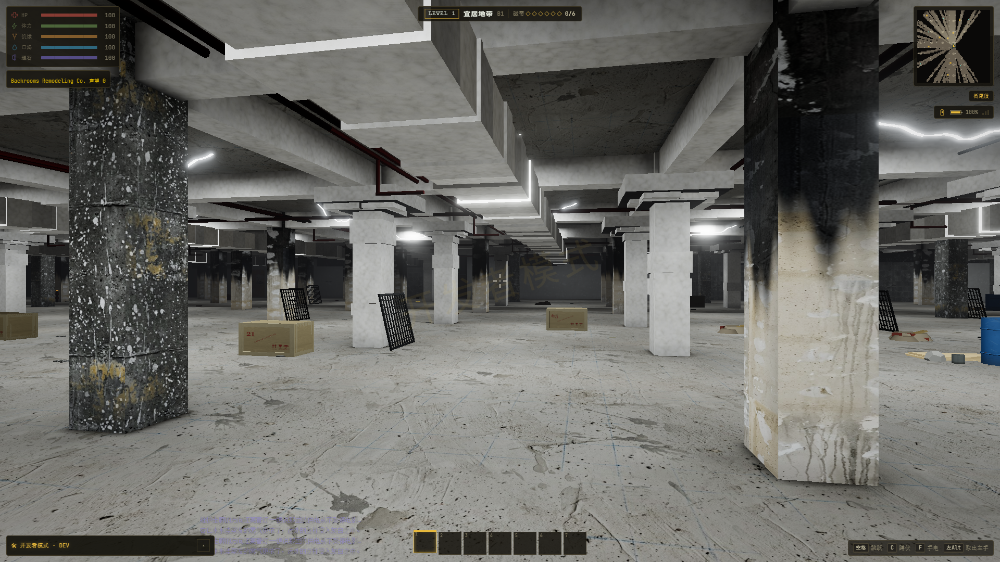
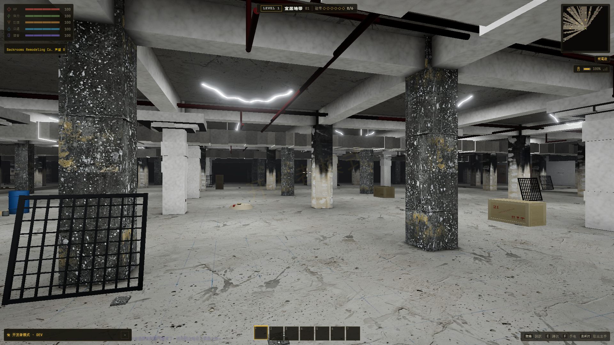
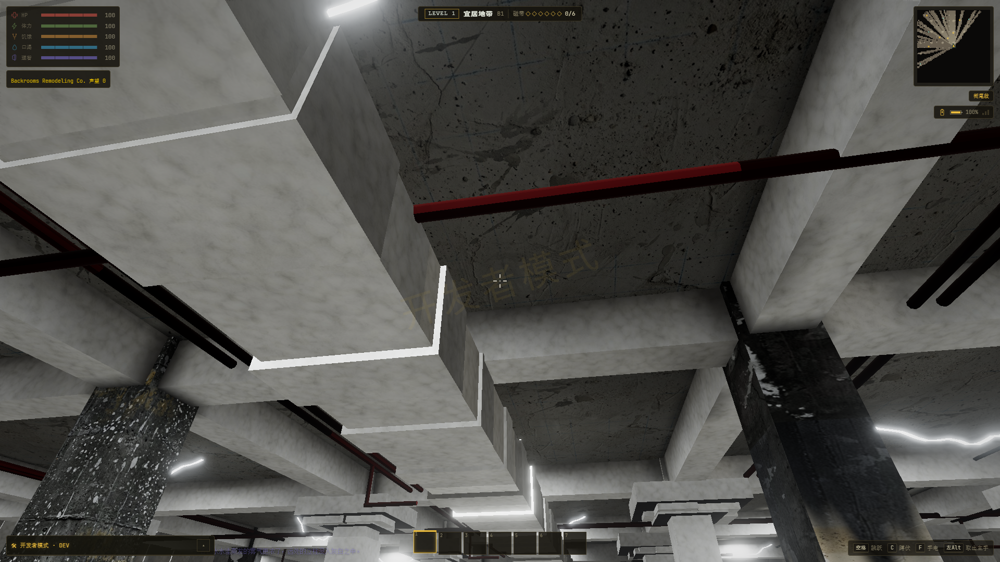

# L1 衔尾段 v3.4 接入验收

2026-10-21，原项目 `E:\ZAN\backroom`。已合入用户附件的累计 v3.2–v3.4 重制，保留原布局和此前实体、物品、界面与流式加载更新。[实现与命令](../../OUROBOROS-IMPORT.md)；[附件来源、原始说明与哈希](../../assets/sources/ouro-v34/README.md)。

## 交付

- 喷涂柱梁和矩形风管、双色柱、分段墙面图集、红色喷淋支管、松垂下照灯带、米黄木门、斜靠格栅与桶罐／胶合板材料堆均已接入。
- 新贴图逐字节来自附件；经典及真实模式均支持图集。共享混凝土法线、单 map 采样器与独立灯带几何，保留材质合批和现有资源管理。
- 减少施工道具与 B.R.C. 员工通过独立随机流筛选，避免重新掷出原有物资和风口身份。格栅候选位置不足时跳过，不迁移到走道。
- [108 个参考区块](offline/manifest.json)全部重新烘焙并发布为修订 19；建筑生成版本仍为 6，主存档仍为 v1。
- [最终生产构建](build-final.log)通过；[16 组回归](regressions.json)全部通过；[专项检查](static.json)共 137,261 项断言。
- 96 条布局基线的地面、区域、门洞和主墙柱体积保持一致；其他基础区域的建筑指纹不变。手臂 80/80、Nguithr、L1 放置／交互、离线与分步加载、模型预热、程序完成、物品缓存及实体注册回归均通过。
- [文件审计](audit.json)保留 75 份原文件备份；依赖和 lockfile 未改变，离线发布文件与本次生成文件一致。并行的 Traders 灯光遮罩单行修正已保留，没有覆盖。

## 实际 App 与性能

Chrome `--headless=new`，1920×1080，种子 `20261006`，原生分辨率、动态分辨率关闭、动态曝光关闭。设备为 NVIDIA GeForce RTX 4060 Laptop GPU / ANGLE D3D11。四个取景方向使用真实场景；性能采样前返回相同正面机位，等后台精细烘焙完成后预热，再采样五轮。

| 模式 | 单次 L1 进入 | 帧间隔中位 / P95 | 最差轮 P95 | 绘制调用中位（范围） | 三角面中位 |
| --- | ---: | ---: | ---: | ---: | ---: |
| 改前真实 | 14.66 秒 | 9.70 / 15.20 ms | 16.30 ms | 350 (350–840) | 148783 |
| 改后真实 | 7.07 秒 | 9.60 / 15.50 ms | 16.40 ms | 314 (314–559) | 136013 |
| 改后经典 | 5.16 秒 | 4.80 / 7.00 ms | 9.10 ms | 300 (300–300) | 121479 |

表中帧间隔中位和 P95 分别取五轮对应值的中位。调用范围包含按帧发生的阴影更新等额外绘制，不只报告最低一帧。原始记录：[改前](before-realistic/result.json)、[改后真实](final-realistic/result.json)、[改后经典](final-classic/result.json)。

进入时间是独立浏览器配置下的单次观测，不含标题页首次加载，也不是五轮冷启动或所有层级的性能结论。帧间隔是实际无头 App 的回调统计，未使用 GPU 计时查询，不能直接等同显示器呈现时间；本轮未验证 Android 真机。

经典和真实模式各完成六轮新格栅、材料堆与灯带的实际 GPU 准备、显示和回收。六轮空场几何／贴图／程序数一致：真实 815 / 181 / 98；经典 798 / 154 / 89。两种模式均无运行错误、游戏资源请求失败或 WebGL 上下文丢失。favicon 的 404 独立排除。

## 前后与多角度截图

下图均来自本轮实际 App，已检查材质、灯带、柱梁、格栅和材料堆；附件原图只保存在来源目录。

| 改前真实光影 | 改后真实光影 |
| --- | --- |
|  |  |

| 改后侧向 | 改后顶面 |
| --- | --- |
|  |  |

[背面](final-realistic/ouro-back.png)；[经典模式](final-classic/ouroboros-final.png)；[机位、方向、FOV 和状态](final-realistic/result.json)。

喷涂鼓包仍沿用附件的低模方体组合，近景部分端面受光与接缝偏硬；本轮不声称已与参考照片逐像素一致。灯光仍使用同一建筑数据和烘焙路径，没有背景照片或截图专用假墙。

## 复现

在 `E:\ZAN\backroom\app` 执行：

```powershell
npm run check:ouro-import
npm run check:l1-v2
npm run check:l1-d-import
npm run check:l1v3-nguithr
npm run check:l1-progressive
npm run check:l1-offline
npm run build
npm run verify:ouro-import -- --seed=20261006 --label=review-realistic
npm run verify:ouro-import -- --seed=20261006 --classic --label=review-classic
```

重新烘焙：`npm run prebake:l1-smooth -- --out reports/ouro-import-20261021/offline --reuse`。服务和调试端口自动分配，浏览器配置与存储隔离，结束或失败后自动清理；可用 `CHROME_PATH` 指定 Chrome。

## 诊断与审计

初轮失败原件保存在 [attempt-1](attempt-1/regressions.json)。修正了旧材质额外采样器／旧平板装饰的断言；小径实体密度改为使用未舍入的值比较，改前快照与最终版本都通过，均为小径 7、大厅 163（固定 20×20 区块窗口）。手臂旧存档断言补上项目既有的 `tradersWorld` 字段，生产存档实现未因本轮改变。

修改前游戏服务器现在只读取本任务备份与旧 r17 离线包。早期误用旧加载测试快照的结果保存在 `legacy-loader-baseline`，不纳入对照；`initial-*` / `preview-realistic` 是中途诊断。原始 ZIP 内的阶段截图和脚本不作为本轮通过证据。

构建保留原有字体路径、PostCSS、Browserslist 与包体警告；本轮没有通过更改这些配置屏蔽警告。[测试进程清理](cleanup.json)、[结构化结论](summary.json)。
