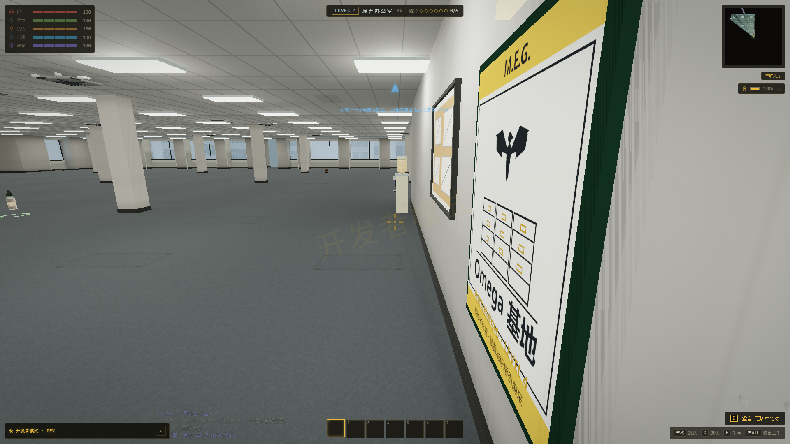
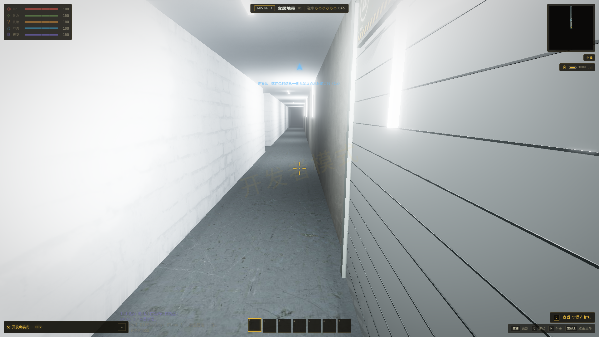
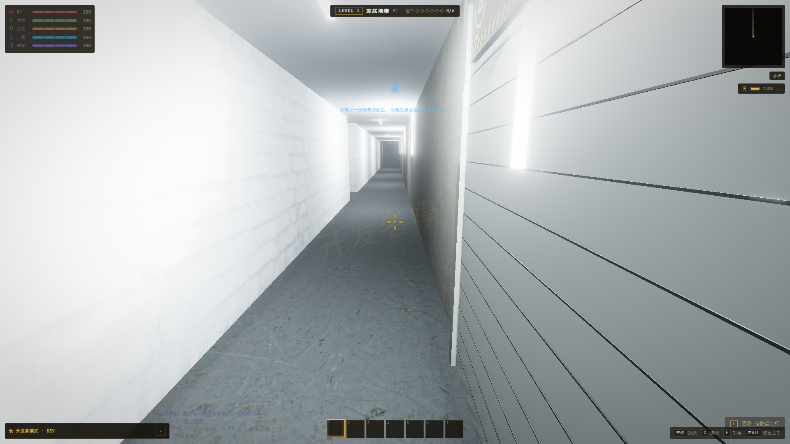

# 据点出口返回原入口（2026-11-03）

修改位置：`E:\ZAN\backroom\app`。

## 修复结果

从地标卡、开发者据点入口或 NPC 带路进入据点时，记录进入前的层级、地图种子、绝对坐标、脚下高度、楼层与视角。离开据点时，地图预热和正式生成均复用原种子，再回到同一个入口的接近位置。无限层的正负世界坐标不再误当成局部坐标；正常返程不会重新生成首访补给。

返程位置先检查真实碰撞、地面、深坑、深水和头顶净空；被占用时优先在入口附近三米内找安全站位。来源信息保留到抵达并写入自动存档，避免在出口动画中保存丢失返程信息。连续进入其他据点时保留上一段返程路径。

沿用 v1 主存档，扩展已有的可选 `career.returnAnchor`，无需重开局。更新前的旧档如果缺少地图种子或完整入口坐标，无法准确还原未记录的历史数据：优先寻找当前窗口内对应据点的实际入口，再校正附近安全落点，失效坐标回退默认入口。之后重新进入据点便会记录完整信息。

## 原因与改动

旧记录仅有层级、平面坐标和水平视角；L2、L3、L4、L5、L8 等地图在返程时会按变化后的游戏时间重新取种子。旧位置因而可能对应新地图里的墙体，再被通用安全校正移至别处。NPC 带路进入杰瑞房间的路径还未记录入口位置；出口动画开始时也会过早清除来源层级。

- `src/game/engine/outpostReturn.ts`：统一入口记录、返程种子和安全定位；兼容缺字段旧记录与连续访问。
- `src/game/engine/level.ts`：连接地标及出口进出路径、预热、正式载入和自动存档前的返程定位。
- `src/game/engine/npc.ts`：NPC 带路进入杰瑞房间时使用同一入口记录。
- `src/game/engine/career.ts`：已有存档字段使用扩展类型。
- `scripts/check-outpost-return.ts`、`verifier/outpost-return-game.ts` 与独立 CDP 启动脚本：可复现回归。

原文件备份位于 `app/.cache/outpost-return-20261103/before`。本轮核心文件哈希见 [source-manifest.json](source-manifest.json)。

## 验证

| 检查 | 结果 |
|---|---|
| 16 个注册据点的实际生成、进入、退出与原坐标／种子恢复 | 全部通过；连同其余场景共 424 项断言 |
| 无限地图远处／负坐标、存读档、退出动画中保存、连续访问、NPC 引路、上层落点 | 通过 |
| 入口被占用、深水／深坑避让、失效坐标回退、旧字段、新开局清理 | 通过 |
| 实际 App：Alpha 与 Omega 的地标 E → 前往按钮 → 出口 E → 返回 | 36 项检查通过；Omega 包含据点内存档恢复 |
| 现有生涯回归 | 36 次任务交付及读档／奖励／设施检查通过 |
| 现有 L11 旧档迁移 | 6 案例通过，完整备份与幂等通过 |
| 生产构建 | `tsc -b && vite build` 通过 |

实际游戏使用独立 profile 和随机端口的 Chrome `--headless=new`、1920×1080、真实光影、原生 RTX 4060 Laptop GPU（D3D11），并且检查真实渲染后的碰撞。无运行时或 WebGL 错误；仅未提供的 favicon 返回 404。自建浏览器、服务器和 profile 均已清理。不是 Android 真机测试。

| 实景据点 | 地图种子 | 进入前世界坐标 x/y/z | 返回世界坐标 x/y/z | 水平偏移 |
|---|---|---|---|---|
| Omega / L4 | 888123.625 | 117.5 / 33.6 / 0 | 117.5 / 33.6 / 0 | 0 米 |
| Alpha / L1 | 424242 | -18.5 / -88.9 / 0 | -18.5 / -88.9 / 0 | 0 米 |

### 实际游戏截图

Omega 进入前：



Omega 从出口返回后：


Alpha 进入前：



Alpha 从出口返回后：



[脚本检查数据](unit.json) · [实际游戏检查、坐标与错误记录](game-realistic/result.json) · [Vite 日志](game-realistic/server.log)

## 复现

在 `E:\ZAN\backroom\app` 中：

```powershell
npm run check:outpost-return
npm run check:careers
node node_modules/esbuild/bin/esbuild scripts/check-l11-migration.ts --bundle --platform=node --format=esm --outfile=.cache/check-l11-migration.mjs
node .cache/check-l11-migration.mjs
npm run verify:outpost-return
npm run build
```

浏览器脚本复用完整 App 的独立验证入口，自动操作地标和出口；不改动玩家真实存档。手动复现可从任意据点地标进入，移动／停留后使用基地出口；也可在据点内保存并继续游戏，再使用出口，均应返回进入前的位置与视角。

构建仍有项目既存的字体路径、Browserslist、PostCSS 和较大 bundle 提示；本轮没有新增渲染功能或资产依赖。此前没有种子信息的旧据点存档无法保证历史入口完全一致，完整新记录与本轮实景案例均已验证。
