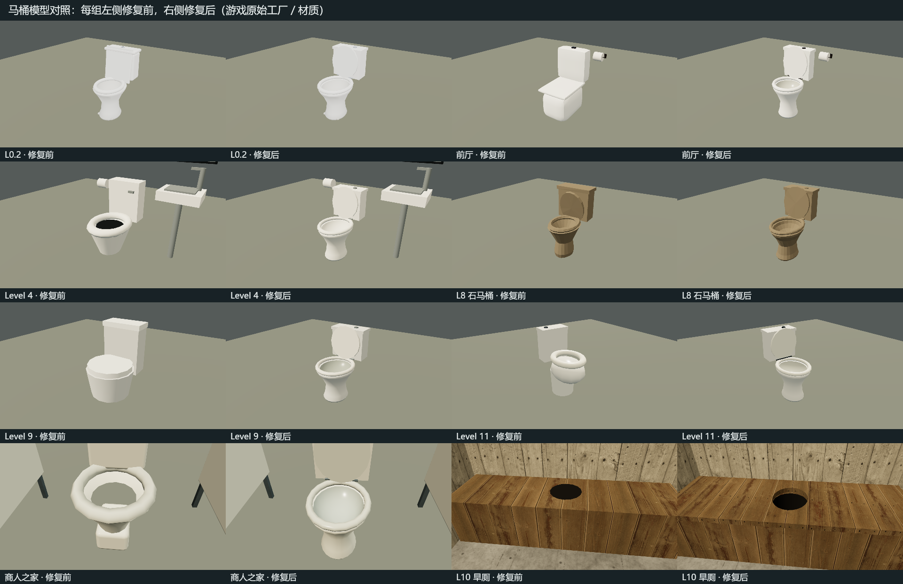
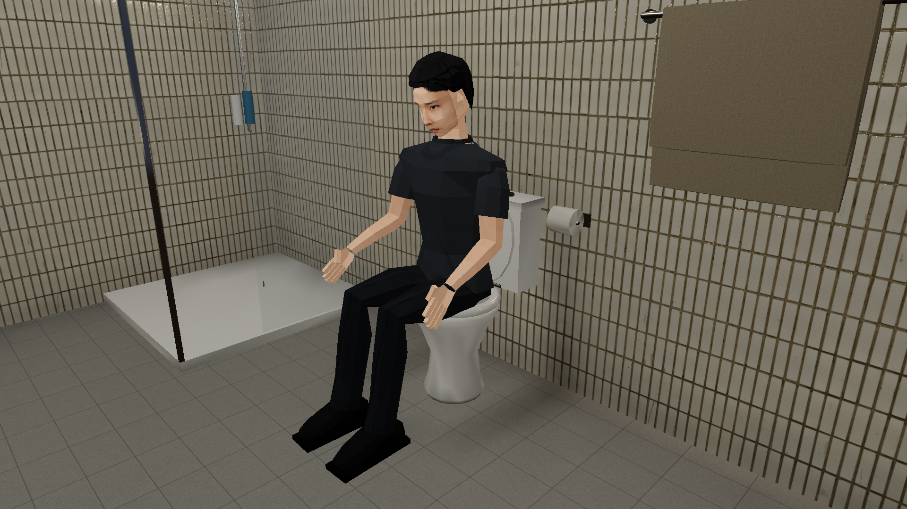
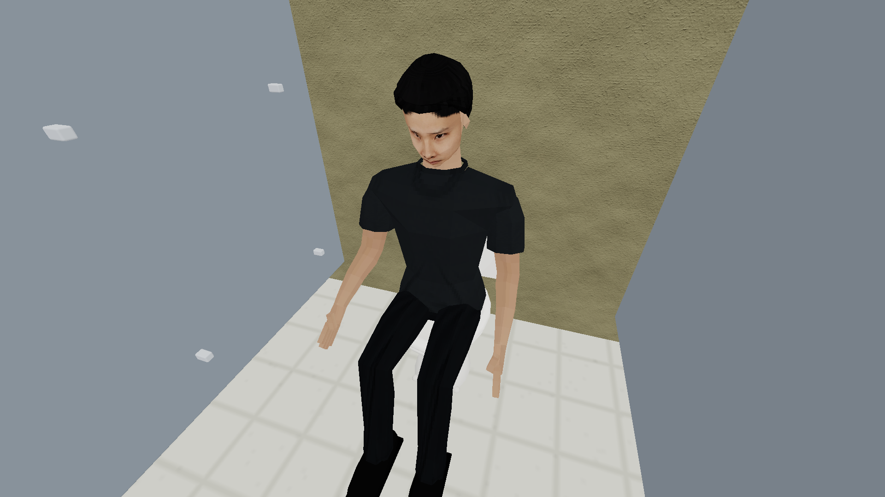

# 马桶模型与坐下交互（2026-10-30）

修改原项目 E:\ZAN\backroom\app，保留已有更新。

## 操作

- 靠近便器正面或侧面，按交互键（默认 E）坐下；复用当前玩家形象和坐下／起身动画。
- 坐稳后按特殊交互键（默认 X）发出放屁声。移动端出现「放屁」情境按钮。重绑定继续生效。
- 移动、跳跃或再次交互可起身；起身后撤去放屁动作。普通椅子和小便器不会获得这个动作。
- 声音约 0.7 秒，走现有音效总线，服从音量／静音；1.1 秒播放间隔，点按消费，不以按住状态循环播放。

## 建模检查与修正

| 场景 | 发现的问题与修正 |
|---|---|
| 前厅 | 原便盆和盖板是实心圆角块；改为中空瓷盆、真实椭圆座圈和竖起的盖板，按卫生间占地使用紧凑规格 |
| L0.2 | 延续此前已修好的内盆，统一座圈、水箱和铰链尺寸；保留角阀、编织软管和螺栓 |
| L4 | 封口圆柱下方悬空，用黑圆片表现盆口；补齐底座、中空内壁、座盖和水箱连接 |
| L8 石乐器洞 | 保留粗糙石质、原洞面贴合与单网格；统一盆口和盖板连接，座位从实际贴地矩阵读取 |
| L9 | 上沿被整片圆柱盖住；换为开放便盆并正确应用原有旋转，保留偏旧色调和稍宽体型 |
| L11 | 原球形碗体、座圈缩放和高度不一致；用共同的连续内外轮廓，适配城市家具朝 -Z 的约定 |
| 商人之家 | 原盆体下端未封合、座圈悬起；补齐落地基座、盆内和铰链，保留隔间／卷纸与原有材质烘焙 |
| L10 旱厕 | 黑圆片覆盖实心木凳；改为穿透木板的真实便孔、空心框架和凹入内筒，修正背墙净空与内部组旋转 |

共同瓷便器核心 1,068 三角面、最多四组表面，按各场景原有工厂合批。几何由实例独立持有，源形状和现有贴图共享；L8 仍合为单个石质网格。没有新增贴图下载、灯光或后处理。

坐姿使用显式便器标记和座面坐标；标准座面约 0.447 米、木坐凳 0.46 米。场景旋转、无限地图重定位和 L8 洞面高度均参与坐标换算。起身与存档继续使用有身体净空的安全落点；厕所隔板和旱厕外墙不能作为坐入路径穿过。

## 截图与实际游戏

上图为原始游戏工厂／材质的单件对照，用同一固定测试机位。商人之家在真实洗手间坐标调用生产 bakeTradersProp 烘焙后移至比较台，使用内部近景；它与其他物件的机位不同。

[第一人称与特殊交互提示](l02-view-realistic/firstPerson.png) · [触控按钮与发声](final-realistic/soundThree.png) · [音效样本](fart-preview.wav)。

实际 App、原生 RTX 4060 Laptop GPU / D3D11、Chrome headless=new，桌面 1920×1080、DPR 1、贴图质量 2；L0.2 固定种子 20261025，前厅按其既有固定家居布局。使用独立内存存档、端口和临时浏览器 profile。

- [真实光影结果](final-realistic/result.json)：286 项检查通过。
- [经典光影结果](final-classic/result.json)：286 项检查通过。
- 每种模式包含七类便器×四个方向的可坐、实际盆口射线对齐、起身和安全存档位置检查；前厅使用实际生成家具另测。
- 在真实生成的 L0.2／前厅用键盘 E 坐下、X 发声、E 起身。原生 AudioContext 捕获到四次 0.7 秒音效：短间隔重复键被抑制、稍后可再按、触控可发声、起身后不会发声。
- 844×390 触控模拟验证了现有移动端「放屁」按钮；这是桌面模拟，不是 Android 真机性能结论。
- 无 JavaScript／GPU 错误；非成功请求只有 favicon.ico。额外的隔间内机位见 [真实](l02-view-realistic/result.json)／[经典](l02-view-classic/result.json)，商人之家烘焙近景见 [真实](traders-realistic/result.json)／[经典](traders-classic/result.json)。

## 自动回归

[命令与退出码](checks.json)：

- 马桶专项 155 项：有限顶点／法线／UV、真实盆内与旱厕穿孔、座圈位置、几何独立释放、三种采样率和九组音效波形、音频源／增益节点释放。
- 既有坐姿 310 项、L0.2 装饰 1,100 项、400 种子 L0.2 机制 30,940 项、前厅 v2 230 项均通过。
- L11 模型（32 类建筑、108 类装饰）及小小／L8 石乐器相关 87 项检查通过。
- [生产构建](build.log)通过；保留已有字体、PostCSS、动态／静态导入和包体提示。

## 复现

在原项目 app 目录执行：

~~~powershell
npm run check:toilets
npm run check:seating
npm run check:l02-props
npm run check:l02-round5
npm run check:foyer-v2
npm run check:l11-meshes
npm run check:tiny
npm run build
npm run verify:toilets -- --label=repro-realistic
npm run verify:toilets -- --classic --label=repro-classic
node scripts/toilets-gallery.mjs
~~~

修复前模型比较另加 --baseline（读取 .cache/toilets-20261030/before，只覆盖本轮修改前的模型源码）。原始比较见 [before-realistic](before-realistic/result.json)；早期调试结果保留，最终功能验收以 final-realistic／final-classic 为准。

新增几何和音效均为项目内程序生成；沿用场景原有贴图与许可，无新增第三方素材。主存档格式、物品／属性结算保持原实现。文件哈希见 [source-files.json](source-files.json)，补丁相对本轮初始备份见 [changes.patch](changes.patch)。
