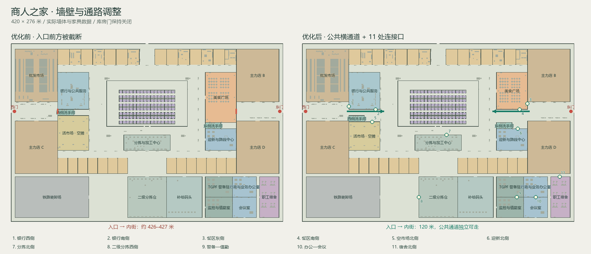

# 商人之家墙壁、通路与门框修正（2026-10-24）

已在原工程 `E:\ZAN\backroom` 完成公共动线和房间连接调整，并修正新门框与墙裙/腰线的穿插。

## 主要问题与完成方案

原东西入口正前方分别被银行/洗手间/空市场，以及餐区的墙截断。各大区只有一个开口；可走路线存在，但经常必须沿外围长距离折返。办公与会议室虽相邻，却要经楼后绕行。

现在从两侧大厅可独立走入内侧步行街，公共交通不需要穿过银行或餐厅。西侧洗手间南移 9.6 米，空市场北界相应后移，空摊位仍保留九个；餐区南界北移至与银行相同的轴线，现有 64 张餐桌全部保留。新增 11 个固定开放的连接口，使公共服务形成回环，分拣、办公和值勤区可直接互通。



| 编号 | 连接 | 名义洞宽 | 世界中心坐标 |
|---|---|---|---|
| 1 | 银行 · 西门大厅 | 3.2 m | (76, 101.5) |
| 2 | 银行 · 公共回廊 | 3.6 m | (117, 106) |
| 3 | 美食广场 · 东门大厅 | 4.2 m | (352, 97) |
| 4 | 美食广场 · 迎新回廊 | 3.6 m | (340, 106) |
| 5 | 活市场 · 西门回廊 | 4.2 m | (112, 125.2) |
| 6 | 迎新中心 · 公共回廊 | 3.6 m | (337, 136) |
| 7 | 分拣中心 · 保险库交接广场 | 4.8 m | (227, 145.6) |
| 8 | 二级分拣 · 装卸区 | 4.8 m | (184, 242.2) |
| 9 | 警备 · 值勤室 | 2.4 m | (335.5, 242.2) |
| 10 | 业务办公室 · 会议室 | 3 m | (365, 242.2) |
| 11 | 宿舍 · 后勤回廊 | 2.4 m | (402, 210.4) |

两条公共横通道的中心线为 `y=109`，主通行带宽四米；家具和柱体避让这条带以及各门洞两侧的缓冲。新门洞使用石材或金属包边，和已有建筑一起按材质合批；没有新增门扇交互、业务入口、实时灯光或全场导航计算。

## 路线对照

相同种子 `424242`、同一批起终点、全部实际家具、玩家半径 0.32 米、0.5 米四邻接网格；128 个库门保持关闭。以下是可走的网格路径长度，包含家具绕行，不能当作对角平滑行走的精确距离。

| 采样路线 | 修改前 | 修改后 | 缩短 |
|---|---|---|---|
| 西门 → 西横街 | 427 m | 120 m | 71.9% |
| 东门 → 东横街 | 426 m | 120 m | 71.8% |
| 西门 → 银行南侧 | 473 m | 113 m | 76.1% |
| 东门 → 餐区东侧 | 511 m | 70 m | 86.3% |
| 西门 → 空市场 | 423 m | 124 m | 70.7% |
| 餐区 → 迎新中心 | 177.5 m | 18.5 m | 89.6% |
| 保险库交接区 → 分拣 | 124 m | 9 m | 92.7% |
| 装卸区 → 二级分拣 | 119 m | 10 m | 91.6% |
| 警备 → 值勤 | 152.5 m | 6.5 m | 95.7% |
| 业务办公 → 会议室 | 168.5 m | 6.5 m | 96.1% |
| 后勤走廊 → 宿舍 | 90.5 m | 6.5 m | 92.8% |

原始路径及取点存于 [修改前](before-routes.json)、[修改后](after-routes.json)；布局/家具数据为 `before-layout.json` 和 `after-layout.json`。图由 `draw-plan.py` 从这些真实数据生成，不是游戏中的假墙或截图替代。

## 门框穿插修复

墙面石材墙裙、金属腰线及顶线原来会在墙段两端额外扩展 12–20 mm，进入门洞，造成金属门框上露出石材/金色条纹，并产生同平面闪边。新增 `tradersWallFinishBounds()`，让这些端头在实际开口边界收口；门框包边略盖住结构端面，顶边不与门楣底面共面。采用实际几何处理，未通过取消深度检测或额外贴图遮盖。

- [修复前门框](realistic-final/10-office_meeting.png) → [修复后正面](trim-realistic-final/10-office_meeting.png)。
- [金属框近距离斜视](trim-realistic-final/12-office_meeting-trim-close.png)、[石材框近距离斜视](trim-realistic-final/12-bank_west-trim-close.png)。
- [背面示例](trim-classic-final/11-secondary_west-back.png)。

## 保留与实现

- 场地仍为 420×276 米，28 个编号铺位、四个主力店和 128 间库房，现有六家店及市场 A、ATM、试射位和 Ferren 区域保留。
- 189 个持久 NPC 身份、154 个岗位、42 个坐姿岗位及附近最多 32 人不变。既有检查确认岗位、坐姿及会议椅朝向仍有效。
- 世界/布局版本仍为 4，主存档仍为 v1。门和搜刮使用原身份，移动隔墙没有重置存档；原玩家挤出求解在三处旧隔墙落点通过就地恢复检查，位移少于一米。
- 新通路数据同用于墙/碰撞、地图和静态光照；共享墙两侧同时切洞。可见区块采样补充新开口方向，已有分批加载与回收窗口保留。仅保存轻量全场布局，进入时不实例化全据点。
- 保险库数量、闭门碰撞和权限保留；新增连接口不通入库房、店铺或未开通的交通区域。
- 本轮修改 `app` 和根 `info.md`；没有新增运行时图像/模型资产，材质复用已有来源记录。未修改另一个 GitHub 副本，联机仍冻结。

## 验证结果

| 检查 | 结果 |
|---|---|
| `npm run check:traders-circulation` | 3,216 个带家具身体采样、11 门洞、两条完整公共带、门框/墙裙端头、128 闭门及旧隔墙恢复通过 |
| `npm run check:traders-keep` | 全房间可达、确定性、分批生成、门/搜刮恢复和人数限制通过 |
| `npm run check:traders-fitout` | 154 岗位 / 42 坐姿，60 秒岗位模拟，通过 |
| `npm run check:traders-dressing` | 贴墙装饰、家具、会议椅、吊顶/探针检查通过 |
| `npm run check:traders-visibility` | 门洞可见性和关闭库房准备规则通过 |
| `npm run check:traders-gates` | 既有大门和服务工位通过 |
| `npm run check:traders-shops` / `check:traders-market` | 现有店铺/试射位和市场检查通过 |
| 真实游戏 | 真实/经典各 42 项，84 项通过；各 27 张最终截图 |
| `npm run build` | 通过，见 [最终构建日志](build-final.log) |

运行中的正式游戏由主菜单继续存档进入商人之家，逐一从门前步行穿过、倒退返回；两条大厅公共带的原封堵平面也实际行走通过，检查原版地图仍不生成全场细节。每种模式另外拍摄所有新洞的背面及两种材质的近景。终轮浏览器错误和请求失败均为零；自己的无头浏览器、临时配置与独立服务器均已关闭/删除。

首次真实模式在后台尚有构建任务时，用固定 1.6 秒墙钟时间判断位移不足；改为等待实际穿过平面，并保留超时与双向检查。该初始记录另存于 `after-realistic/`，最终验收采用 `trim-*-final/`，没有改动游戏移动速度来通过测试。

验证设备为 RTX 4060 Laptop、ANGLE/Direct3D11、1920×1080；本轮未重新进行全层级帧率压力或 Android 真机测试。资源仍按区块准备，墙段从 871 增至 893。构建现有字体、PostCSS 和大 chunk 警告保留，详见日志。

## 复现

在 `E:\ZAN\backroom\app` 运行：

```powershell
npm run check:traders-circulation
node reports/traders-circulation-20261024/verify.mjs --label=review-realistic
node reports/traders-circulation-20261024/verify.mjs --classic --label=review-classic
```

脚本创建自己独立的端口和 Chrome `--headless=new` 配置；不会读写日常浏览器或玩家已有存档。测试种子 `424242`，原生 1080p、纹理质量 1、阴影 1、灯上限 16，关闭动态分辨率/曝光及颗粒震动。按门洞中心的负法线方向 2.8 米处取正面，穿过后回望取背面；准确坐标及行走起终点在各 `runtime.json`。NPC/属性锁定只用于测试重现。

[真实模式完整记录](trim-realistic-final/runtime.json) · [经典模式完整记录](trim-classic-final/runtime.json) · [实际原版地图](trim-realistic-final/20-map-overview.png) · [文件摘要](changes.json)
