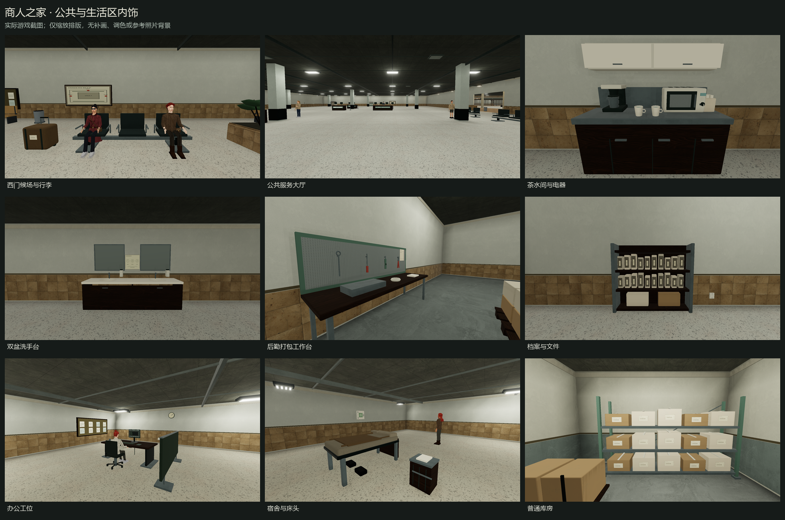
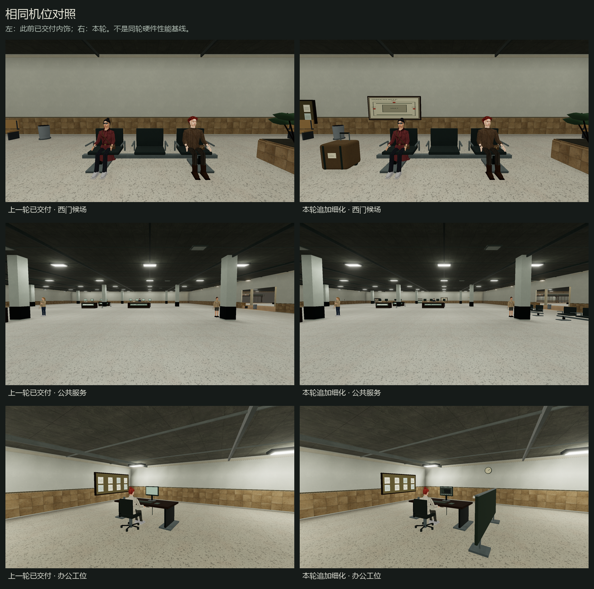
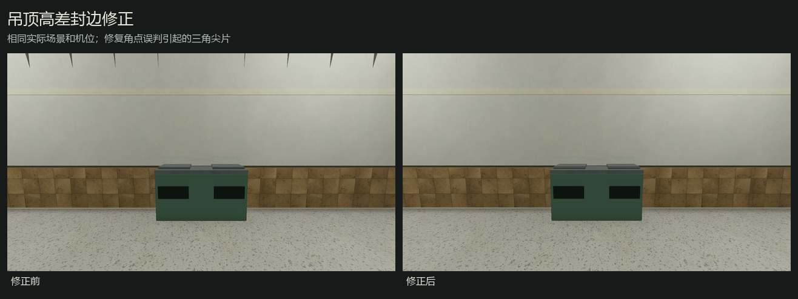

# 商人之家公共与生活区追加细化 · 2026-10-21

本轮已在原项目 E:/ZAN/backroom/app 加入 **224 组**内饰布置，并细化 **289 件**库房、后勤及住宿家具。贴墙设施、桌面小物、坐姿/屏幕朝向和吊顶过渡均做了数据与实际画面检查。修改保留 420×276 米单层规划和原有业务、权限、物品及存档。

[实现说明](../../TRADERS-KEEP-REMAKE.md) · [来源与许可](../../TRADERS-KEEP-SOURCES.md) · [实际游戏完整结果](traders-dressing-verified-20261021/runtime.json) · [经典取景结果](traders-dressing-classic-verified-20261021/runtime.json) · [机器可读摘要](dressing-summary-20261021.json)

## 内饰安排

| 空间 | 本轮具体变化 |
|---|---|
| 三处入口、中庭与公共服务 | 靠墙导览、公共电话、挂钟、消防柜/灭火器/卷管、急救柜、取号机、入口地垫、行李箱和补充排椅。 |
| 银行、办公室、会议与警备 | 档案架、复印机及纸盒、邮件格柜、茶水台、25 个工位隔屏、白板、电话、插座、暖气、衣帽架与休息软座；监控墙有地图/值班/记录分区，会议椅面向桌子。 |
| 美食广场 | 两处餐盘回收台、少量杯具/纸本、茶水及卫生/消防设施；就餐和回收动线留出净空。 |
| 两处分拣中心 | 打包工作台、真实比例穿孔工具板、扳手/螺丝刀/刀具/钳子、胶带、工单、邮件格柜、清洁推车和设备柜。 |
| 两处卫生间 | 六个隔间、四组双盆台、四个小便器及清洁车。实际台面开孔、盆体/排水、龙头、皂液、镜框和落地马桶。 |
| 宿舍 | 24 套床架/床垫/枕头/毯子/床下鞋，12 个床头柜，以及行李、值班和茶水设施。 |
| 库房与后勤存储 | 117 个带横撑/层板/标签箱件的货架，119 组带叉孔/木条/绑带的托盘，28 个带保温盖/把手/通风/温度面板的冷藏箱。 |

28 个沿街铺位、四个主力店维持空铺；未开通铁路与补给码头未新增内饰或业务。新增装饰没有挂接无意义的“贸易设施”交互。



## 模型、贴图与摆放修正

- 墙挂设施依据完整实墙定位，检查墙段身份、正面法线和 8 mm 安装间距。三处缺少完整背墙的候选跳过，未强行塞入门洞。
- 旋转家具保留局部宽深，生成对应的世界包围盒与分件碰撞。新增家具避让实际人物岗位及路线。
- 会议椅、仓储正面、办公屏幕与柜台终端分别朝向使用者；包裹推车轮轴、电话键盘/线缆、时钟朝向同步检查。
- 纸本、文件夹、床毯、杯子和胶带落在真实支撑面。杯具具有内壁，液面低于杯口；盆台有实际圆孔和空壳柜体，不用填满的盒子穿过盆体。
- 微波炉使用门框/网孔/把手/旋钮，咖啡机有滤斗/杯壶/底座；工具板与微波炉孔纹重复到物理尺度，并合入同一材质批次。
- 复用项目已有 CC0 水磨石、钢材、木材、纸板及织物扫描。新增 1024² 颜色与各 512² 法线/粗糙度共享图集，含导览、消防、值班、档案、终端、条码等 16 格，保留扩边和 mipmap。
- 图集由可重现 Pillow 脚本绘制，没有外部位图或 AI 图像步骤；印刷表面用平法线。具体作者/许可、资产路径与 SHA-256 见[图集记录](../../public/textures/traders/DRESSING-SOURCES.md)及[扫描材质来源](../../TRADERS-KEEP-SOURCES.md)。
- 镜面为低成本环境反射近似；没有新增实时镜面捕获、折射、场景灯或后处理通道。



左图是此前已交付版本的实际取景，右图为本轮相同种子/机位；仅作视觉对照，不作为同设备同轮性能基线。

## 尖片与远处露空

实际画面复核发现餐盘回收区上方的黑色尖片。几何射线和法线诊断确认：吊顶高差封边在网格端点读到了侧方矮顶区域，生成了本不应存在的三角片，且封边法线与绕序不一致。现在按边段内部判断邻区，只闭合真实高差；补充回归断言，并在原机位重拍。法线图仅用于诊断，没有用作验收材质。



建筑与家具现在由独立队列准备：真实墙门可见性优先决定建筑就绪，近处家具随后完成，避免远墙被前一区块家具构建阻塞。查询只对轻量二维墙门数据工作，不渲染假墙，也不把尚未加载当作无遮挡。

关闭库房的内部装饰在距门 4 米、开门或玩家已经在室内时准备；稳定 ID、物理碰撞、物品与权限记录仍存在。新批次预热完成后整体替换，保留原门动画进度。卷帘上升高度按自身门洞计算，门板留在卷筒附近，实际净高超过 2.1 米。

## 人物、功能与兼容检查

保持六名联系人及 154 名职业居民、42 个坐姿岗位；附近活动上限 32。固定岗位人物在实际取景中没有漂离 home 点，数据检查另外覆盖通路、墙体/家具冲突及 60 秒活动。新增设施避让这些岗位和巡逻路线。

完整真实 UI 检查共 **39 项通过**，包含首次西门进入、各区安全传送、卷帘交互/碰撞/动画、地图拖动与右键传送、远处区块回收、重复往返、带物品/仓库/任务进度的存读档、旧布局迁移、返回口和新开局清理。画质检查另外覆盖经典/真实、高低纹理、过期构建取消、隐藏碰撞代理与资源释放。详细断言保存在完整结果 JSON 中。

模型审计通过：有限几何/UV、旋转尺寸、正面朝向、完整背墙、独立几何/共享材质寿命、盆孔实际射线、卷帘净高、方向探针插值及吊顶高差。本轮新增物件的审计冲突为 0；这不代表人工检查了每个随机人物的每一帧。

## 最终取景参数

实际生产 Engine/Renderer，层级 102；渲染夹具种子 424242，1920×1080、DPR 1、原生分辨率，垂直 FOV 72°、正常眼高。yaw/pitch 为弧度；x/y 为游戏平面坐标。关闭颗粒/晃动，固定岗位按真实 NPC 更新；仅在验收夹具里提前打开两个待拍库门，不修改玩家存档。真实 UI 流程另使用该开局衍生的地图种子 437604，记录在结果中。

| 取景 | x, y | yaw / pitch | 实际原图 |
|---|---|---|---|
| 西门候场与行李 | 21.00, 101.00 | 0.000 / -0.100 | [真实](traders-dressing-verified-20261021/west-waiting.png) · [经典](traders-dressing-classic-verified-20261021/west-waiting.png) |
| 入口导览 | 18.00, 99.30 | 0.000 / 0.030 | [真实](traders-dressing-verified-20261021/arrival-guide.png) · [经典](traders-dressing-classic-verified-20261021/arrival-guide.png) |
| 公共服务大厅 | 108.00, 94.00 | 0.000 / -0.040 | [真实](traders-dressing-verified-20261021/bank-layout.png) · [经典](traders-dressing-classic-verified-20261021/bank-layout.png) |
| 档案与文件 | 81.00, 51.80 | 0.000 / -0.080 | [真实](traders-dressing-verified-20261021/archive-detail.png) · [经典](traders-dressing-classic-verified-20261021/archive-detail.png) |
| 复印和邮件 | 89.00, 51.30 | 0.000 / -0.120 | [真实](traders-dressing-verified-20261021/copy-detail.png) · [经典](traders-dressing-classic-verified-20261021/copy-detail.png) |
| 茶水间与电器 | 83.00, 103.80 | 3.142 / -0.230 | [真实](traders-dressing-verified-20261021/tea-detail.png) · [经典](traders-dressing-classic-verified-20261021/tea-detail.png) |
| 美食广场 | 325.00, 100.00 | 0.000 / -0.040 | [真实](traders-dressing-verified-20261021/food-court.png) · [经典](traders-dressing-classic-verified-20261021/food-court.png) |
| 餐盘回收 | 311.00, 122.60 | 3.142 / -0.100 | [真实](traders-dressing-verified-20261021/tray-return.png) · [经典](traders-dressing-classic-verified-20261021/tray-return.png) |
| 双盆洗手台 | 82.00, 111.70 | 3.142 / -0.070 | [真实](traders-dressing-verified-20261021/wash-basins.png) · [经典](traders-dressing-classic-verified-20261021/wash-basins.png) |
| 卫生间隔间 | 86.20, 112.40 | 0.000 / -0.100 | [真实](traders-dressing-verified-20261021/wash-cubicles.png) · [经典](traders-dressing-classic-verified-20261021/wash-cubicles.png) |
| 办公工位 | 353.50, 219.00 | 0.550 / -0.050 | [真实](traders-dressing-verified-20261021/office-detail.png) · [经典](traders-dressing-classic-verified-20261021/office-detail.png) |
| 办公室布局 | 370.00, 232.00 | 0.600 / -0.040 | [真实](traders-dressing-verified-20261021/office-layout.png) · [经典](traders-dressing-classic-verified-20261021/office-layout.png) |
| 监控与值勤 | 338.00, 246.40 | 0.000 / 0.030 | [真实](traders-dressing-verified-20261021/monitor-room.png) · [经典](traders-dressing-classic-verified-20261021/monitor-room.png) |
| 警备工位 | 307.70, 216.40 | 0.000 / -0.060 | [真实](traders-dressing-verified-20261021/security-desk.png) · [经典](traders-dressing-classic-verified-20261021/security-desk.png) |
| 会议室 | 364.60, 266.00 | 0.000 / -0.080 | [真实](traders-dressing-verified-20261021/meeting-room.png) · [经典](traders-dressing-classic-verified-20261021/meeting-room.png) |
| 宿舍与床头 | 394.80, 220.10 | 0.750 / -0.140 | [真实](traders-dressing-verified-20261021/dorm-bed.png) · [经典](traders-dressing-classic-verified-20261021/dorm-bed.png) |
| 后勤打包工作台 | 239.00, 148.00 | -0.896 / -0.100 | [真实](traders-dressing-verified-20261021/packing-bench.png) · [经典](traders-dressing-classic-verified-20261021/packing-bench.png) |
| 普通库房 | 184.30, 85.60 | 3.142 / -0.100 | [真实](traders-dressing-verified-20261021/vault-storage.png) · [经典](traders-dressing-classic-verified-20261021/vault-storage.png) |
| 冷藏库房 | 173.50, 85.60 | 3.142 / -0.140 | [真实](traders-dressing-verified-20261021/cold-storage.png) · [经典](traders-dressing-classic-verified-20261021/cold-storage.png) |

## 性能与仍未达标项

测试为 RTX 4060 Laptop、1080p 桌面真无头 Chrome；真实光影、高纹理、16 场景灯、阴影开启、泛光开启、AO 1，加载预算 6 ms / 普通流式预算 3 ms。以下为预热和跨区往返后的相同西入口机位五轮；不是全据点最坏情况，也不是 Android 实测。

| 轮次 | 帧时间中位数 ms | P95 ms | 绘制调用 | 三角面 |
|---|---|---|---|---|
| 1 | 7.30 | 11.00 | 630 | 301099 |
| 2 | 10.80 | 15.50 | 630 | 301099 |
| 3 | 11.80 | 15.40 | 630 | 301099 |
| 4 | 12.80 | 17.50 | 630 | 301099 |
| 5 | 12.90 | 17.70 | 630 | 301099 |

三次跨区回收再返回后均为 775 个几何、187 张纹理，最终漂移为 0 / 0。该路径五轮达到中位数 ≤16.7 ms、P95 ≤20 ms；不能据此宣布所有区域性能达标。

冷渲染进入 9.23 s；实际 UI 进入就绪 9.38 s、可操作 10.81 s。长距离开发者传送仍可能明显超过十秒：

| 目标 | 实际就绪时间 |
|---|---|
| service-hall | 2.53 s |
| vault-corridor | 15.82 s |
| food-court | 11.48 s |
| logistics | 6.39 s |
| office | 5.15 s |
| dormitory | 2.06 s |
| vault-door | 12.60 s |

**进入/跨区全部十秒以内的目标尚未全面达到。** 最慢的密集库区仍需后续继续优化构建与预热。没有以降低可见就绪标准、截图通过或较早更快的一轮数据代替这个结果。

细小家具采用六方向受光探针；长窄家具使用长度/高度各三点的方向探针网格，建筑保留逐顶点取样。同一生产货架的五轮独立 CPU 烘焙对照中位数为 43.22 → 2.38 ms；它是受光近似，原始对照的最大/RMS 颜色属性差为 0.563/0.107，不声称数学等价或游戏 FPS 提升 18.2 倍。[CPU 原始数据](dressing-bake-benchmark-20261021.json)。

## 构建、回归及复现

生产构建通过，保留既有 bundle 大小提示：[构建日志](dressing-build-20261021.log)。

| 检查 | 结果 | 日志 |
|---|---|---|
| check:traders-dressing | 通过 | [dressing-check-traders-dressing-20261021.log](dressing-check-traders-dressing-20261021.log) |
| check:traders-visibility | 通过 | [dressing-check-traders-visibility-20261021.log](dressing-check-traders-visibility-20261021.log) |
| check:traders-fitout | 通过 | [dressing-check-traders-fitout-20261021.log](dressing-check-traders-fitout-20261021.log) |
| check:traders-keep | 通过 | [dressing-check-traders-keep-20261021.log](dressing-check-traders-keep-20261021.log) |
| check:traders-gates | 通过 | [dressing-check-traders-gates-20261021.log](dressing-check-traders-gates-20261021.log) |
| check:settlements | 通过 | [dressing-check-settlements-20261021.log](dressing-check-settlements-20261021.log) |
| check:outpost-colliders | 通过 | [dressing-check-outpost-colliders-20261021.log](dressing-check-outpost-colliders-20261021.log) |
| check:settlement-assets | 通过 | [dressing-check-settlement-assets-20261021.log](dressing-check-settlement-assets-20261021.log) |
| check:static-batch-job | 通过 | [dressing-check-static-batch-job-20261021.log](dressing-check-static-batch-job-20261021.log) |
| check:model-warmup | 通过 | [dressing-check-model-warmup-20261021.log](dressing-check-model-warmup-20261021.log) |
| check:seating | 通过 | [dressing-check-seating-20261021.log](dressing-check-seating-20261021.log) |
| check:program-completion | 通过 | [dressing-check-program-completion-20261021.log](dressing-check-program-completion-20261021.log) |

真实和经典运行均 0 条浏览器运行错误。仅有 favicon.ico 的 404，没有贴图/模型加载失败；原始网络事件保留在结果 JSON。两个验收浏览器都明确使用 --headless=new、独立端口和配置目录，结束后回收自身浏览器、服务器与配置目录；没有连接或关闭用户浏览器。

```powershell
cd E:\ZAN\backroom\app
python scripts/generate-traders-dressing.py
npm run check:traders-dressing
npm run check:traders-visibility
npm run check:traders-fitout
npm run check:traders-keep
npm run check:traders-gates
npm run check:settlements
npm run check:outpost-colliders
npm run check:settlement-assets
npm run check:static-batch-job
npm run check:model-warmup
npm run check:seating
npm run check:program-completion
npm run build
node scripts/verify-traders-keep.mjs --label=traders-dressing-verified-20261021 --quality --dressing
node scripts/verify-traders-keep.mjs --label=traders-dressing-classic-verified-20261021 --classic --renderer-only --dressing
python scripts/report-traders-dressing.py
```

生产源模块分别位于 content/tradersDressing.ts、tradersDressingShapes.ts、tradersFurnishings.ts，以及 renderer/tradersDressingMeshes.ts、tradersLivingProps.ts、tradersWallFixtures.ts、tradersDressingParts.ts、tradersStream.ts、tradersVisibility.ts、tradersMeshes.ts、tradersBakedLighting.ts。几何、材料、照明与碰撞均为正常游戏共用实现。
