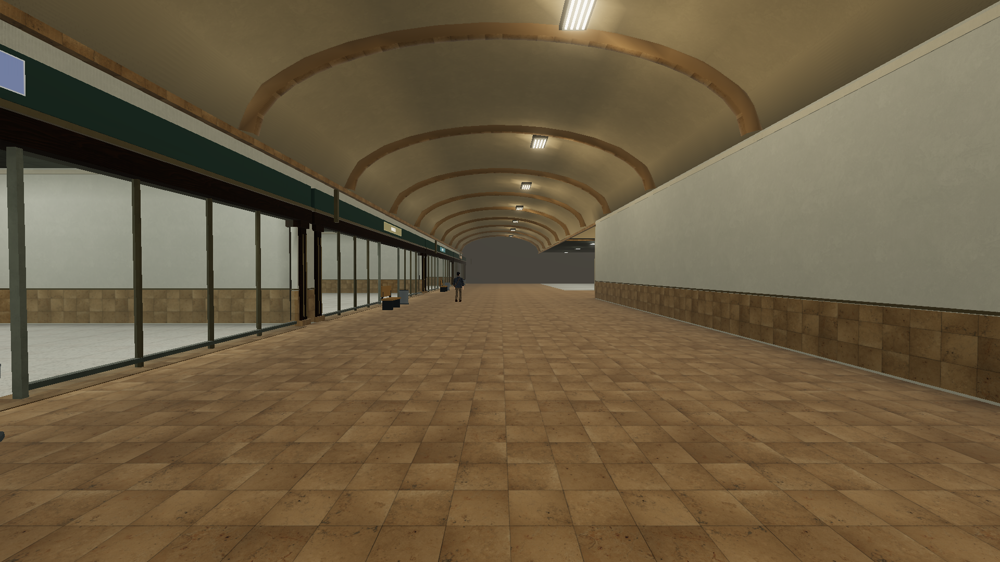
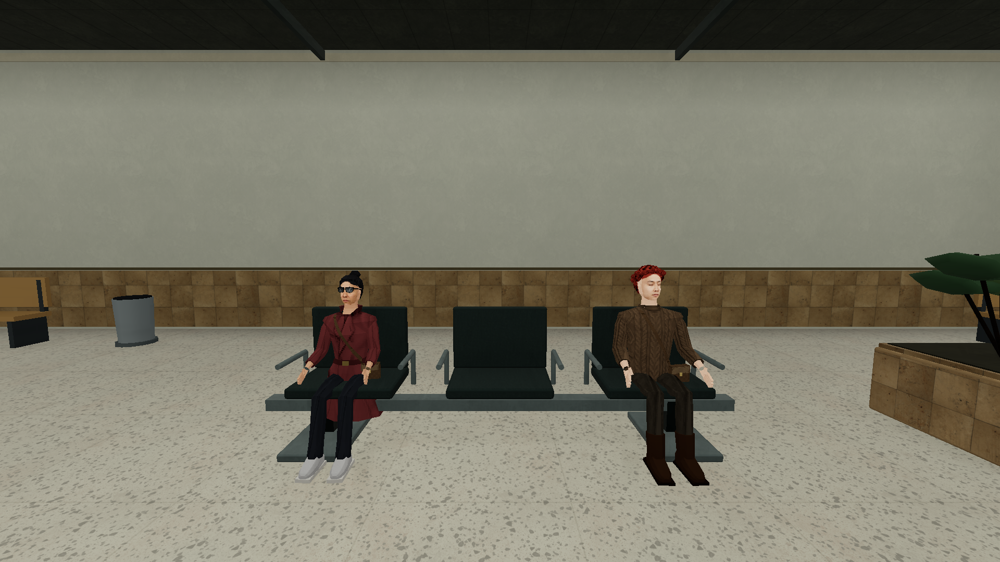
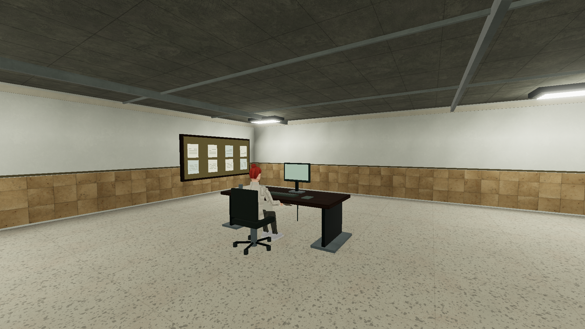

# 商人之家内饰与岗位细化 · 2026-10-21

本轮针对首轮内饰过于粗糙、材料单一和人物散站的问题，继续修改原项目 `E:\ZAN\backroom`。420×276 米、单层、28+4 个空铺、128 个库房及现有玩法/进度保留。原工作区、GitHub 副本、app-lite 和联机封闭要求保持原样。

[当前实现](../../TRADERS-KEEP-REMAKE.md) · [材质和参考来源](../../TRADERS-KEEP-SOURCES.md) · [完整实际游戏检查](traders-fitout-delivery-20261021/runtime.json) · [最终近景补验](traders-fitout-visual-final-20261021/runtime.json)

## 实际变化

| 空间 | 细化内容 |
|---|---|
| 西/东入口 | 联排扶手座椅、咨询台、导视、饮水/回收、绿植；中央通行带与两侧候场区域分开。 |
| 公共服务 | 石材台面、木饰面、金属收口、双显示器与文具，排队栏杆和明确等候点；固定联系人位于实际柜台后。 |
| 商业街 | 连续石材拱架、木/金属门框、竖梃、64 面实际玻璃、中央通道、分色编号牌和侧向标牌。空铺保持可进入，不放具体商品或店名。 |
| 保险库 | 卷帘导轨、底梁、拉手/锁扣，普通/高安/冷藏色带及顶上管线/支架。 |
| 办公 | 成组工作站、抽屉/拉手、显示器/底座、键盘/鼠标、文具/线缆、五轮椅及文件柜。 |
| 美食/市场 | 木面圆桌与四个紧凑桌椅组团、休息居民、绿植与回收设施；市场为空摊位。 |
| 宿舍/后勤 | 六个四床组团、半高隔断、带百叶孔的储物柜、包裹推车和装卸通路。 |

材质使用已有 CC0 扫描，区分水磨石、石材、灰泥、织物、木材、钢材与纸箱；颜色/法线/粗糙度沿用质量系统。吊顶板缝和地面细缝采用抗锯齿代码图案配合真实骨架，移除假灯斑。玻璃不采用实时折射，没有增加灯光池数量或新后处理。细部按材质合批，碰撞来自独立的实心部件数据，避免将合批大包围盒当作空气墙。

## 前后及近景

下面是实际生产 Engine/Renderer 截图。最终近景没有 HUD；其余 UI 图来自真实 React 游戏。没有截图专用场景或背景照片。

| 对照/取景 | 链接 |
|---|---|
| 首轮大厅 | [此前画面](traders-delivery-20261021/ui-service-hall.png) |
| 当前大厅 | [实际游戏](traders-fitout-delivery-20261021/ui-service-hall.png) |
| 首轮商业街 | [此前画面](traders-delivery-20261021/ui-north-bazaar.png) |
| 当前商业街，门头共面闪烁已修正 | [最终画面](traders-fitout-visual-final-20261021/bazaar-final.png) |
| 候场坐姿、座面和扶手 | [最终近景](traders-fitout-visual-final-20261021/waiting-final.png) |
| 公共服务与队列 | [最终画面](traders-fitout-visual-final-20261021/bank-final.png) · [柜台近景](traders-fitout-delivery-20261021/ui-counter-detail.png) |
| 导视与饮水 | [近景](traders-fitout-delivery-20261021/ui-directory-detail.png) |
| 办公坐姿和工作台 | [最终近景](traders-fitout-visual-final-20261021/workstation-final.png) |
| 库区与卷帘五金 | [最终画面](traders-fitout-visual-final-20261021/vault-final.png) · [开门](traders-fitout-delivery-20261021/ui-vault-open.png) |
| 美食广场 | [画面](traders-fitout-delivery-20261021/ui-food-court.png) |
| 宿舍组团 | [近景](traders-fitout-delivery-20261021/ui-dorm-bay.png) |
| 后勤与推车 | [画面](traders-fitout-delivery-20261021/ui-logistics.png) |
| 经典模式 | [高纹理](traders-fitout-delivery-20261021/quality-classic-1.png) · [低纹理](traders-fitout-delivery-20261021/quality-classic-0.png) |
| 地图与玻璃边界 | [地图](traders-fitout-delivery-20261021/ui-map-overview.png) |

完整流程截图之后又调整了门头离墙距离和六名联系人的工作距离；最终五张近景覆盖这些调整，未把共面锯齿当作可接受结果。







## 人物与机制

六名固定联系人贴合公共服务、保险库登记、警备和封签柜台。154 名新增居民各有岗位或有限路线，其中 42 个座椅岗位共用实际座面位置、朝向和高度：候场、餐桌休息、登记和办公室。工作、坐姿、轻微交谈动作复用现有骨骼；不再向大厅中任意撒点游荡。

`check:traders-fitout` 检查所有站位身体净空、42 个坐姿与真实椅子的对应、人物间距、64 面玻璃碰撞，并模拟 60 秒路线和岗位保持：零重叠落点、零被家具挡住的岗位、固定岗位零漂移。路线移动会避让近处居民；玩家不能选择已被 NPC 占用的座位。

仍按距离逐批创建，附近活动至多 32 人。存档主版本继续为 v:1，世界布局仍为 4，新增可选 `tradersWorld.fitout: 1`。旧散落人物位置重置到新岗位，生命/身份、柜门、仓库和任务记录保留；实际非空仓库存取与旧布局迁移回归通过。

## 运行与性能

GPU 为 RTX 4060 Laptop；1920×1080、DPR1、原生分辨率，关闭动态分辨率。真实光影，高纹理，16 盏灯上限、阴影档1、AO和泛光开启；构建预算3ms、入口6ms。完整游戏种子424242，地图437604。首次近处准备 4.81 秒，连同转场可操作 6.17 秒。最终近景为地图424242，静态规划相同，居民外貌种子不同。

预热后同一西大厅镜头五轮，每轮90帧；固定居民位置以排除人物穿越加载边界造成的计数变化：

| 轮 | 帧间隔中位 ms | P95 ms | CPU 中位 ms | 绘制调用 | 三角面 |
|---|---|---|---|---|---|
| 1 | 4.10 | 5.50 | 3.20 | 584 | 269605 |
| 2 | 4.10 | 5.00 | 3.10 | 584 | 269605 |
| 3 | 4.10 | 5.50 | 3.00 | 584 | 269605 |
| 4 | 4.10 | 5.50 | 3.40 | 584 | 269605 |
| 5 | 4.10 | 5.50 | 3.20 | 584 | 269605 |

三轮远端/大厅往返后，几何717、纹理181、程序78均保持不变。更多细节和玻璃使绘制量相对首轮增加，本轮测得的稳定镜头仍低于16.7/20ms目标；不据此推断所有设备/所有区域/长期游玩的结果。移动端尚未真机验证。

完整实际游戏检查 39 项通过，含近景取景、门动画/碰撞、地图拖动/右键安全传送、存读档、旧布局迁移和返回。两种光影/高低纹理及取消构建回归通过；最终近景另外实际运行普通 NPC 更新，固定岗位零漂移。两个成功记录的脚本/控制台错误为0，网络仅已有favicon.ico的404。

复现机位：商业街 (100,42.4)、yaw=-π/2、pitch=-.02；候场 (21,101)、yaw=0、pitch=-.1；银行(108,94)、yaw=0、pitch=-.04；库区(190,82.6)、yaw=-π/2、pitch=-.02；办公(353.5,219)、yaw=.55、pitch=-.05。FOV72°。

```powershell
cd E:\ZAN\backroom\app
npm run check:traders-keep
npm run check:traders-fitout
npm run check:settlements
npm run check:outpost-colliders
npm run check:settlement-assets
npm run check:static-batch-job
npm run check:model-warmup
npm run build
node scripts/verify-traders-keep.mjs --label=traders-fitout-delivery-20261021 --profile --quality
node scripts/verify-traders-keep.mjs --label=traders-fitout-visual-final-20261021 --renderer-only --fitout-details
```

[生产构建日志](fitout-build-20261021.log) · [相关回归日志](fitout-regressions-20261021.log) · [逐项退出码](fitout-regressions-20261021.json)。生产构建的既有字体相对URL、Browserslist、PostCSS和大包提示不属于本轮新增修复。测试用浏览器/端口/配置独立，并已清理。

脚本验证与用户视觉验收分开记录；商铺内容仍按约定留空。本轮没有添加新跨层连接、非欧保险库或重新开放联机。
