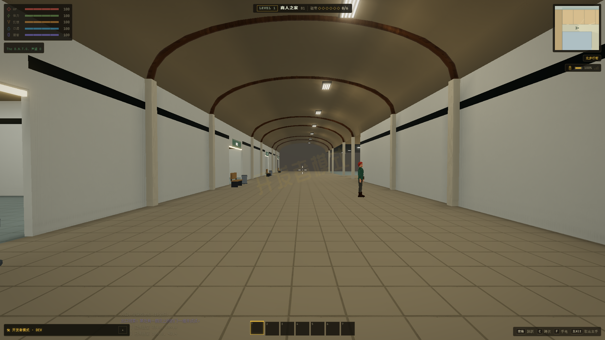
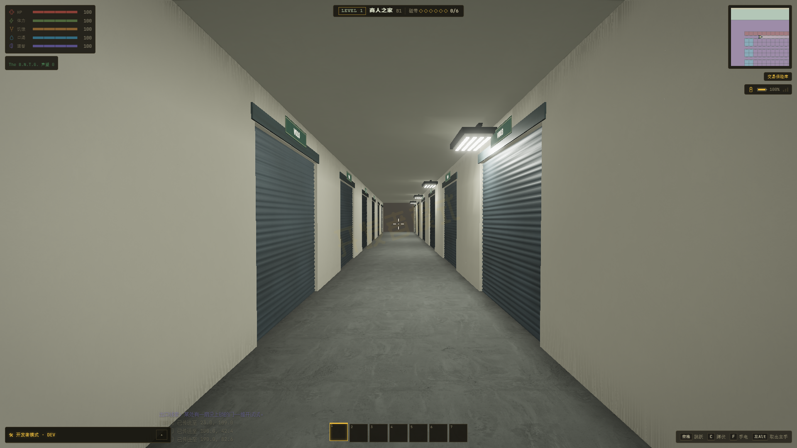
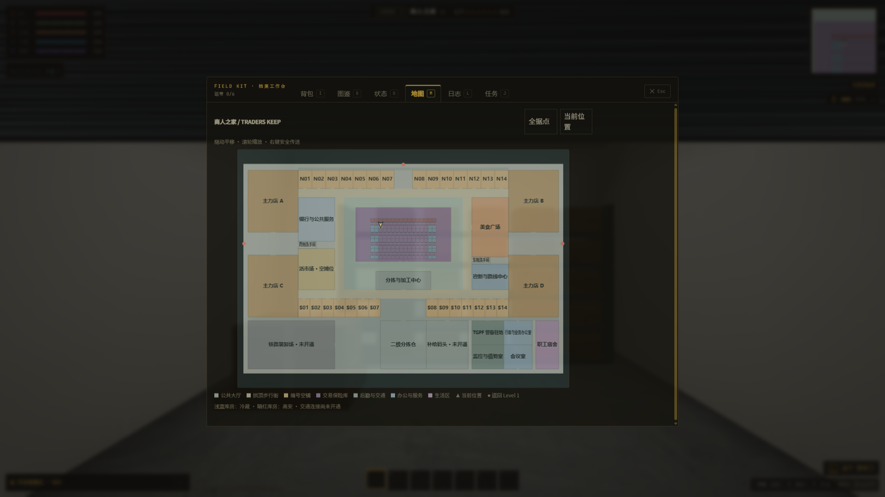

# 商人之家首轮布局记录 · 2026-10-21

当前内饰、玻璃门面和 NPC 岗位已继续细化，见 [最新记录](FITOUT.md)。以下保留首轮布局与性能基线。

实际修改原项目 `E:\ZAN\backroom` 的 `app` 及根说明，保留工作区已有改动。按照逐项确认的 420×276 米单层方案完成：28 个沿街编号空铺、4 个主力店空壳、128 间普通实体库房、公共服务、后勤及办公生活区；6 名既有人物和 154 名新增职业居民，附近至多 32 人活动。具体商铺内容留待用户安排。

[实现与确认范围](../../TRADERS-KEEP-REMAKE.md) · [参考及许可](../../TRADERS-KEEP-SOURCES.md) · [本轮完整机器记录](traders-delivery-20261021/runtime.json) · [实施前记录](../outpost-loading/traders-before-20261020/runtime.json)

## 实景和布局

所有截图来自实际游戏和正式 Engine/Renderer，没有截图专用材质、背景照片或替代场景。首次从西门进入；大地图读取轻量二维规划，未生成全部 3D 场景。商业街为空铺阶段，参考照片中的商品、商铺业务和密集广告未在本轮添加。

| 画面 | 链接 |
|---|---|
| 实施前入口 | [原小据点](../outpost-loading/traders-before-20261020/102-entry.png) |
| 用户规划图 | [原图](../../reference/TradersKeep/plan.png) |
| 西门大厅 | [截图](traders-delivery-20261021/ui-west-arrival.png) |
| 公共服务大厅 | [截图](traders-delivery-20261021/ui-service-hall.png) |
| 拱顶商业街 | [截图](traders-delivery-20261021/ui-north-bazaar.png) |
| 双面卷帘门保险库 | [截图](traders-delivery-20261021/ui-vault-corridor.png) |
| 门动画及真实通行 | [截图](traders-delivery-20261021/ui-vault-open.png) |
| 美食广场基础桌椅 | [截图](traders-delivery-20261021/ui-food-court.png) |
| 空市场摊位 | [截图](traders-delivery-20261021/ui-empty-market.png) |
| 分拣后勤 | [截图](traders-delivery-20261021/ui-logistics.png) |
| 行政工位 | [截图](traders-delivery-20261021/ui-office.png) |
| 职工宿舍 | [截图](traders-delivery-20261021/ui-dormitory.png) |
| 未开通铁路装卸场 | [截图](traders-delivery-20261021/ui-rail-unopened.png) |
| 原版地图总览 | [截图](traders-delivery-20261021/ui-map-overview.png) |
| 旧布局迁移 | [截图](traders-delivery-20261021/ui-legacy-migration.png) |
| 经典模式前序全流程（最终画质切换专项见完整机器记录） | [记录](traders-classic-20261021/runtime.json) · [商业街](traders-classic-20261021/ui-north-bazaar.png) |







## 复现参数

真实 React 游戏：新局种子 424242，商人之家地图种子 437604；实际 1920×1080、DPR 1、原生分辨率、关闭动态分辨率。FOV 72°，除另注外 pitch=-0.02，z=0，yaw=-π/2（向东）。美食广场 yaw=π/2，办公室与宿舍 yaw=0，门交互 yaw=π、pitch=0。取景由 `scripts/traders-keep-app-check.mjs` 固定。

设置：真实光影、高纹理、场景灯上限 16、阴影档 1、环境遮蔽及泛光开启、普通构建预算 3 ms、加载预算 6 ms，关闭颗粒、摇晃及动态曝光。为固定对照，开发者无敌和属性锁开启；NPC 保持种子落点但仍绘制模型及闲置动画，排除随机移动跨越模型加载边界造成的资源差异。另有普通居民活动的前序全流程记录 [traders-probe-final-20261021](traders-probe-final-20261021/runtime.json)。

以下时间为开发者直接选点后的安全落点检查、近处几何准备，加上截图前固定 1.2 秒等待；并非正常行走每个区块都会停顿。普通行走提前准备 94 米内细节、118 米外回收。

| 取景 | 世界坐标 x,y | 包含截图等待的总时间 |
|---|---|---|
| service-hall | 23.0, 109.0 | 1.53 s |
| north-bazaar | 100.0, 42.4 | 6.66 s |
| vault-corridor | 190.0, 82.6 | 11.03 s |
| food-court | 322.0, 74.0 | 5.34 s |
| empty-market | 98.0, 142.0 | 3.22 s |
| logistics | 205.0, 155.0 | 5.48 s |
| office | 362.0, 229.0 | 3.88 s |
| dormitory | 403.0, 241.0 | 2.03 s |
| rail-unopened | 65.0, 243.0 | 3.20 s |

## 首次进入与稳定帧

GPU：ANGLE (NVIDIA, NVIDIA GeForce RTX 4060 Laptop GPU (0x000028E0) Direct3D11 vs_5_0 ps_5_0, D3D11)。Chrome 真正 `--headless=new`，每次使用独立端口和临时浏览器配置。无头脚本使用帧间隔和 CPU 提交计时，没有 GPU 计时查询；这些结果不是 Android 或长时间游玩的性能结论。

| 指标 | 实施前 | 当前 |
|---|---|---|
| 直接冷建场景 | 4.48 s | 6.22 s |
| 入口加载期间最大 CPU 帧 | 1734.9 ms | 1325.4 ms |
| 实际游戏近处准备完成 | 未单独采样 | 6.18 s |
| 实际游戏入口可操作（含原有转场） | 未单独采样 | 7.49 s |

原场景规模、镜头和物件数不同，不能据此宣称同画面提升或将两个场景的绘制量直接比较。重制后入口可操作仍在十秒以内；加载时保留遮挡，未宣称完全消除首次编译长帧。

预热、完成所有当前细节任务后，在西大厅 (23,109)、向东固定镜头采样五轮，每轮 90 帧：

| 轮次 | 帧间隔中位 ms | 帧间隔 P95 ms | CPU 中位 ms | CPU P95 ms | 总绘制调用 | 三角面 |
|---|---|---|---|---|---|---|
| 1 | 4.70 | 7.40 | 4.10 | 5.70 | 383 | 198907 |
| 2 | 4.60 | 6.60 | 4.00 | 4.80 | 383 | 198907 |
| 3 | 4.30 | 7.60 | 3.80 | 4.70 | 383 | 198907 |
| 4 | 4.40 | 6.90 | 3.80 | 4.60 | 383 | 198907 |
| 5 | 4.40 | 6.20 | 3.90 | 4.60 | 383 | 198907 |

当前样本低于 16.7/20 ms 的中位/P95 目标，但仍有跨区构建尖峰：本轮记录的轻量 CPU 区块准备最大值为 27.4 ms。该最大值不能解释成无尖峰；稳定镜头的五轮统计也不能替代所有区域长期压力测试。大跨度直接传送到保险库的近处准备加固定等待约 11 秒，是本轮最慢取景。

首次入口仅准备 22 个数据区块；整个规划最多 126 个相交区块，运行过程数据区块峰值 50，并未一次实例化全部据点。家具、居民定义和网格按距离/帧准备，远处回收。

## 资源与机制

远端宿舍和西大厅三轮往返；每轮等待所有当前区块完成、再等待 5 秒，固定取相同位置：

| 往返轮次 | 几何 | 纹理 | 程序 | 数据块 / 含公共物件绘制组 |
|---|---|---|---|---|
| 1 | 447 | 157 | 65 | 26 / 27 |
| 2 | 447 | 157 | 65 | 26 / 27 |
| 3 | 447 | 157 | 65 | 26 / 27 |

最终几何、纹理和程序数量均形成平台。几何由区块持有、材质按世界共享，纹理沿用项目缓存；取消构建和离开据点会正确退休资源。迭代中修复了隐藏碰撞代理重复绘制，以及满载 Map 缓存逐条淘汰造成的 CPU 开销。后者的定位样本在 [修复前 CPU 采样](traders-probe-final-20261021/stream.cpuprofile)。现在使用两批、总计最多 144000 条受光缓存，小家具采用六方向遮挡探针。

正式游戏 33 项流程检查和画质/持久化专项通过，覆盖：

- 首次西门落点、原返回目的地、离开及再次进入。
- 所有已布置房间通过完整碰撞数据的可达性检查，实际身体穿越每个真实门洞；薄墙、拱架和门网格由同一数据生成。
- 真实按 E 开门、门帘动画、碰撞同步；恢复为已开门后，再关门也会阻挡。
- 普通地图直接打开、拖动不传送、开发者右键安全落点；总览不创建全部 3D 世界。
- 门/搜刮及居民状态、世界种子、旧布局迁移、新开局清理。
- 使用真实仓库存入/取出电池、背包非空、HP/口渴、职业 rank/task、任务证据及异常盘点 sequence 存读档；旧布局迁移保留这些内容。
- 经典/真实及高低纹理五次切换、构建中跨场景取消、几何有限数值、代理不可见。
- 三个异常货箱保持唯一身份和已有盘点状态；普通/冷藏/高安权限保留，不新增补给或商店业务。

## 命令、构建和限制

```powershell
cd E:\ZAN\backroom\app
npm run check:traders-keep
npm run check:settlements
npm run check:outpost-colliders
npm run check:settlement-assets
npm run check:static-batch-job
npm run check:model-warmup
npm run build
node scripts/verify-traders-keep.mjs --label=traders-delivery-20261021 --profile --quality
node scripts/verify-traders-keep.mjs --label=traders-classic-20261021 --classic
```

布局专项通过 175 个房间、128 个库房、28+4 个空铺和 160 个居民身份检查；全家具导航连通格 109420，静态合批回归 11621 项，模型预热 111 项。已有据点回归覆盖其他据点。碰撞检查将字符串完全相等改为数值 1e-10 容差，处理既有旋转运算约 1.8e-15 的舍入差异，缓存身份检查仍严格相等。旧版小据点的功能面积比例不适用于本轮大量空铺和公共回廊，BNTG 改由完整家具导航及全部服务/房间可达性检查覆盖；其余据点面积比例检查保留。

[最终构建日志](build-final-20261021.log) · [回归输出](regressions-final-20261021.log) · [逐项退出码](regressions-final-20261021.json)。现有字体相对 URL、Browserslist、PostCSS 和大包警告仍需独立处理；运行检查没有脚本/控制台错误，网络记录仅现有 favicon.ico 的 404。所有测试用 Chrome、Vite 和临时配置已清理，进程及启动参数见机器记录。

本轮没有进行 Android 真机验收，没有为 128 库房同时开门、所有 NPC 同屏或持续数小时运行提供性能结论。交通跨层连接仍标为未开通，具体空铺业务、上层和超大非欧保险库均按本轮确认范围留待后续。联机维持封闭，未修改协议或运行联机测试。
