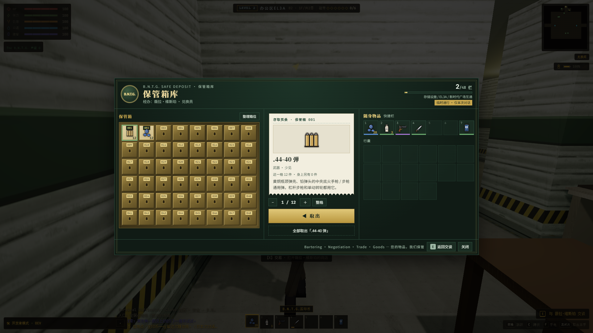

# 阵营仓库 UI 接入验收（2026-10-25）

用户提供的 `backroom-warehouse-ui.zip` 已按仓库增量合入原工程 `E:\ZAN\backroom`。完整包包含上一轮商店 UI，本轮保留那些文件的后续修复，以及现有地图、枪械、人物和实体改动。来源、SHA256 与文件摘要见 [接入清单](import-manifest.json)；`incoming/` 为原包，`before/` 为导入前源文件。本任务仅给 package 增加仓库检查命令，原有字段及并行加入的蠕菌检查均保留。

## 完成内容

- M.E.G. 钢板货架与 B.N.T.G. 黄铜编号保管箱两套独立页面，包含 48 个库位、使用量、经办人、共享基地、临时通行和物品详情。
- 分量存取、双击整格移动、拖拽、同类一键、分类整理及键盘操作；快捷栏与当前容量的行囊同屏显示，没有强制改成 24 格。
- 整格和分量操作统一预检与提交，满仓/满包失败时两边不变。同类一键按实际剩余容量移动；整理不截断旧数据，来源标签、耐久、血污、医疗次数、枪械弹仓/选弹/装填/转轮位置均保留。
- 成功操作立即保存；主存档仍为 v1，各阵营容量仍为 48 栏，临时通行不写入存档。
- 保留声望与五信用点/压印币临时通行。补齐已登记七位仓管的权限识别，包括 L11 两位；没有修改 NPC 的生成位置。
- 窄屏纵向滚动，低矮横屏改为库存和详情并排，避免详情覆盖两个库存；返回键跟随改绑，关闭清理临时权限，仓库不继承隐藏对话的 X 交易快捷键。枪械/弹药归到武器分类。

## 截图



[M.E.G. 物资库](layout-final-realistic/01-meg-warehouse.png) · [M.E.G. 详情](layout-final-realistic/02-meg-selected-details.png) · [Gemma 共享库存](layout-final-realistic/05-gemma-shared-warehouse.png) · [B.N.T.G. 临时通行](layout-final-realistic/06-bntg-vault.png)

[M.E.G. 竖屏](layout-final-realistic/04-meg-phone.png) · [M.E.G. 横屏](layout-final-realistic/04-meg-landscape.png) · [B.N.T.G. 竖屏](layout-final-realistic/04-bntg-phone.png) · [B.N.T.G. 横屏](layout-final-realistic/04-bntg-landscape.png) · [触屏点按取回](accepted-classic/08-touch-withdrawal.png)

## 验证

| 检查 | 结果 |
|---|---|
| `npm run check:warehouse-ui` | 44 项通过：原子性、非法数量、容量边界、守恒、状态、整理、七位仓管权限 |
| `npm run check:merchant-trade` | 44 项通过 |
| `npm run check:bntg-bank` | 银行及临时服务支付回归通过 |
| 真实模式实际游戏 | 37 项通过、10 张截图，[完整记录](layout-final-realistic/runtime.json) |
| 经典模式实际游戏 | 38 项通过、11 张截图，增加 CDP 触屏点按，[完整记录](accepted-classic/runtime.json) |
| `npm run build` | 通过，[最终日志](build-final.log) |

正式主菜单继续存档 → Alpha「算盘」准心 E 交谈 → 仓库操作 → Gemma「布兰特」共享库存 → EL3A「维斯珀」低声望付费通行 → 返回交谈/重进不重复收费 → 关闭失效 → 真正存档重载。三位 NPC 均通过合法身体落点及正常 E 交互进入，没有用原型页或替代 NPC 代替该链路。

覆盖分量、双击、HTML 拖拽事件、排序、键盘、改绑返回键、两套皮肤在 390×844 / 844×390 的按钮遮挡、跨基地、临时权限、库存/弹仓/标签/余额恢复。低矮横屏额外检查两侧库存都能点击；经典模式以真实 CDP touchStart/touchEnd 点按取回，确认只结算一次。

两轮终验运行错误与请求失败均为 0；独立 `--headless=new` Chrome、配置与 Vite/CDP 端口均有记录，自己的浏览器、服务器和配置已清理。桌面触屏模拟不代表 Android 真机性能，本轮未重跑全层级帧率压力。使用包内纯 CSS 和现有字体，没有新增运行时图片/模型，未改联机或 `app-lite`。

商店旧测试夹具缺少项目新增的蠕菌状态，已只补齐夹具的 `creepRun`，未改该实体逻辑。初期记录保留：`initial-realistic` 修正了要求四件绷带必须仍在单格的错误断言，现按堆叠上限及总数验收；`layout-realistic` 修正测试中的基地注册键为 `gamma`；`controls-realistic` 发现手机详情被压缩，随后修正并通过终验。构建已有字体、PostCSS 和大 chunk 警告保留。

## 复现

在 `E:\ZAN\backroom\app` 运行：

```powershell
npm run check:warehouse-ui
npm run check:merchant-trade
npm run check:bntg-bank
node reports/warehouse-ui-import-20261025/verify.mjs --label=review-realistic
node reports/warehouse-ui-import-20261025/verify.mjs --classic --label=review-classic
```

独立存储，种子 424242，原生 1920×1080、纹理/阴影质量 1、场景灯上限 16，关闭动态分辨率/曝光及颗粒震动，锁定生存属性与 NPC 移动。玩家现有存档和日常浏览器不参与检查。准确站位、库存和启动参数见各轮记录，脚本为 [实际流程](app-check.mjs)、[独立运行器](verify.mjs)。
